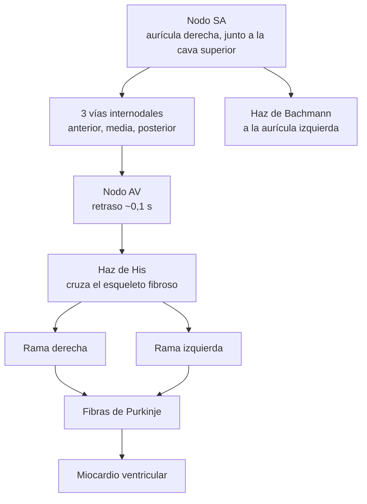
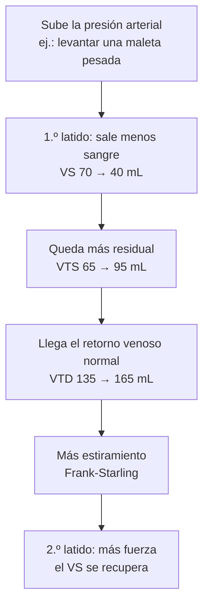
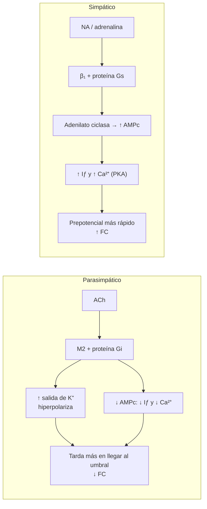
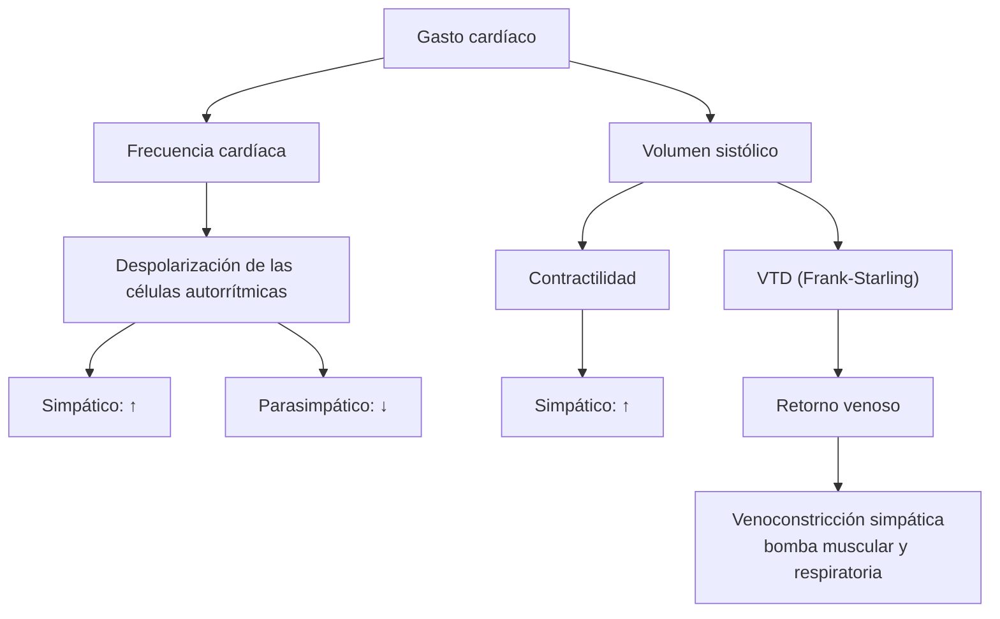

# Apuntes de clase · Cardiovascular (Temas 2-9, Seminarios 1-3, Prácticas 1-2)


## Tema 2 · Introducción al aparato cardiovascular

*Dra. Carmen Castro · clase del 22/09/26 (+ repaso del 23/09) · base: Silverthorn, cap. 14; Guyton, cap. 9* · Preguntas: Tema 2 · Preguntas · Test real: Tests de la plataforma


## Tema 2 · Introducción al aparato cardiovascular › Lo esencial

- Circuito **cerrado** que mueve la sangre **en un único sentido**, a favor de **gradiente de presión**. El corazón crea el gradiente y las válvulas imponen el sentido.
- **Arteria = sale del corazón; vena = llega**, lleve la sangre que lleve.
- Dos bombas **funcionalmente en serie**: el ventrículo derecho manda sangre a los pulmones y el izquierdo al resto del cuerpo. **Bombean el mismo volumen**; el izquierdo genera **4–6 veces más presión**.
- **Aurícula = bomba de cebado** (completa el llenado); **ventrículo = bomba de eyección**.
- **Válvulas: la profesora las calificó de «superimportantes»** y salieron en el test. R1 = cierre de las AV; R2 = cierre de las semilunares.

> **Pistas de examen**
>
> - ★★★ «**Esto es superimportante**: ¿entendemos cómo funcionan las válvulas?» Ya cayeron dos preguntas en el test del 24/09.
> - ★★★ En sus tests: eyección con presión ventricular > **120 mmHg** (el libro dice 80).
> - ★★ La mitral es **la única con dos cúspides**. Trampa típica: cambiar derecho por izquierdo o arteria por vena. Todas las pistas: Pistas de examen


## Tema 2 · Introducción al aparato cardiovascular › 1. Componentes y funciones

Cuatro componentes: **sangre, vasos, corazón y válvulas**, al servicio de la **homeostasis**. Los fluidos van siempre de mayor a menor presión; el corazón es la bomba que genera ese gradiente.

Funciones: llevar sustancias desde la superficie hasta lo más profundo (sin circulación, el O₂ absorbido por la piel no pasaría de las capas superficiales); regular la temperatura; equilibrio ácido-base y pH; transporte de gases, nutrientes, agua, hormonas y desechos; equilibrio de líquidos; defensa inmunitaria; hemostasia (plaquetas y coagulación).

| Sustancia | Desde | Hasta |
| --- | --- | --- |
| O₂ | Pulmones | Todas las células |
| Nutrientes y agua | Tubo digestivo | Todas las células |
| Hormonas | Células endocrinas | Células con receptor para esa hormona |
| Nutrientes almacenados | Hígado y tejido adiposo | Todas las células |
| Desechos | Algunas células | Hígado (procesamiento) |
| Desechos metabólicos | Todas las células | Riñones |
| Calor | Todas las células | Piel |
| CO₂ | Todas las células | Pulmones |

La profesora avisó de que esta tabla «no hay que aprendérsela, es pura lógica».


## Tema 2 · Introducción al aparato cardiovascular › 2. Circulación mayor y menor

&#91;image: Distribución del volumen sanguíneo en el circuito\]

| Circuito | Recorrido |
| --- | --- |
| Sistémica (mayor, periférica) | Ventrículo izquierdo → aorta → arterias → arteriolas → capilares → vénulas → venas → cavas → aurícula derecha |
| Pulmonar (menor) | Ventrículo derecho → arteria pulmonar → capilares pulmonares → venas pulmonares → aurícula izquierda |

Ambos circuitos están **en serie**; los órganos sistémicos, **en paralelo** entre sí.

| Territorio | % del volumen sanguíneo |
| --- | --- |
| Circulación sistémica (total) | 84% |
|  Venas, vénulas y senos venosos | 64% |
|  Arterias | 13% |
|  Arteriolas y capilares | 7% |
| Circulación pulmonar | 9% |
| Corazón | 7% |

Las venas son el **reservorio** (vasos de capacitancia): casi dos tercios de la sangre.

> **Corrección** · En clase: «dos bombas que están en paralelo». · Correcto: están una al lado de la otra, pero **funcionalmente en serie**. Lo que expulsa el derecho es lo que recibe el izquierdo; por eso bombean el mismo volumen.


## Tema 2 · Introducción al aparato cardiovascular › 3. El corazón: forma, cámaras y pared

- **Cono invertido** en el tórax, detrás del esternón y entre los pulmones. La **base** es la parte superior, donde están los grandes vasos. El **vértice (ápice)** es la punta, abajo y a la izquierda. El **tabique** (septo) separa el corazón derecho del izquierdo.
- En los dibujos, **izquierda y derecha van invertidas** respecto a quien mira: el corazón se dibuja como el de un paciente que está enfrente.

&#91;image: Cámaras y válvulas: flujo unidireccional\]

| Cámara | Pared | Recibe de | Envía a |
| --- | --- | --- | --- |
| Aurícula derecha | Fina | Venas cavas (sangre desoxigenada) | Ventrículo derecho (tricúspide) |
| Ventrículo derecho | Media | Aurícula derecha | Arteria pulmonar → pulmones |
| Aurícula izquierda | Fina | Venas pulmonares (sangre oxigenada) | Ventrículo izquierdo (mitral) |
| Ventrículo izquierdo | **La más gruesa** | Aurícula izquierda | Aorta → todo el cuerpo |

**Por qué es más grueso el ventrículo izquierdo:** tiene que vencer la gran resistencia de la circulación mayor (cerebro, extremidades…) y genera 4–6 veces más presión (\~120 frente a \~25 mmHg sistólicos). El derecho solo impulsa hasta los pulmones, que están al lado.

> **Corrección** · En clase: «a la aurícula izquierda llega la **arteria** pulmonar», con sangre «desoxigenada», y «la sangre pasa directamente al ventrículo izquierdo» desde las cavas. · Correcto: a la aurícula izquierda llegan las **venas pulmonares** con sangre **oxigenada**; las **cavas** llegan a la **aurícula derecha**. La arteria pulmonar **sale** del ventrículo derecho.

&#91;image: Ventrículos en corte y capas de la pared\]


## Tema 2 · Introducción al aparato cardiovascular › 3. El corazón: forma, cámaras y pared

| Capa (de dentro a fuera) | Qué es y para qué sirve |
| --- | --- |
| Endocardio | Endotelio de células planas. Deja la superficie **lisa** para que las plaquetas no se activen ni formen trombos |
| Miocardio | Músculo estriado cardíaco en capas cruzadas; genera la fuerza |
| Epicardio (pericardio visceral) | Capa externa del corazón |
| Espacio pericárdico | Con **líquido pericárdico**: lubrica y evita el rozamiento; el corazón «flota» en él |
| Pericardio parietal y fibroso | Envuelta externa que aísla el corazón del resto del mediastino |

El miocardio se irriga por las **coronarias**.


## Tema 2 · Introducción al aparato cardiovascular › 4. Las válvulas

| Válvula | Tipo | Entre | Cúspides |
| --- | --- | --- | --- |
| Tricúspide | Auriculoventricular (AV) | Aurícula derecha → ventrículo derecho | 3 |
| Mitral (bicúspide) | Auriculoventricular (AV) | Aurícula izquierda → ventrículo izquierdo | **2** (la única) |
| Pulmonar | Semilunar | Ventrículo derecho → arteria pulmonar | 3 |
| Aórtica | Semilunar | Ventrículo izquierdo → aorta | 3 |

- Se abren y cierran **de forma pasiva**, por diferencias de presión.
- **AV:** tienen **cuerdas tendinosas** unidas a **músculos papilares**. Cuando el ventrículo se llena y se contrae, los papilares se contraen, tensan las cuerdas y **sujetan las valvas para que no se eviertan** hacia la aurícula. Así impiden el reflujo (respuesta oficial del test).
- **Semilunares:** sin cuerdas. Se abren cuando la presión ventricular supera la arterial. Se cierran cuando la arterial supera la ventricular: el pequeño reflujo llena las cúspides y las junta.
- **Esqueleto fibroso:** anillos que sostienen las válvulas y **aíslan eléctricamente** aurículas y ventrículos (clave en el Tema 3).

> **Corrección** · En clase: «la mitral separa el ventrículo izquierdo del ventrículo derecho» y la semilunar se cierra «porque la sangre cae por la gravedad». · Correcto: la mitral separa la **aurícula** izquierda del ventrículo izquierdo. La semilunar se cierra por **inversión del gradiente de presión**, no por la gravedad: funciona igual tumbado.


## Tema 2 · Introducción al aparato cardiovascular › 5. Diástole y sístole

&#91;image: Diástole: AV abiertas, semilunares cerradas\]

|  | Diástole (relajación) | Sístole (contracción) |
| --- | --- | --- |
| Válvulas AV | Abiertas | Cerradas |
| Válvulas semilunares | Cerradas | Abiertas (eyección) |
| Músculos papilares | Relajados | Contraídos; cuerdas tensas |
| Qué ocurre | Llenado, sobre todo pasivo; al final, la sístole auricular lo completa | Sube la presión; cuando supera la arterial, sale la sangre |

&#91;image: Sístole: AV cerradas, semilunares abiertas\]

**Umbral de eyección.** Según la profesora y el test, el ventrículo tiene que superar los \~120 mmHg de la aorta para abrir la aórtica; con hipertensión, más todavía.

> **Matiz de libro (Guyton):** la aórtica se abre al superar la **presión diastólica aórtica (\~80 mmHg)**; 120 mmHg es el **pico** sistólico. En sus tests, marca 120. Lo verás a fondo en mecánica cardíaca.

&#91;image: Giro (torsión) del ventrículo izquierdo\]

**Giro del ventrículo izquierdo.** Las fibras del miocardio forman capas en espiral cruzadas (subendocárdica y subepicárdica). En sístole el ventrículo se retuerce y escurre la sangre desde el vértice hacia la base, «como estrujar una galleta en diagonal», y genera más tensión. Al destorcerse, ayuda a la relajación.

> **Corrección** · En clase: «estas fibras del **endocardio** están dispuestas en dos capas». · Correcto: son fibras del **miocardio**; el endocardio es solo el revestimiento endotelial.

> **Para subir nota (Guyton):** \~80% del llenado ventricular es pasivo y la aurícula aporta el \~20% restante. Por eso en fibrilación auricular el llenado en reposo apenas cae, pero sí la capacidad de ejercicio.


## Tema 2 · Introducción al aparato cardiovascular › 6. Ruidos y soplos

| Ruido | Qué se oye | Cuándo |
| --- | --- | --- |
| R1 («lub») | Cierre de las AV (mitral y tricúspide) | **Inicio** de la sístole |
| R2 («dup») | Cierre de las semilunares (aórtica y pulmonar) | **Final** de la sístole = inicio de la diástole |

Se oye el **cierre** de las válvulas, no la eyección. Una válvula que no cierra bien produce reflujo, que se oye como **soplo**.

> **Corrección** · En clase (23/09): «los dos ruidos ocurren durante la sístole ventricular». · Correcto: R1 marca el **inicio** y R2 el **final** de la sístole. Entre R1 y R2 hay sístole; entre R2 y el siguiente R1, diástole.


## Tema 2 · Introducción al aparato cardiovascular › Glosario

| Término | Definición breve |
| --- | --- |
| Circulación sistémica / pulmonar | Mayor (VI → cuerpo → AD) / menor (VD → pulmones → AI) |
| Gradiente de presión | Diferencia de presión que mueve la sangre de más a menos |
| Vasos de capacitancia | Venas: contienen \~64% de la sangre |
| Bomba de cebado / de eyección | Aurícula / ventrículo |
| Base / vértice | Parte superior con los grandes vasos / punta inferior izquierda |
| Endocardio, miocardio, epicardio, pericardio | Capas de la pared, de dentro a fuera |
| Válvulas AV | Tricúspide y mitral (la única con 2 cúspides) |
| Válvulas semilunares | Pulmonar y aórtica |
| Cuerdas tendinosas y papilares | Sujetan las valvas AV en sístole |
| Esqueleto fibroso | Soporte valvular y aislante eléctrico |
| Diástole / sístole | Relajación-llenado / contracción-eyección |
| R1 / R2 | Cierre de las AV / cierre de las semilunares |
| Soplo | Ruido por flujo anormal a través de una válvula |


## Tema 3 · Generación del ritmo cardíaco

*Dra. Carmen Castro · clase del 23/09/26 (+ repaso del 24/09) · base: Guyton, caps. 9–10; Silverthorn, cap. 14* · Preguntas: Tema 3 · Preguntas


## Tema 3 · Generación del ritmo cardíaco › Lo esencial

- **Dos tipos de células:** miocitos contráctiles (\~99%) y células autorrítmicas (\~1%). Las autorrítmicas son **músculo modificado, no neuronas**.
- **Sincitio funcional** por los discos intercalares (uniones GAP). Hay **dos sincitios**, auricular y ventricular, separados por el esqueleto fibroso.
- **Potencial de acción del miocito:** \~250 ms, con **meseta de Ca²⁺**. El periodo refractario dura casi lo mismo que la contracción, así que **no hay tétanos cardíaco**.
- **Autoexcitabilidad:** el nodo SA dispara solo (prepotencial Iƒ) a 70–80/min. El sistema nervioso solo **modula**.
- **Retraso en el nodo AV (\~0,1 s):** permite que las aurículas terminen de llenar los ventrículos. La profesora lo destacó: «quería que os quede claro».

> **Pistas de examen**
>
> - ★★★ «**Quería que os quede claro**»: el nodo AV es menos excitable y **retrasa** el impulso para que la aurícula se contraiga antes que el ventrículo.
> - ★★★ Test 24/09: el nodo SA «es autorrítmico, dispara potenciales de acción con una frecuencia constante».
> - ★★ Preguntó a la clase: Ca²⁺ en la contracción, desmosomas y uniones GAP. Refractario largo = **sin sumación ni tétanos**. Todas las pistas: Pistas de examen


## Tema 3 · Generación del ritmo cardíaco › 1. Dos tipos de células

|  | Miocitos contráctiles | Células autorrítmicas |
| --- | --- | --- |
| Proporción | \~99% | \~1% |
| Función | Contraerse | Generar y conducir el impulso |
| Dónde | Miocardio auricular y ventricular | Nodo SA, vías internodales, nodo AV, His, ramas, Purkinje |
| Potencial de reposo | Estable, \~−90 mV | Inestable, −60 a −55 mV |
| Fase de subida | Na⁺ rápido (3–5 ms) | Ca²⁺ (canales tipo L), lenta |
| Meseta | Sí (Ca²⁺) | No |

> **Corrección** · En clase (transcripción): las células marcapasos «son neuronas, no son células musculares». · Correcto: **no son neuronas; son células musculares cardíacas modificadas**. Lo dice la diapositiva y lo confirmó la profesora el 24/09.


## Tema 3 · Generación del ritmo cardíaco › 2. Miocitos: un sincitio funcional

&#91;image: Miocitos y discos intercalares\]

- Fibras estriadas, **ramificadas** y con **un solo núcleo** (el esquelético es multinucleado).
- **Discos intercalares:**
  - **Desmosomas:** uniones mecánicas que transmiten la fuerza.
  - **Uniones GAP (conexinas):** comunican los citoplasmas; el potencial de acción pasa de célula a célula.
- **Sincitio funcional:** si se excita una célula, se excitan todas.
- **Dos sincitios** (auricular y ventricular) separados por el **esqueleto fibroso**, que no conduce. El único puente eléctrico normal es el **nodo AV y el haz de His**. Por eso la sístole auricular precede a la ventricular.


## Tema 3 · Generación del ritmo cardíaco › 3. Potencial de acción del miocito ventricular

&#91;image: Potencial de acción del miocito ventricular: fases y periodos refractarios\]

| Fase (diapositiva) | Fase clásica | Duración | Corriente | Termina con |
| --- | --- | --- | --- | --- |
| 1. Despolarización rápida | 0 | 3–5 ms | Entrada de Na⁺ (canales rápidos) | Inactivación rápida del Na⁺ |
| — | 1 (repolarización precoz) | Breve | Salida transitoria de K⁺ | — |
| 2. Meseta | 2 | \~175 ms | Entrada de Ca²⁺ (canales L) | Inactivación del Ca²⁺ |
| 3. Repolarización | 3 | \~75 ms | Salida de K⁺ (canales lentos) | Cierre del K⁺ |
| Reposo | 4 | — | K⁺ (\~−90 mV) | — |

- Duración total: **\~250 ms**, frente a **1–2 ms** en el esquelético.
- **Periodo refractario absoluto:** 0–200 ms. **Relativo:** 200–250 ms.

> **Corrección** · En clase: el periodo refractario «dura unos 100 ms» (y «412 ms» para el esquelético, error de transcripción). · Correcto: el **absoluto dura \~200 ms** (Guyton: 0,25–0,30 s en ventrículo) y el esquelético dura 1–2 ms. Lo que sí dijo bien: dura casi lo mismo que el potencial de acción.


## Tema 3 · Generación del ritmo cardíaco › 4. Acoplamiento excitación-contracción

**Esquelético (recordatorio):** la acetilcolina de la motoneurona genera el potencial, y el DHPR del túbulo T tira mecánicamente del RyR. **No necesita Ca²⁺ extracelular.**

&#91;image: Acoplamiento excitación-contracción en el cardiomiocito\]

**Cardíaco: liberación de Ca²⁺ inducida por Ca²⁺**

1. Llega el potencial desde una célula vecina (por uniones GAP, **no por un nervio**).
2. Se abren los canales de Ca²⁺ tipo L y entra Ca²⁺.
3. Ese Ca²⁺ abre los RyR del retículo sarcoplásmico.
4. Sale mucho Ca²⁺ del retículo (**chispas de Ca²⁺**): **es la mayor parte del Ca²⁺ de la contracción**.
5. Las chispas se suman en la señal de Ca²⁺.
6. El Ca²⁺ se une a la **troponina C** → la tropomiosina se desplaza → quedan libres los sitios de unión de la miosina en la actina → contracción.
7. La relajación empieza cuando el Ca²⁺ se separa de la troponina.
8. La **SERCA** devuelve el Ca²⁺ al retículo.
9. El **NCX** (3 Na⁺/1 Ca²⁺) y la Ca²⁺-ATPasa del sarcolema lo sacan de la célula.
10. La **Na⁺/K⁺-ATPasa** mantiene el gradiente de Na⁺ que usa el NCX.

> **Corrección** · En clase (respuesta de un alumno): el Ca²⁺ libera «el sitio de unión de la ATP a la tropomiosina». · Correcto: el Ca²⁺ se une a la **troponina C**, que desplaza a la tropomiosina y deja expuestos los **sitios de unión de la miosina en la actina**. El ATP se une a la cabeza de miosina.

> **Enlace clínico:** la digoxina inhibe la Na⁺/K⁺-ATPasa. Sube el Na⁺ intracelular, el NCX saca menos Ca²⁺ y aumenta la contractilidad.


## Tema 3 · Generación del ritmo cardíaco › 5. Por qué el corazón no se tetaniza

&#91;image: Sumación temporal: esquelético frente a cardíaco\]

|  | Esquelético | Cardíaco |
| --- | --- | --- |
| Potencial de acción | 1–2 ms | \~250 ms |
| Periodo refractario frente a contracción | Mucho más corto | Casi igual |
| Estímulos repetidos | Sumación y **tétanos** | Sin sumación: siempre contracción y relajación |

Gracias a esto, el ventrículo siempre se relaja y se llena entre latidos.


## Tema 3 · Generación del ritmo cardíaco › 6. Autoexcitabilidad

- El corazón aislado sigue latiendo (**preparación de Langendorff**).
- El corazón trasplantado está **desnervado** y late toda la vida.
- **El corazón genera su propia actividad eléctrica.** La inervación autónoma no inicia el latido: solo modula la frecuencia y la fuerza.


## Tema 3 · Generación del ritmo cardíaco › 7. Potencial marcapasos (nodo SA)

&#91;image: Potencial de acción de las células autoexcitables\]

| Fase | Qué pasa | Corriente |
| --- | --- | --- |
| Prepotencial (despolarización diastólica lenta) | Desde \~−60 mV sube lentamente hacia el umbral | **Iƒ** («funny» o Iₕ): Na⁺ por canales **HCN** activados por hiperpolarización. Se suman el cierre de K⁺ y el Ca²⁺ tipo T |
| Subida | Al llegar al umbral (\~−40 mV); pico \~0 a +10 mV | **Ca²⁺ tipo L** |
| Repolarización | Vuelve a \~−60 mV | Salida de K⁺ |

> **Corrección** · En clase: la subida del potencial nodal es «por canales de sodio y también de calcio». · Correcto: la subida es de **Ca²⁺ tipo L**. A −60 mV los canales rápidos de Na⁺ están inactivados; el Na⁺ participa en el **prepotencial** (Iƒ). Por eso verapamilo y diltiazem enlentecen el nodo, y la ivabradina (bloquea Iƒ) baja la frecuencia.

**La pendiente del prepotencial fija la frecuencia.** La noradrenalina aumenta Iƒ y el Ca²⁺: más pendiente, taquicardia. La acetilcolina aumenta la salida de K⁺ y reduce Iƒ: bradicardia.


## Tema 3 · Generación del ritmo cardíaco › 8. Sistema de conducción

&#91;image: Sistema de conducción: nodo SA frente a ventrículo\]



| Estructura | Localización y rasgo clave |
| --- | --- |
| Nodo sinoauricular (sinusal) | Pared superior y posterior de la aurícula derecha, junto a la cava superior. Marcapasos natural |
| Vías internodales | Anterior, media y posterior. De la anterior sale el **haz de Bachmann** a la aurícula izquierda |
| Nodo auriculoventricular | Aurícula derecha, en la base del tabique, tras la tricúspide (triángulo de Koch). **Menos excitable; conduce muy despacio** |
| Haz de His | Cruza el esqueleto fibroso; se divide en ramas derecha e izquierda |
| Fibras de Purkinje | Grandes, la conducción **más rápida**; activan el ventrículo casi a la vez |


## Tema 3 · Generación del ritmo cardíaco › 8. Sistema de conducción › El retraso nodal AV

&#91;image: Tiempos de llegada del impulso al nodo AV y al tabique (s)\]

- Llega al nodo AV a los **0,03 s**, sale del His penetrante a los **0,12 s** y alcanza el tabique a los **0,16 s**.
- Retraso \~**0,13 s** (\~0,09 s en el nodo + \~0,04 s en el His penetrante). Se debe a fibras finas, pocas uniones GAP y un potencial de reposo menos negativo.
- **Función:** las aurículas se contraen y acaban de llenar los ventrículos antes de la sístole ventricular. Además **filtra** impulsos (fibrilación auricular).

> **Corrección** · En clase: «0,40 milisegundos» y «0,12 milisegundos». · Correcto: son **segundos**. El retraso es \~0,1 s (unos 100 ms).


## Tema 3 · Generación del ritmo cardíaco › 8. Sistema de conducción › Frecuencias y velocidades

&#91;image: Tiempos de activación (s) y frecuencias intrínsecas\]

| Marcapasos | Frecuencia intrínseca | Cuándo manda |
| --- | --- | --- |
| Nodo SA | 70–80 lat/min | Siempre en condiciones normales |
| Nodo AV | 40–60 lat/min | Si falla el SA (ritmo de la unión) |
| Purkinje | 15–40 lat/min | Si falla el AV (ritmo idioventricular) |

El más rápido **impone su ritmo** (supresión por sobreestimulación). Un marcapasos distinto del sinusal se llama **ectópico**.

| Tejido | Velocidad de conducción (Guyton) |
| --- | --- |
| Purkinje | 1,5–4 m/s (la más rápida) |
| Vías internodales | \~1 m/s |
| Músculo auricular y ventricular | 0,3–0,5 m/s |
| Nodo AV | \~0,02–0,05 m/s (la más lenta) |


## Tema 3 · Generación del ritmo cardíaco › 9. Secuencia de activación

1. Se despolariza el **nodo SA**.
2. Las **aurículas** se despolarizan (0,07–0,09 s) por las vías internodales y el haz de Bachmann, y se contraen.
3. **Retraso** en el nodo AV.
4. Primero se despolariza el **tabique** (de izquierda a derecha).
5. Después el **vértice** y las **paredes libres** (de endocardio a epicardio); por último las **bases** (\~0,22 s). La contracción va de abajo arriba, hacia los grandes vasos.
6. **Repolarización** y vuelta a empezar.

Cómo se registra todo esto en el ECG: Tema 4 · Apuntes.

> **Caso resuelto (pregunta de la figura de Silverthorn):** si el nodo AV no conduce (**bloqueo AV completo**), las aurículas siguen al nodo SA, pero los ventrículos quedan en manos de un marcapasos de Purkinje, a 15–40 lat/min, **disociados** de las aurículas. En el ECG se ven ondas P sin relación con los QRS.


## Tema 3 · Generación del ritmo cardíaco › Glosario

| Término | Definición breve |
| --- | --- |
| Células autorrítmicas | Músculo cardíaco modificado que genera y conduce impulsos |
| Discos intercalares | Desmosomas (fuerza) + uniones GAP de conexinas (electricidad) |
| Sincitio funcional | Miocitos acoplados que se excitan juntos; hay dos (auricular y ventricular) |
| Meseta | Fase 2 del potencial del miocito; Ca²⁺ tipo L |
| Periodo refractario absoluto / relativo | Sin respuesta posible / solo a un estímulo mayor |
| Liberación de Ca²⁺ inducida por Ca²⁺ | Canal L → RyR → chispas de Ca²⁺ |
| SERCA, NCX | Bombas y antiportes que retiran el Ca²⁺ en la relajación |
| Autoexcitabilidad (automatismo) | Capacidad de generar impulsos sin estímulo externo |
| Prepotencial, Iƒ, HCN | Despolarización lenta del nodo SA por Na⁺ (canales HCN) |
| Nodo SA, nodo AV, His, ramas, Purkinje | Sistema de conducción |
| Retraso nodal AV | \~0,1 s que separa la sístole auricular de la ventricular |
| Supresión por sobreestimulación | El marcapasos más rápido impone su ritmo |
| Marcapasos ectópico | Cualquier origen del ritmo distinto del nodo SA |


## Tema 4 · Electrocardiografía

*Dra. Carmen Castro · clase del 24/09/26 · base: Guyton, caps. 11–12* · Preguntas: Tema 4 · Preguntas


## Tema 4 · Electrocardiografía › Lo esencial

- El ECG registra **desde fuera** los **dipolos** que aparecen en el líquido extracelular al despolarizarse y repolarizarse el corazón. **No son potenciales de acción.** La profesora insistió en ello.
- **Vector:** cola en las cargas negativas y punta en las positivas («eso no lo podéis olvidar»). Si va hacia el electrodo +, deflexión positiva; hacia el −, negativa; perpendicular, nada.
- **10 electrodos → 12 derivaciones:** 6 frontales (I, II, III, aVR, aVL, aVF) y 6 precordiales (V1–V6, plano transversal).
- **II = I + III** (ley de Einthoven). La II suele tener el QRS mayor.
- **Eje eléctrico** \~+59° (normal −30° a +90°). Se calcula en prácticas.

> **Pistas de examen**
>
> - ★★★ «La cola marca las cargas negativas y la punta las positivas. **Eso no lo podéis olvidar**».
> - ★★★ «**Lo que quiero que entendáis es que estamos registrando por fuera**». Test 24/09: onda T = repolarización ventricular.
> - ★★ «El eje lo vais a calcular **en prácticas**» (cuenta para el examen de prácticas). Preguntó: ¿qué derivación da más voltaje? (la II). Todas las pistas: Pistas de examen


## Tema 4 · Electrocardiografía › 1. Qué es el ECG y de dónde viene

- **Definición:** registro gráfico de la actividad eléctrica del corazón con electrodos en la piel. Diagnostica arritmias, infartos y otras cardiopatías.
- **Augustus D. Waller (1887):** primer ECG humano desde la superficie corporal, con el electrómetro capilar de Lippmann.
- **Willem Einthoven (1901–03):** galvanómetro de cuerda, ondas **P, Q, R, S, T**, derivaciones I, II y III. **Nobel en 1924.**

> **Corrección** · En clase (transcripción): «Nobel en 194» y «derivaciones bipolares ampliadas». · Correcto: **1924**; son derivaciones **unipolares** ampliadas.


## Tema 4 · Electrocardiografía › 2. Dipolos y vectores

&#91;image: Dipolos: orientación, magnitud y registro\]

**Dipolo:** dos conjuntos de cargas iguales y de signo contrario. Se dibuja como una **flecha**: cola en −, punta en +, y su longitud es la magnitud. Para medirlo hacen falta **dos electrodos**.

| El vector respecto a la línea de electrodos | Registro |
| --- | --- |
| Apunta al electrodo + | Deflexión **positiva** |
| Apunta al electrodo − | Deflexión **negativa** |
| Perpendicular | Línea **isoeléctrica** |
| Oblicuo | Menor: solo cuenta la **proyección** (magnitud × coseno del ángulo) |
| Más grande | Deflexión más grande |

&#91;image: Despolarización de una tira de células: reposo (1), dipolo (2), todo despolarizado (3)\]

**Por qué aparece el dipolo:** en reposo, el exterior de todas las células es positivo y no hay dipolo (1). Al despolarizarse, el exterior de las células activadas se vuelve negativo y aparece un dipolo entre la zona activada y la que está en reposo (2). Con todo despolarizado, el exterior es negativo en todas partes y el dipolo desaparece (3). **Solo se registra algo mientras la onda avanza.** Por eso el **segmento ST es plano**.

&#91;image: Durante la repolarización el vector se invierte\]

En la **repolarización**, el vector se invierte: si avanza en el mismo sentido que la despolarización, la deflexión es negativa.

> **Para subir nota (Guyton): por qué la onda T normal es positiva.** En el ventrículo, la repolarización empieza en el **epicardio** (su potencial es más corto) y avanza hacia el endocardio. Es decir, avanza al revés que la despolarización. Dos inversiones se anulan y la T sale del mismo signo que el QRS.

&#91;image: Componentes vectoriales: solo cuenta la proyección\]


## Tema 4 · Electrocardiografía › 3. Flujo medio de corriente

&#91;image: Flujo de corriente alrededor de los ventrículos\]

Durante la despolarización ventricular hay **negatividad hacia la base y positividad hacia el vértice**. El vector medio apunta abajo y a la izquierda (\~+59°). Según dónde pongamos los electrodos, la misma actividad se ve con más o menos amplitud o con otro signo. Por eso se usan 12 derivaciones.


## Tema 4 · Electrocardiografía › 4. Las 12 derivaciones

| Grupo | Derivaciones | Plano | Cómo se miden |
| --- | --- | --- | --- |
| Bipolares estándar | I, II, III | Frontal | Entre dos extremidades |
| Unipolares ampliadas | aVR, aVL, aVF | Frontal | Una extremidad (+) frente a la media de las otras dos |
| Precordiales | V1–V6 | Transversal | Electrodo torácico (+) frente a un «cero» central |

**10 electrodos:** brazo derecho, brazo izquierdo, pierna izquierda, pierna derecha (tierra) y 6 precordiales.


## Tema 4 · Electrocardiografía › 4. Las 12 derivaciones › 4.1 Bipolares: triángulo de Einthoven

&#91;image: Triángulo de Einthoven con los potenciales registrados\]

| Derivación | Electrodo − | Electrodo + | Ángulo |
| --- | --- | --- | --- |
| I | Brazo derecho | Brazo izquierdo | 0° |
| II | Brazo derecho | Pierna izquierda | +60° |
| III | Brazo izquierdo | Pierna izquierda | +120° |

Regla para recordarlo: **la pierna izquierda siempre es + y el brazo derecho siempre es −**.

> **Corrección** · En clase (transcripción): II = «brazo izquierdo (−) → pie izquierdo (+)» y III = «brazo derecho (−) → pie izquierdo (+)». · Correcto: están **cruzadas**. **II = brazo derecho → pierna izquierda; III = brazo izquierdo → pierna izquierda.**

- **Voltaje mayor cuanto más paralela** sea la derivación al flujo de corriente. Como el eje va a \~+60°, **la II registra el QRS mayor**.
- **Ley de Einthoven: II = I + III.** En la figura: 0,5 + 0,7 = 1,2 mV.
- Las tres tienen **P y T positivas y QRS mayoritariamente positivo**. Sirven para ver arritmias y miopatías y para calcular el eje.

&#91;image: Registros en I, II y III\]


## Tema 4 · Electrocardiografía › 4. Las 12 derivaciones › 4.2 Unipolares ampliadas

&#91;image: aVR, aVL y aVF\]

Se nombran por el **electrodo positivo**: R (brazo derecho), L (brazo izquierdo) y F (pie). El negativo es la media de las otras dos extremidades; la «a» (*augmented*) indica que así el voltaje aumenta un 50%. **En aVR normal todo es negativo** (P, QRS y T), porque el impulso se aleja de ella.

&#91;image: Ejes de las derivaciones frontales (sistema hexaxial)\]

| Derivación | Ángulo |
| --- | --- |
| I | 0° |
| II | +60° |
| aVF | +90° |
| III | +120° |
| aVL | −30° |
| aVR | −150° |


## Tema 4 · Electrocardiografía › 4. Las 12 derivaciones › 4.3 Precordiales (plano transversal)

&#91;image: Colocación de las precordiales\]

| Electrodo | Posición | QRS normal |
| --- | --- | --- |
| V1 | 4.º espacio intercostal, borde derecho del esternón | Negativo |
| V2 | 4.º espacio intercostal, borde izquierdo del esternón | Negativo |
| V3 | Entre V2 y V4 | Isoeléctrico (transición) |
| V4 | 5.º espacio intercostal, línea medioclavicular | Positivo |
| V5 | Nivel de V4, línea axilar anterior | Positivo |
| V6 | Nivel de V4, línea axilar media | Positivo |

**Regla general:** QRS positivo = el impulso se **acerca** a esa derivación; negativo = se **aleja**; isoeléctrico = va **perpendicular**. V1–V2 están sobre el ventrículo derecho y la gran masa izquierda se despolariza alejándose de ellas.


## Tema 4 · Electrocardiografía › 5. Eje eléctrico medio

Dirección preponderante de la **despolarización ventricular** (QRS). Normal: \~+59°.

&#91;image: Cálculo del eje a partir de I y III, y zonas de desviación\]

**Cálculo (se hace en prácticas):**

1. En dos derivaciones (por ejemplo I y III), calcula el QRS neto: R menos S.
2. Lleva cada valor sobre su eje en el sistema hexaxial, hacia el polo + si es positivo.
3. Traza perpendiculares desde los extremos. El cruce marca la punta del vector resultante: ese es el eje.

| DI | aVF | Eje |
| --- | --- | --- |
| + | + | Normal (0° a +90°) |
| + | − | Hacia la izquierda (0° a −90°); si DII también es −, desviación izquierda real (< −30°) |
| − | + | Desviación derecha (+90° a 180°) |
| − | − | Desviación extrema (−90° a 180°) |

> **Corrección** · En clase (transcripción): rango normal «entre 30 y 120» y eje ideal «29». · Correcto según la diapositiva: **normal de −30° a +90°; eje típico +59°**. Guyton da \~+20° a +100°. Para el examen, el de la diapositiva.

| Causa de desviación | Hacia dónde | Ejemplos |
| --- | --- | --- |
| Posición del corazón | Horizontal → izquierda; vertical → derecha | Obesidad, embarazo, espiración / personas altas y delgadas, inspiración |
| Hipertrofia ventricular | **Hacia el ventrículo hipertrofiado** | HTA o estenosis aórtica → izquierda; hipertensión pulmonar → derecha |
| Bloqueo de rama | **Hacia la rama bloqueada** | Además el QRS se ensancha (≥ 0,12 s) |


## Tema 4 · Electrocardiografía › 6. Ondas, segmentos e intervalos

&#91;image: Correlación entre eventos eléctricos y ECG\]

| Elemento | Qué representa | Valor normal (Guyton) |
| --- | --- | --- |
| Onda P | Despolarización auricular | < 0,11 s; 0,1–0,3 mV |
| Intervalo PR (PQ) | Inicio de P → inicio de QRS: retraso AV + His-Purkinje | 0,12–0,20 s (típico 0,16) |
| QRS | Despolarización ventricular (tapa la repolarización auricular) | 0,06–0,10 s; 1–1,5 mV en II |
| Segmento ST | Ventrículos despolarizados del todo; isoeléctrico | — |
| Onda T | Repolarización ventricular | 0,2–0,3 mV |
| Intervalo QT | Inicio de Q → final de T: sístole eléctrica | \~0,35 s (varía con la frecuencia) |
| Intervalo RR | Tiempo entre latidos | 0,8 s = 75 lat/min |

**Papel estándar:** 25 mm/s → 1 mm = 0,04 s y 1 cuadro grande = 0,2 s; 10 mm/mV → 1 mm = 0,1 mV.

```latex
FC = \frac{60}{RR\ (s)} = \frac{1500}{RR\ (mm)} = \frac{300}{RR\ (\text{cuadros grandes})}
```

> **Corrección** · En clase (transcripción): un QRS «cada 0,8 milisegunditos» y «la C» para la repolarización. · Correcto: **0,8 segundos** y **onda T**.


## Tema 4 · Electrocardiografía › 7. Anomalías en el ECG

| Alteración | Qué se ve | Qué pasa |
| --- | --- | --- |
| Bradicardia | RR largo; < 60 lat/min | Frecuencia lenta (normal en deportistas en reposo) |
| Taquicardia | RR corto; > 100 lat/min | Frecuencia elevada |
| Fibrilación auricular | **Sin ondas P**; QRS normales con **RR irregular** | Activación auricular caótica; el nodo AV filtra. Se pierde la bomba de cebado |
| Fibrilación ventricular | Ondas caóticas, **sin QRS** | El ventrículo no bombea: paro. Necesita **desfibrilador** |

El **desfibrilador** despolariza todo el miocardio a la vez («pone todo a cero»), y el nodo SA suele recuperar el ritmo.


## Tema 4 · Electrocardiografía › Glosario

| Término | Definición breve |
| --- | --- |
| ECG | Registro extracelular, desde la piel, de la actividad eléctrica cardíaca |
| Dipolo / vector | Cargas iguales y opuestas / flecha de − a + |
| Derivación | Par (o combinación) de electrodos que mira el corazón desde un ángulo |
| Triángulo y ley de Einthoven | I, II, III; II = I + III |
| Sistema hexaxial | Las 6 derivaciones frontales en un círculo |
| Zona de transición | Precordial con QRS isoeléctrico (V3–V4) |
| Eje eléctrico medio | Dirección media del QRS; \~+59° |
| P, QRS, T | Despolarización auricular, despolarización ventricular, repolarización ventricular |
| PR, ST, QT, RR | Retraso AV, meseta, sístole eléctrica, ciclo |
| Fibrilación auricular / ventricular | Sin P con RR irregular / sin QRS, paro |


## Tema 5 · Mecánica cardíaca (factores intrínsecos)

*Dra. Carmen Castro · clase del 25/09/26 · base: Guyton, cap. 9; Silverthorn, cap. 14* · Preguntas: Tema 5 · Preguntas


## Tema 5 · Mecánica cardíaca (factores intrínsecos) › Lo esencial

- La mecánica cardíaca estudia cómo se generan y regulan las **fuerzas, presiones y volúmenes** que permiten el llenado y la eyección. Es la base de cómo el corazón se adapta a las necesidades del organismo.
- **Ciclo cardíaco \~0,8 s** en cinco fases: llenado (rápido y lento) → sístole auricular → contracción isovolumétrica → eyección → relajación isovolumétrica.
- **VS = VTD − VTS** ≈ 135 − 65 = 70 mL. **GC = VS × FC** ≈ 70 mL × 70–80 lat/min ≈ **5 L/min**: toda la sangre del cuerpo cada minuto.
- **Trabajo cardíaco = VS × presión arterial.** «No confundir con gasto cardíaco», avisó la profesora.
- **Frank-Starling:** a más llenado (precarga), más estiramiento de los sarcómeros, más fuerza y más VS. El corazón **bombea tanta sangre como le llega**. También mantiene el VS constante si sube la postcarga dentro de unos límites.

> **Pistas de examen**
>
> - ★★★ «Trabajo cardíaco. **No confundir con gasto cardíaco**» (VS × PA frente a VS × FC).
> - ★★★ Respuesta a una subida aguda de la postcarga: «**lo repito**», y la volvió a repasar el 28/09. Sé contarla paso a paso.
> - ★★★ Frank-Starling: «el corazón bombea tanta sangre como le llega» («insisto»). Precarga y postcarga son «conceptos muy importantes». Todas las pistas: Pistas de examen


## Tema 5 · Mecánica cardíaca (factores intrínsecos) › 1. Del impulso eléctrico a la mecánica

La actividad eléctrica de los Temas 3 y 4 (nodo SA → aurículas → retraso AV → His-Purkinje → ventrículos) se traduce en **actividad mecánica**: fuerzas, presiones y volúmenes. El corazón adapta su función a la situación: no bombea lo mismo tumbado en el sofá que en una carrera o subiendo un puerto en bici.

| Tipo de regulación del GC | Afecta a | Mecanismo | Tema |
| --- | --- | --- | --- |
| **Intrínseca** | Volumen sistólico | El propio corazón: autorregulación según la sangre que le llega (Frank-Starling) | Este |
| **Extrínseca** | VS **y** frecuencia cardíaca | Sistema nervioso autónomo y hormonas | Tema 6 |


## Tema 5 · Mecánica cardíaca (factores intrínsecos) › 2. El ciclo cardíaco

&#91;image: Fases del ciclo cardíaco y volúmenes\]

| N.º | Fase | Momento | Válvulas AV / semilunares | Volumen ventricular | Presión ventricular |
| --- | --- | --- | --- | --- | --- |
| 1 | Llenado rápido y llenado lento (diastásis) | Primer y segundo tercio de la diástole ventricular | Abiertas / cerradas | Sube (sobre todo pasivo) | Baja |
| 2 | Sístole auricular | Último tercio de la diástole ventricular | Abiertas / cerradas | Sube un poco más: completa el llenado | Baja |
| 3 | **Contracción isovolumétrica** | Inicio de la sístole; **R1** | **Cerradas / cerradas** | Constante = **VTD (\~135 mL)** | Sube mucho |
| 4 | Eyección | Cuando la presión ventricular supera la aórtica | Cerradas / **abiertas** | Baja \~70 mL | Sube hasta \~120 mmHg y luego baja |
| 5 | **Relajación isovolumétrica** | Diástole temprana; tras **R2** | **Cerradas / cerradas** | Constante = **VTS (\~65 mL)** | Cae bruscamente |

- **Contracción isovolumétrica:** el ventrículo se contrae con todas las válvulas cerradas. El volumen no cambia, pero la presión sube mucho, como al apretar un globo de agua cerrado.
- **Eyección:** cuando la presión del ventrículo supera la de la aorta, se abre la aórtica. La presión de la aorta también sube, porque la aorta recibe sangre y se distiende.
- **Volumen telesistólico:** nunca se vacía del todo; siempre queda un residual, «como al apretar una botella de agua».

> **Corrección** · En clase: la aórtica se abre al superar «unos 120 mmHg» de la aorta (y así lo da por bueno el test del 24/09). · Correcto: en la misma clase, al explicar el bucle presión-volumen y la postcarga, la profesora dijo **\~80 mmHg**, que es lo que dice el libro. La aórtica se abre al superar la **presión diastólica aórtica (\~80 mmHg)**; **120 mmHg es el pico** de la eyección.


## Tema 5 · Mecánica cardíaca (factores intrínsecos) › 3. Diagrama de Wiggers

&#91;image: Diagrama de Wiggers\]

Reúne en un solo eje de tiempo la presión auricular, ventricular y aórtica, el volumen ventricular, el ECG y el fonocardiograma del **ventrículo izquierdo**.

| Evento | Qué se ve en el diagrama |
| --- | --- |
| Onda P → sístole auricular | Onda **a** de presión auricular; pequeña subida final del volumen |
| QRS → sístole ventricular | La presión ventricular despega; se cierra la AV (**R1**) |
| Contracción isovolumétrica | Presión ventricular sube en vertical, volumen plano; onda **c** auricular (la AV se abomba hacia la aurícula) |
| Apertura aórtica (\~80 mmHg) | Las curvas ventricular y aórtica se juntan; el volumen cae |
| Onda T → relajación | Cierre aórtico (**R2**) con la **incisura** (muesca) en la presión aórtica |
| Relajación isovolumétrica | Presión ventricular cae en vertical, volumen plano (VTS) |
| Apertura de la AV | Llenado rápido; antes, onda **v** auricular (la aurícula se llena con la AV cerrada) |

**Ruidos:** R1 = cierre de las AV; R2 = cierre de las semilunares; **R3** = llenado rápido ventricular, casi inaudible. Lo oíréis en la práctica de sonidos cardíacos.

> **Corrección** · En clase: el diagrama es de «Quickers» y el tercer ruido es «el final del llenado». · Correcto: es de **Carl Wiggers**. El **R3** se produce al **inicio de la diástole, en el llenado rápido**, cuando la sangre choca contra el ventrículo (Guyton). El ruido del final del llenado, por la sístole auricular, es el **R4**. Ambos suelen ser inaudibles en adultos; un R3 puede ser normal en jóvenes y deportistas.


## Tema 5 · Mecánica cardíaca (factores intrínsecos) › 4. Bucle presión-volumen

&#91;image: Bucle presión-volumen del ventrículo izquierdo\]

| Tramo | Fase | Qué pasa |
| --- | --- | --- |
| A → B | Llenado | Abre la mitral (A); el volumen sube mucho con poca presión. B = **VTD** (cierre mitral) |
| B → C | Contracción isovolumétrica | Línea vertical: sube la presión sin cambio de volumen. C = apertura aórtica (\~80 mmHg) |
| C → D | Eyección | Sale el **VS**; la presión llega a \~120 mmHg. D = cierre aórtico |
| D → A | Relajación isovolumétrica | Línea vertical hacia abajo; volumen = **VTS** |

- **Anchura del bucle = volumen sistólico.**
- **Área encerrada = trabajo externo del corazón** (trabajo presión-volumen).

```latex
TE = \oint P\,dV
```

> **Para subir nota (Guyton):** la **fracción de eyección** es FE = VS / VTD. Con los números de la diapositiva sale 70/135 ≈ 52%; el valor normal es \~55–70% (Guyton, \~60%). Es el índice clínico de la función sistólica.


## Tema 5 · Mecánica cardíaca (factores intrínsecos) › 5. Gasto cardíaco

&#91;image: Gasto cardíaco = volumen sistólico × frecuencia cardíaca\]

```latex
GC = VS \times FC \approx 70\ \text{mL} \times 70\text{–}80\ \text{lat/min} \approx 5\ \text{L/min}
```

- Un adulto de \~70 kg tiene \~5 L de sangre: **el corazón mueve toda la sangre del cuerpo en un minuto**.
- El GC mide la **capacidad de bombeo** del ventrículo y varía mucho: \~5 L/min en reposo y hasta **30–35 L/min** en un atleta de élite (6–7 veces más).
- Enlace con el Tema 1: antes de una carrera, la **anticipación** ya sube el GC.


## Tema 5 · Mecánica cardíaca (factores intrínsecos) › 6. Precarga y postcarga

&#91;image: Preparación de Frank y Starling, precarga y postcarga\]

Otto Frank y Ernest Starling (1914) usaron un **corazón aislado** en el que controlaban cuánta sangre entraba y contra qué presión salía.

|  | Precarga | Postcarga |
| --- | --- | --- |
| Definición | Grado de tensión (estiramiento) del músculo **cuando empieza a contraerse** | **Carga contra la que el músculo contrae**: la resistencia a la eyección |
| Depende de | Llenado ventricular en diástole: **VTD y retorno venoso** | **Presión arterial** (aórtica); también de una estenosis aórtica |
| Analogía de clase | Un globo muy lleno expulsa más agua al apretarlo | Empujar una puerta fina frente a una puerta muy pesada |
| Valor de referencia | VTD \~135 mL | Presión aórtica diastólica \~80 mmHg (con HTA, 140–160 o más) |

```latex
\text{Trabajo cardíaco} = VS \times PA
```

> **Corrección** · En clase: «con VS 70 mL y PA 80 mmHg, el trabajo es 80 por 70, es decir, 560». · Correcto: 70 × 80 = **5600** (mmHg·mL). El mensaje sí es el bueno: con la misma eyección, a más presión arterial, más trabajo.


## Tema 5 · Mecánica cardíaca (factores intrínsecos) › 7. Ley de Frank-Starling: autorregulación por la precarga

&#91;image: Curva de función ventricular y relación longitud-tensión\]

- **Curva de función ventricular:** al aumentar el VTD, aumenta el VS.
- **Base celular (relación longitud-tensión):** la tensión que desarrolla el miocito depende de **cuánto está estirado al final de la diástole**. Con sarcómeros cortos (\~1,5 µm) la fuerza es poca; al estirarse hacia \~2,2–2,4 µm, la fuerza aumenta. Es lo mismo que en el esquelético: «para lanzar más lejos, primero estiras el brazo».
- **Significado funcional:** el corazón **ajusta automáticamente el GC al retorno venoso**; bombea tanta sangre como le llega.

> **Para subir nota (Guyton):** el estiramiento no solo mejora el solapamiento actina-miosina. También **aumenta la sensibilidad de la troponina C al Ca²⁺** (activación dependiente de longitud); por eso el efecto es tan potente en el corazón. Y la curva **se aplana**: al doble de VTD no sale el doble de VS.

> **Corrección** · En clase: «si entran 200 posiblemente se haga el doble» y el GC de 35 L/min de un atleta se debe «precisamente» a este mecanismo. · Correcto: la relación no es lineal (la curva se aplana). En el ejercicio intenso, el gran aumento del GC se debe sobre todo al **simpático** (más frecuencia y más contractilidad, Tema 6) más el aumento del retorno venoso. Frank-Starling contribuye, pero no lo explica solo.


## Tema 5 · Mecánica cardíaca (factores intrínsecos) › 8. Autorregulación frente a cambios de postcarga

&#91;image: Volumen sistólico y gasto cardíaco frente a presión arterial\]

Dentro del rango normal (unos **80–160 mmHg**), el VS y el GC se mantienen **constantes** aunque suba la presión arterial. Por encima de \~160–250 mmHg, caen. La profesora lo explicó dos veces («lo repito»), paso a paso:



**Significado funcional:** dentro de unos límites, el corazón mantiene VS y GC aunque cambie la presión arterial. Lo consigue **a costa de trabajar con el ventrículo más dilatado**, con VTD y VTS aumentados.


## Tema 5 · Mecánica cardíaca (factores intrínsecos) › 9. De la compensación aguda a la adaptación crónica

&#91;image: Remodelado excéntrico frente a hipertrofia concéntrica\]

Frank-Starling compensa cambios **agudos**. Si la sobrecarga se repite o persiste, el corazón cambia su estructura:

|  | Sobrecarga de volumen repetida | Sobrecarga de presión sostenida |
| --- | --- | --- |
| Ejemplo | Entrenamiento de resistencia (atletas) | Hipertensión arterial, estenosis aórtica |
| Estímulo | ↑ retorno venoso → ↑ VTD | ↑ postcarga → ↑ tensión de la pared |
| Remodelado | **Excéntrico, fisiológico**: ↑ cavidad + ↑ masa proporcional | **Hipertrofia concéntrica**: ↑ grosor de la pared |
| Resultado | ↑ VS y ↑ reserva de GC. FC de reposo baja (\~40 lat/min) porque con un VS grande basta menos frecuencia para el mismo GC | Al principio mantiene el VS. Si persiste: ↓ distensibilidad → **disfunción diastólica** → insuficiencia cardíaca |

**Idea clave de la diapositiva:** adaptación **fisiológica ≠ patológica**. El tipo de estímulo crónico decide el tipo de remodelado.

> **Para subir nota (ley de Laplace):** tensión de la pared ≈ presión × radio / (2 × grosor). Ante más presión, engrosar la pared normaliza la tensión: por eso la sobrecarga de presión produce hipertrofia **concéntrica**.

> **Corrección** · En clase: «la adaptación fisiológica es buena, la adaptación fisiológica no es buena» y «mi corazón está eyectando 30 mL». · Correcto: fisiológica (buena) frente a **patológica** (mala); y el VS de reposo es **\~70 mL**.


## Tema 5 · Mecánica cardíaca (factores intrínsecos) › Glosario

| Término | Definición breve |
| --- | --- |
| Mecánica cardíaca | Generación y regulación de fuerzas, presiones y volúmenes del corazón |
| Ciclo cardíaco | Secuencia llenado → sístole auricular → contracción isovolumétrica → eyección → relajación isovolumétrica (\~0,8 s) |
| Contracción / relajación isovolumétrica | Cambio de presión con todas las válvulas cerradas y volumen constante |
| VTD / VTS | Volumen al final del llenado (\~135 mL) / volumen residual tras la eyección (\~65 mL) |
| Volumen sistólico | VTD − VTS (\~70 mL) |
| Fracción de eyección | VS / VTD (\~55–70%) |
| Gasto cardíaco | VS × FC (\~5 L/min) |
| Trabajo cardíaco | VS × presión arterial |
| Diagrama de Wiggers | Presiones, volumen, ECG y ruidos del ventrículo izquierdo en el tiempo |
| Bucle presión-volumen | Ciclo en ejes P–V; su área es el trabajo externo |
| Precarga | Estiramiento del músculo antes de contraerse (VTD, retorno venoso) |
| Postcarga | Carga contra la que se contrae (presión arterial) |
| Ley de Frank-Starling | Más llenado → más estiramiento → más fuerza → más VS |
| Remodelado excéntrico / hipertrofia concéntrica | Adaptación a sobrecarga de volumen (fisiológica) / de presión (patológica si persiste) |


## Tema 6 · Regulación extrínseca del corazón e introducción a la hemodinámica

*Dra. Carmen Castro · clase del 28/09/26 · base: Guyton, caps. 9, 14 y 20; Silverthorn, caps. 14–15* · Preguntas: Tema 6 · Preguntas

> **Fuentes:** transcripción del 28/09, Guyton y la presentación de la Dra. Castro (recibida el 05/10; en su portada pone «Tema 5», pero es el tema 6). Las figuras propias se mantienen junto a las diapositivas.


## Tema 6 · Regulación extrínseca del corazón e introducción a la hemodinámica › Lo esencial

- **GC = VS × FC.** El VS se regula por factores intrínsecos (Frank-Starling, Tema 5) y extrínsecos; la **FC solo por factores extrínsecos**.
- El corazón late solo, pero está **inervado** para ajustar el GC. **Simpático: cronotropo e inotropo positivo. Parasimpático (vago): solo cronotropo negativo.**
- **Parasimpático:** ACh → receptor **muscarínico (M2, metabotrópico, proteína G)** del nodo SA → sale más K⁺ (hiperpolariza) y entra menos Ca²⁺ → tarda más en llegar al umbral → bradicardia.
- **Simpático:** noradrenalina (nervios) y adrenalina (médula suprarrenal) → **β₁** → Gs → adenilato ciclasa → AMPc → PKA. En el nodo SA sube la pendiente del prepotencial (taquicardia); en el miocito entra más Ca²⁺ y hay más fuerza (contractilidad).
- **Hemodinámica:** la sangre fluye por **gradiente de presión** (no por la presión absoluta). Flujo = ΔP / R, y **R = 8ηL / πr⁴**: el **radio** es lo único que el cuerpo ajusta al momento. Si el radio se duplica, el flujo se multiplica por 16.

> **Pistas de examen**
>
> - ★★★ «**Lo que quiero que entendáis** es el papel tan importante del radio»: r⁴, ×16 si se duplica.
> - ★★★ «El simpático tiene efectos cronotrópicos e inotrópicos; el parasimpático, solo cronotrópicos negativos. ¿Se ha entendido?»
> - ★★ Preguntó si los muscarínicos son canales o metabotrópicos, y si el flujo depende de la presión o del gradiente. «El SNA lo tenéis que saber de neuroanatomía». Todas las pistas: Pistas de examen


## Tema 6 · Regulación extrínseca del corazón e introducción a la hemodinámica › 1. Repaso: regulación intrínseca

El corazón ajusta **por sí solo**, sin nervios ni hormonas, lo que bombea a lo que le llega (Frank-Starling). También mantiene el VS aunque suba la postcarga, a costa de más trabajo. Si la sobrecarga se cronifica, el corazón se remodela. Detalle en Tema 5 · Apuntes.

| Determinante del GC | Factores intrínsecos | Factores extrínsecos |
| --- | --- | --- |
| Volumen sistólico | Sí: precarga (Frank-Starling) y postcarga | Sí: contractilidad (simpático) y retorno venoso (venoconstricción simpática) |
| Frecuencia cardíaca | No | Sí: simpático (↑) y parasimpático (↓) |

> **Corrección** · En clase: el aumento de la frecuencia «se llama cronotropismo… esto está mal, cronomotropismo». · Correcto: el término es **cronotropismo** (*chronos*, tiempo). «Cronomotropismo» no existe. También en el repaso: si al corazón le llegan 200 mL no bombea «una cantidad proporcional»; la curva de Frank-Starling se aplana.


## Tema 6 · Regulación extrínseca del corazón e introducción a la hemodinámica › 2. Inervación autónoma del corazón

- **Vías aferentes:** del órgano al SNC (encéfalo y médula) con información de su estado. **Vías eferentes:** del SNC al órgano, por el sistema nervioso autónomo, simpático y parasimpático.
- **Centro de control:** bulbo raquídeo.
- En las vísceras, simpático y parasimpático suelen tener **acciones antagónicas**. En reposo predomina el tono vagal: el nodo SA a solas iría a \~100 lat/min y el vago lo baja a \~70.

|  | Parasimpático | Simpático |
| --- | --- | --- |
| Nervio / origen | **Nervio vago**, desde el bulbo | Médula torácica (T1–T5) |
| Ganglio | Muy cerca del corazón (preganglionar larga) | Cadena paravertebral, cerca de la médula (preganglionar corta) |
| Neurotransmisor preganglionar | ACh (receptor nicotínico) | ACh (receptor nicotínico) |
| Neurotransmisor posganglionar | **ACh** | **Noradrenalina** |
| Receptor cardíaco | **Muscarínico M2** | **β₁** adrenérgico (sobre todo) |
| Dónde actúa | **Nodo SA, nodo AV** y aurículas; apenas en los ventrículos | Nodos, aurículas **y ventrículos** |
| Efecto | **Cronotropo negativo** (y dromotropo negativo en el nodo AV) | **Cronotropo e inotropo positivo** |

&#91;image: Diapositiva 5: sistema nervioso autónomo, neurotransmisores y receptores\]

*Diapositiva 5.* Parasimpático: ACh – ACh. Simpático: ACh – noradrenalina; médula suprarrenal: ACh – adrenalina. Receptores **muscarínicos** (ACh): ↓ frecuencia. **α-adrenérgicos**: vasoconstricción (la diapositiva dice «coronaria»). **β-adrenérgicos**: ↑ frecuencia y fuerza.


## Tema 6 · Regulación extrínseca del corazón e introducción a la hemodinámica › 2. Inervación autónoma del corazón

**Vía hormonal:** fibras simpáticas preganglionares llegan a las **células cromafines** de la médula suprarrenal, que liberan **adrenalina** (\~80%) y noradrenalina a la sangre. Actúan también sobre los receptores β₁ cardíacos. Por eso un corazón trasplantado, sin nervios, sí responde a la adrenalina circulante.

| Término | Qué modifica |
| --- | --- |
| Cronotropismo | Frecuencia cardíaca |
| Inotropismo | Contractilidad (fuerza de cada latido) |
| Dromotropismo *(para subir nota)* | Velocidad de conducción, sobre todo en el nodo AV |
| Lusitropismo *(para subir nota)* | Velocidad de relajación |


## Tema 6 · Regulación extrínseca del corazón e introducción a la hemodinámica › 3. Efecto sobre la frecuencia: el nodo SA

&#91;image: Potencial marcapasos: normal, con simpático y con parasimpático\]

&#91;image: Diapositiva 7: efecto del simpático y del parasimpático sobre el potencial marcapasos (If, IT)\]

*Diapositiva 7.* **Parasimpático**: ACh → muscarínico → proteína G → **↑ permeabilidad al K⁺** y **↓ Na⁺ (Iƒ) y Ca²⁺ (I\_T)** → despolarización lenta más lenta → cronotropismo negativo. **Simpático**: noradrenalina → **β₁** → proteína G → **adenilato ciclasa / AMPc / PKA** → **↑ Iƒ (Na⁺) y ↑ Ca²⁺** → cronotropismo positivo. Es exactamente la pregunta E6 del examen real.

Recuerda (Tema 3 · Apuntes): el prepotencial se debe a la corriente **Iƒ** («funny», Na⁺ por canales HCN) y a Ca²⁺ tipo T; la subida, al Ca²⁺ tipo L.



- **Parasimpático:** la ACh se une a receptores **muscarínicos**, que son **metabotrópicos** (acoplados a proteína G), no canales iónicos. La proteína G abre **canales de K⁺**: sale K⁺, la célula se hiperpolariza y parte de más abajo. Además reduce la entrada de Ca²⁺. La célula llega al umbral más tarde: **cronotropismo negativo**.
- **Simpático:** NA y adrenalina se unen a **β₁**, también metabotrópico. Gs activa la adenilato ciclasa, sube el AMPc y se activa la PKA. Aumentan la corriente Iƒ y el Ca²⁺, el prepotencial es más empinado y la célula llega antes al umbral: **cronotropismo positivo**.


## Tema 6 · Regulación extrínseca del corazón e introducción a la hemodinámica › 3. Efecto sobre la frecuencia: el nodo SA

> **Corrección** · En clase: el parasimpático inhibe los canales de Ca²⁺ «de tipo T (transitorio)». · Correcto (Guyton, Silverthorn): al bajar el AMPc, la ACh reduce sobre todo la **Iƒ** y la **corriente de Ca²⁺ tipo L**. El efecto principal es la **hiperpolarización por salida de K⁺** (canales GIRK). Si te preguntan el mecanismo, marca «↑ K⁺ y ↓ Ca²⁺»; el matiz del tipo de canal es de libro.


## Tema 6 · Regulación extrínseca del corazón e introducción a la hemodinámica › 4. Efecto sobre la contractilidad: el miocito

**Contractilidad (inotropismo)** no es la capacidad de contraerse, sino la **tensión que se desarrolla en cada contracción** con un mismo estiramiento. **Solo el simpático** la modifica de forma importante.

1. NA o adrenalina → β₁ → Gs → adenilato ciclasa → AMPc → PKA.
2. La PKA fosforila los **canales de Ca²⁺ tipo L**: entra más Ca²⁺.
3. Más Ca²⁺ de entrada → más liberación desde el retículo (RyR).
4. Más Ca²⁺ citosólico → **más puentes cruzados** → más tensión → **más VS** con el mismo VTD.

&#91;image: Diapositiva 8: regulación nerviosa de la contractilidad\]

*Diapositiva 8.* Los cuatro blancos de la **PKA** tras β₁ → AMPc: **1.** canales de Ca²⁺ del sarcolema (más tiempo abiertos); **2.** proteínas del retículo que facilitan la **salida** de Ca²⁺; **3.** **miosina** (↑ actividad ATPasa); **4.** **bombas de Ca²⁺ del retículo** (↑ recaptación: relajación más rápida, necesaria para latir deprisa). Más fuerza y más velocidad de contracción para la misma longitud del miocito; la curva de Frank-Starling se desplaza **hacia arriba**.

> **Para subir nota (Guyton):** la PKA también fosforila el **fosfolambán**, lo que libera la SERCA. El Ca²⁺ vuelve antes al retículo (**relajación más rápida, efecto lusitropo**, clave cuando la diástole se acorta con la taquicardia) y hay más Ca²⁺ almacenado para el siguiente latido.

**Resultado:** con el simpático suben la **FC y el VS** a la vez, así que el GC sube mucho. Frank-Starling y contractilidad son cosas distintas: el primero mueve el punto **sobre** la curva (más VTD); el simpático **desplaza la curva hacia arriba** (más VS con el mismo VTD).


## Tema 6 · Regulación extrínseca del corazón e introducción a la hemodinámica › 5. Curvas de gasto cardíaco

&#91;image: Gasto cardíaco frente a presión auricular derecha según la estimulación autónoma\]

&#91;image: Diapositiva 9: gasto cardíaco frente a presión auricular derecha con estimulación simpática y parasimpática\]

*Diapositiva 9.* «Independientemente del volumen telediastólico, el gasto cardíaco **aumenta** con la estimulación simpática y **disminuye** con la parasimpática», por alteración de la frecuencia y de la contractilidad. La presión auricular derecha es la medida del llenado ventricular.

&#91;image: Diapositiva 10: esquema de regulación del gasto cardíaco\]

*Diapositiva 10.* Mapa completo: GC = FC × VS; la FC depende del autónomo; el VS, de la precarga (retorno venoso, Frank-Starling), la contractilidad (simpático) y la poscarga.

- En el eje X está la **presión auricular derecha**, un índice del **llenado (precarga)**. Al aumentar, sube el GC (Frank-Starling) hasta una meseta.
- **Estimulación simpática normal:** la de todos en reposo. El corazón siempre tiene algo de tono simpático.
- **Sin estimulación:** corazón desnervado (trasplante). La curva queda por debajo de la normal.
- **Simpática máxima** (ejercicio): la curva sube muchísimo. **Parasimpática:** la curva baja.

> **Corrección** · En clase: «la presión auricular derecha es una medida indirecta del volumen sistólico». · Correcto: es una medida del **llenado del corazón (precarga, retorno venoso)**, no del VS. La curva dice cuánto GC sale para cada nivel de llenado.


## Tema 6 · Regulación extrínseca del corazón e introducción a la hemodinámica › 6. Resumen de la regulación del gasto cardíaco



El **retorno venoso** es la sangre que vuelve de los tejidos al corazón. Lo aumentan la venoconstricción simpática y las **bombas muscular y respiratoria**, por eso es mayor en una persona activa. Se verá en circulación sistémica.


## Tema 6 · Regulación extrínseca del corazón e introducción a la hemodinámica › 7. Hemodinámica: por qué fluye la sangre

La hemodinámica estudia cómo se mueve la sangre y qué fuerzas la gobiernan. Se basa en la física de fluidos.

| Concepto | Definición |
| --- | --- |
| Presión | Fuerza que el líquido ejerce sobre las paredes que lo contienen (mmHg) |
| Gradiente de presión (ΔP) | Diferencia de presión entre dos puntos. Es lo que **impulsa** la sangre; lo genera la contracción ventricular |
| Flujo (Q) | Volumen que pasa por un punto por unidad de tiempo. En el conjunto de la circulación = **gasto cardíaco** |
| Resistencia (R) | Oposición al flujo |

&#91;image: Diapositiva 12: hemodinámica, principios básicos\]

*Diapositiva 12.* La sangre fluye a favor de gradiente de presión; el gradiente lo genera la **sístole** (≈**120 mmHg**) y se pierde por **fricción** con las paredes. **Q = ΔP / R**; el flujo total coincide con el gasto cardíaco.

```latex
Q = \frac{\Delta P}{R}
```

- **Si ΔP = 0, no hay flujo**, aunque la presión sea altísima en ambos extremos. **Lo que cuenta es el gradiente, no la presión absoluta** (la profesora lo preguntó en clase con dos tubos: mismo gradiente, mismo flujo).
- **A mayor resistencia, menor flujo** con el mismo gradiente.
- **Fluido en movimiento:** la presión **cae con la distancia** por el rozamiento, que disipa energía. En la circulación cae desde \~100 mmHg de media en la aorta hasta casi 0 en las cavas. La **mayor caída es en las arteriolas**, donde está la mayor resistencia.

&#91;image: Presión a lo largo de la circulación sistémica\]

&#91;image: Diapositiva 14: presiones en el sistema circulatorio\]

*Diapositiva 14.* La presión media cae de la aorta a las cavas; la **mayor caída está en las arteriolas** (Tema 7). Si el líquido no se mueve, la presión hidrostática es constante; si se mueve, cae con la distancia (diapositiva 13).


## Tema 6 · Regulación extrínseca del corazón e introducción a la hemodinámica › 7. Hemodinámica: por qué fluye la sangre

> **Corrección** · En clase: en un líquido quieto, la presión hidrostática «es constante, la misma en todo el sistema». · Correcto: en reposo es igual en todos los puntos **a la misma altura**, pero aumenta con la profundidad (P = ρ·g·h). Por eso, de pie, la presión en las venas de los pies es mucho mayor que en el cuello.


## Tema 6 · Regulación extrínseca del corazón e introducción a la hemodinámica › 8. Resistencia: ley de Poiseuille

```latex
R = \frac{8\,\eta\,L}{\pi\,r^{4}}
```

| Factor | Efecto sobre la resistencia | Ejemplo de clase | ¿Lo regula el cuerpo al momento? |
| --- | --- | --- | --- |
| Longitud (L) | Más larga, más resistencia | Sorber con una pajita muy larga cuesta más | No: es constante (depende de la genética y el crecimiento) |
| Viscosidad (η) | Más viscosa, más resistencia | Un batido cuesta más que el agua | Casi no (depende sobre todo del hematocrito) |
| **Radio (r)** | Más radio, **mucha** menos resistencia (**a la cuarta potencia**) | La pajita ancha es la que menos cuesta | **Sí: vasoconstricción y vasodilatación** |

&#91;image: Diapositiva 16: el flujo es inversamente proporcional a la resistencia; ley de Poiseuille\]

*Diapositiva 16.* **R = 8Lμ / πr⁴** (Poiseuille). Longitud: fija por la anatomía. Viscosidad: relación eritrocitos/plasma, «normalmente muy poco variable». «**¿Qué es lo que determina realmente la resistencia?**» → el radio.

&#91;image: Diapositiva 17: la resistencia se opone al flujo; radio a la cuarta\]

*Diapositiva 17.* **R ∝ 1/r⁴**: el flujo aumenta **16 veces** cada vez que el radio se duplica. Vasoconstricción = ↓ diámetro; vasodilatación = ↑ diámetro.

&#91;image: Diapositiva 18: caudal de flujo frente a velocidad de flujo\]

*Diapositiva 18.* **Caudal (Q)** = volumen por minuto (5 L/min) frente a **velocidad (v) = Q / área de sección**: a flujo constante, más sección → menos velocidad. La profesora lo desarrolló en la clase siguiente (Tema 7).

&#91;image: Diapositiva 19: pregunta de los cuatro tubos\]

*Diapositiva 19 (pregunta).* Cuatro tubos con la misma presión impulsora: el de **mayor radio** tiene el mayor flujo y el de **menor radio** el menor, porque la resistencia va con 1/r⁴.


## Tema 6 · Regulación extrínseca del corazón e introducción a la hemodinámica › 8. Resistencia: ley de Poiseuille

> **Corrección (diapositiva 20, resumen):** «El flujo es inversamente proporcional al **radio** del vaso» está mal escrito: el flujo es inversamente proporcional a la **resistencia** y **directamente** proporcional a r⁴. Si en un test aparece la frase literal del resumen, es falsa.

- **Si el radio se duplica, la resistencia cae a 1/16 y el flujo se multiplica por 16.** Si el radio cae a la mitad, el flujo cae a 1/16.
- Por eso la regulación del flujo a cada tejido se hace casi solo **cambiando el diámetro de los vasos** (vasoconstricción y vasodilatación), junto con el gasto cardíaco.

> **Corrección** · En clase: la fórmula lleva «la densidad», y el Sintrom «disminuye la viscosidad de la sangre para que sea más fácil el flujo». · Correcto: la fórmula lleva la **viscosidad (η)**, no la densidad. El Sintrom (acenocumarol) es un **anticoagulante**: impide que se formen coágulos y **no cambia la viscosidad** de la sangre circulante, que depende sobre todo del **hematocrito**.

**Próxima clase:** tipo de flujo (laminar o turbulento). Al final hubo un **test en el Campus Virtual**; si me pasas las capturas, lo añado a la pestaña de tests.


## Tema 6 · Regulación extrínseca del corazón e introducción a la hemodinámica › Glosario

| Término | Definición breve |
| --- | --- |
| Regulación extrínseca | Control del GC por el sistema nervioso autónomo y las hormonas |
| Cronotropismo | Efecto sobre la frecuencia cardíaca |
| Inotropismo | Efecto sobre la contractilidad |
| Contractilidad | Tensión desarrollada en cada contracción con un mismo estiramiento |
| Nervio vago | Vía parasimpática al corazón (nodos SA y AV) |
| Receptor muscarínico M2 | Receptor metabotrópico de la ACh en el corazón (proteína Gi) |
| Receptor β₁ | Receptor adrenérgico cardíaco (proteína Gs → AMPc → PKA) |
| Células cromafines | Células de la médula suprarrenal que liberan adrenalina a la sangre |
| Retorno venoso | Sangre que vuelve de los tejidos al corazón |
| Hemodinámica | Física del movimiento de la sangre |
| Gradiente de presión | Diferencia de presión que impulsa el flujo |
| Flujo | Volumen por unidad de tiempo; Q = ΔP/R |
| Resistencia vascular | R = 8ηL/πr⁴ (ley de Poiseuille) |
| Vasoconstricción / vasodilatación | Disminución / aumento del radio del vaso |


## Tema 7 · Circulación sistémica y presión arterial

Sep 29, 2026 · @Santi · Dra. Carmen Castro, clase del 29/09/26 · Silverthorn cap. 15 · Guyton caps. 14, 15, 18 y 19


## Tema 7 · Circulación sistémica y presión arterial › Lo esencial

1. La sangre sale del ventrículo izquierdo por la aorta, se reparte por un árbol arterial **divergente**, hace el intercambio en los **capilares** y vuelve por un árbol venoso **convergente** hasta la aurícula derecha. El flujo total es el **gasto cardíaco, ≈5 L/min**.
2. **Flujo (Q) no es velocidad (v)**: el flujo son los litros por minuto, iguales en cualquier nivel del circuito; la velocidad es Q dividido por el **área de sección transversal total**, máxima en la aorta y mínima en los capilares (millones de vasos en paralelo). Por eso la sangre «frena» donde tiene que intercambiar.
3. Cada vaso tiene la pared que le pide su función: **arterias** = reservorio de presión (elásticas y fibrosas); **arteriolas** = resistencia variable (músculo liso, «los tornillos»); **capilares** = intercambio (solo endotelio); **venas** = reservorio de volumen (distensibles, con válvulas).
4. La presión es **pulsátil y máxima en la aorta (120/80)**, cae sobre todo en las arteriolas, casi no pulsa en los capilares y es ≈0 en las cavas. La **PAM = PD + ⅓ (PS − PD) ≈ 93 mmHg** es la presión motriz que refleja la perfusión; **PAM ≈ GC × resistencia periférica**.
5. La PAM se regula a **corto plazo** por el reflejo barorreceptor (segundos), a **medio plazo** por el sistema renina-angiotensina-aldosterona (minutos-horas) y a **largo plazo** por el riñón, ajustando la volemia con la diuresis por presión (ganancia «casi infinita»).


## Tema 7 · Circulación sistémica y presión arterial › Lo esencial

> **Pistas de examen**
>
> - ★★★ «**Una cosa que quiero que aprendáis a distinguir** es el flujo o caudal (Q) y la velocidad del flujo»: v = Q / área de sección. El ejemplo del río: ancho → lento, estrecho → rápido. Los capilares son el tramo ancho.
> - ★★★ Fórmula de la **PAM**, dicha y escrita: PD + ⅓ (PS − PD), ≈93 mmHg (70–105). Hipertensión > 106, hipotensión < 70 (cifras de la diapositiva 10).
> - ★★★ Repetido de la clase anterior: el flujo aumenta **16 veces** al duplicar el radio; las arteriolas son «el sitio de resistencia variable».
> - ★★ Barorreflejo paso a paso, con la pregunta «¿qué pasa cuando os levantáis rápido?»: cayado aórtico y seno carotídeo → bulbo → si la presión sube, parasimpático (↓ FC, vasodilatación); si baja, simpático (↑ FC, ↑ fuerza, vasoconstricción).
> - ★★ «**Fijaros qué maravilla**»: los barorreceptores son mecanorreceptores que disparan con más frecuencia cuanto más se estira la pared.
> - ★★ Ruidos de **Korotkoff**: empiezan a la presión sistólica y desaparecen a la diastólica. Explicado con la manguera.
> - ★ El riñón «deja de funcionar» con presión de perfusión < 60 mmHg; el SRAA lo verá «muy despacio» en temas posteriores: le da menos peso. Diuresis por presión = retroalimentación negativa de ganancia casi infinita.
> - ★ Presión de pulso o diferencial = PS − PD (40 mmHg). Efecto Windkessel explicado con el vídeo del globo.


## Tema 7 · Circulación sistémica y presión arterial › 1. El modelo funcional: divergente, convergente y los «tornillos»

La sangre oxigenada sale del ventrículo izquierdo por la aorta, que se ramifica (carótidas, braquiales, tronco celíaco, mesentéricas, renales, femorales) en un **patrón divergente**: cada arteria se divide en otras más pequeñas hasta las **arteriolas**, que están justo a la entrada de los **lechos capilares**, donde ocurre el intercambio. De los capilares la sangre pasa a **vénulas** y **venas**, que se van uniendo en un **patrón convergente** hasta las cavas y la aurícula derecha. El corazón derecho la manda a los pulmones y el circuito se cierra.

&#91;image: Modelo funcional del aparato cardiovascular\]

*Diapositiva 3.* Las arteriolas se dibujan como **tornillos**: son los puntos donde el organismo cambia el diámetro del vaso y decide cuánta sangre entra en cada lecho capilar. El flujo total = gasto cardíaco = 5 L/min.

**Flujo frente a velocidad.** El **flujo o caudal (Q)** es el volumen que pasa por minuto: 5 L/min en todo el circuito, porque lo que sale de la aorta tiene que volver por las cavas. Depende del gradiente de presión y de la resistencia (Q = ΔP / R, con R proporcional a 1/r⁴, Tema 6). La **velocidad (v)** es otra cosa: a qué velocidad se mueve la sangre en un punto, y vale **v = Q / área de sección transversal total**. El ejemplo de la profesora es un río: en los tramos anchos el agua va lenta, en los estrechos va rápida y forma rápidos. La aorta es un tubo de 2,5 cm²; los capilares son millones de tubos que sumados tienen 2 500–4 500 cm²: la misma sangre pasa mil veces más despacio. Eso tiene dos ventajas, que preguntó a la clase: **si en los capilares hubiera la presión de la aorta, se romperían**, y con la sangre casi parada **el intercambio se hace de forma muy sencilla**.


## Tema 7 · Circulación sistémica y presión arterial › 1. El modelo funcional: divergente, convergente y los «tornillos»

| Nivel | Área total aprox. | Velocidad aprox. | Qué pasa |
| --- | --- | --- | --- |
| Aorta | 2,5 cm² | 30–40 cm/s | Tubo único, máxima velocidad |
| Arteriolas | 40 cm² | 2–3 cm/s | Resistencia variable |
| Capilares | 2 500–4 500 cm² | 0,03–0,1 cm/s | Intercambio; la sangre tarda \~1 s en cruzarlos |
| Venas cavas | 8 cm² | 10–15 cm/s | Vuelve a acelerar al converger |

> **Corrección** · *En la transcripción:* «el gasto cardíaco es de 100 ml por minuto». *Correcto:* **5 L/min** (≈5 000 ml/min), como dijo ella misma diez líneas después y como pone la diapositiva 3.

**En ejercicio** el organismo deriva más flujo a los músculos y menos al tubo digestivo; **después de comer**, al revés. Lo hace abriendo y cerrando arteriolas: es lo que se desarrolla en los temas siguientes.


## Tema 7 · Circulación sistémica y presión arterial › 2. Los vasos sanguíneos: la pared explica la función

Todos los vasos tienen **endotelio** por dentro (una capa de células planas). Lo que cambia es lo que hay fuera: tejido **elástico**, **músculo liso** (en capas circulares y en espiral: al contraerse estrecha el vaso, al relajarse lo ensancha) y tejido **fibroso**. Cada combinación da un tipo de vaso con un papel distinto.

&#91;image: Los vasos sanguíneos\]

*Diapositiva 5.* Capas de cada vaso y su diámetro. Las arterias son un **reservorio de presión**; las arteriolas, el **sitio de resistencia variable**; los capilares, el **intercambio**; las venas, el **reservorio de sangre**.

| Vaso | Capas (de dentro a fuera) | Propiedad | Función |
| --- | --- | --- | --- |
| Arteria | Endotelio + elástico + músculo + fibroso | Firme y a la vez elástica; aguanta mucha presión | Reservorio de presión: se expande en sístole y devuelve la energía en diástole |
| Arteriola | Endotelio + músculo liso (sin elástico ni fibroso) | Cambia mucho su diámetro; no se expande | Resistencia variable: decide cuánta sangre entra en cada lecho capilar; mayor caída de presión |
| Metarteriola y esfínter precapilar | Músculo liso solo parcial | Abre o cierra capilares individuales | Regulación local fina |
| Capilar | Solo endotelio (a veces con huecos entre células) | Pared de una célula; muy frágil (moratones) | Intercambio de gases y sustancias |
| Vénula | Endotelio + poco tejido fibroso (músculo solo en las grandes) | Convergen | Recogen la sangre de los capilares |
| Vena | Endotelio + fibroso + músculo + poco elástico; pared fina | Muy distensible; con **válvulas venosas** | Reservorio de volumen (≈64 % de la sangre); ajusta el retorno venoso |

&#91;image: Arterias, arteriolas y capilares\]


## Tema 7 · Circulación sistémica y presión arterial › 2. Los vasos sanguíneos: la pared explica la función

*Diapositiva 6.* A medida que las arterias se dividen se hacen más pequeñas y más musculares. Entre arteriolas y capilares están las **metarteriolas** con **esfínteres precapilares**, que abren o cierran cada capilar.

&#91;image: El flujo converge en vénulas y venas\]

*Diapositiva 7.* Las venas de las piernas tienen **válvulas** (como las semilunares: se abren con la sangre que empuja hacia el corazón y se cierran si vuelve) y el **músculo esquelético actúa como bomba** al comprimirlas. Las venas son más superficiales, más numerosas y más anchas que las arterias, y contienen más sangre.

**Por qué las venas son el reservorio.** Su pared fina y distensible admite mucho volumen con poco aumento de presión. Cuando hace falta más retorno venoso (ejercicio, hemorragia), el simpático contrae las venas (venoconstricción) y esa sangre «se activa» y vuelve al corazón: sube la precarga y, por Frank-Starling (Tema 5), el volumen sistólico. Contra la gravedad, la sangre de las piernas vuelve gracias a la **bomba muscular**, la **bomba respiratoria** (la inspiración baja la presión torácica y aspira sangre) y las válvulas que impiden el reflujo. Si las válvulas fallan aparecen las **varices**.

> **Corrección** · *En clase:* «las vénulas son unos vasos bastante más fuertes que las arteriolas, pueden aguantar más tensión». *Correcto:* las vénulas tienen solo endotelio y algo de tejido conectivo; son vasos **de pared muy fina y baja presión**. Las arteriolas, con su capa muscular, soportan presiones mucho mayores. La idea que sí vale: las vénulas y venas son **más distensibles** (admiten más volumen), no más resistentes.


## Tema 7 · Circulación sistémica y presión arterial › 3. Presiones en la circulación sistémica

&#91;image: La sangre fluye a favor de gradiente de presión\]

*Diapositiva 4.* Presión media a lo largo del circuito: máxima en la aorta (≈95 mmHg), la **mayor caída en las arteriolas** (de ≈90 a ≈35), ≈30 al entrar en los capilares, y casi 0 en las venas cavas. La sangre baja esa cuesta.

La fuerza que genera el flujo es la contracción del ventrículo izquierdo. Como el sistema está en movimiento, la presión va cayendo por rozamiento (Tema 6) y cae sobre todo donde más resistencia hay: las arteriolas. En capilares y venas la presión es mínima; por eso hacen falta las bombas muscular y respiratoria para devolver la sangre al corazón.

**Presión pulsátil y presión de pulso.** En el ventrículo la presión va de 0 a 120 mmHg en cada latido. En la aorta y las arterias no baja de 80 porque la válvula aórtica se cierra: oscila entre **120 (sistólica) y 80 (diastólica)**. La diferencia, **presión de pulso o diferencial = PS − PD = 40 mmHg**, es lo que notas al tomar el pulso. La onda se amortigua en las arteriolas y **en los capilares y las venas ya no existe onda de presión**: el flujo venoso es continuo.

&#91;image: Presiones en la circulación sistémica\]

*Diapositiva 9.* La presión pulsátil es máxima en la aorta (120/80) y desaparece al llegar a las venas.


## Tema 7 · Circulación sistémica y presión arterial › 3. Presiones en la circulación sistémica

**Efecto Windkessel: por qué la sangre no sale a borbotones.** El ventrículo empuja solo durante la sístole (un tercio del ciclo), pero el flujo en los tejidos es continuo. La razón es la **pared elástica de la aorta y las grandes arterias**: en sístole se expanden y almacenan parte de la energía como retracción elástica; en diástole, con la válvula aórtica cerrada, se retraen y siguen empujando la sangre hacia delante. Es el vídeo del globo intercalado en la manguera: al apretar, el globo se hincha; al soltar, se deshincha y mantiene el chorro. Por eso las arterias son un **reservorio de presión**.

&#91;image: El flujo de sangre depende de la presión arterial\]

*Diapositiva 8.* A la izquierda, sístole: la aorta se expande para recibir la sangre. A la derecha, diástole: la retracción elástica mantiene la presión y el flujo con la válvula cerrada.

> **Corrección** · *Transcripción:* «la alta es 120 y **la baja sería 60**»; «efecto **cambiar**». *Correcto:* la diastólica normal es **80 mmHg** (120/80, diapositivas 9 y 11); el nombre es efecto **Windkessel** («cámara de aire» en alemán, por las bombas de incendios antiguas).

> **Para subir nota (Guyton)** · La presión de pulso depende del **volumen sistólico** (más VS, más pulso) y de la **distensibilidad arterial** (menos distensible, más pulso). Con la edad las arterias se endurecen: sube la sistólica, la diastólica no, y la presión de pulso crece (hipertensión sistólica aislada del anciano). En la **insuficiencia aórtica** la sangre refluye en diástole: diastólica muy baja y pulso amplio («pulso saltón»). En la **estenosis aórtica** el VS es pequeño y el pulso, débil.


## Tema 7 · Circulación sistémica y presión arterial › 4. La presión arterial media (PAM): la presión motriz

En el reconocimiento te miden sistólica y diastólica, pero para saber si un órgano está bien **perfundido** se usa la **presión arterial media**, la media de la presión a lo largo de todo el ciclo. No es la media aritmética de 120 y 80 (sería 100), porque la diástole dura más que la sístole: está más cerca de la diastólica.

```latex
PAM = P_{diastólica} + \tfrac{1}{3}\,(P_{sistólica} - P_{diastólica}) = 80 + \tfrac{1}{3}\cdot 40 \approx 93\ \text{mmHg}
```

&#91;image: La PAM refleja la presión motriz\]

*Diapositiva 10.* Valores normales ≈93 mmHg (70–105). **Hipertensión > 106 mmHg, hipotensión < 70 mmHg** (de PAM). Depende de la entrada de sangre (GC) y de la resistencia al flujo: **PAM ≈ GC × R periférica**.

**De qué depende.** Es la ley de Ohm de la circulación aplicada al circuito entero (Tema 6): la presión en la aorta sube si entra más sangre por minuto (**gasto cardíaco**) o si cuesta más que salga (**resistencia periférica**, fijada por el diámetro de las arteriolas). Ejemplos de clase:

- **Frío**: vasoconstricción generalizada → ↑ resistencia → ↑ PAM. **Calor**: vasodilatación → ↓ PAM (el mareo en verano).
- **Ejercicio**: ↑ GC y vasoconstricción en los órganos que no trabajan → ↑ PAM (la sistólica; la diastólica apenas cambia porque el músculo se vasodilata).
- **Edad y aterosclerosis**: arterias más rígidas, menos distensibles, y placas que reducen el diámetro → ↑ resistencia → hipertensión crónica.
- **Volemia**: más volumen de sangre → más retorno venoso → más GC → más PAM. El volumen de sangre es sobre todo agua: por eso el riñón manda a largo plazo.

&#91;image: Factores que influyen en la presión arterial\]


## Tema 7 · Circulación sistémica y presión arterial › 4. La presión arterial media (PAM): la presión motriz

*Diapositiva 12.* Los cuatro determinantes de la PAM: **volemia**, **eficacia del corazón como bomba (GC = VS × FC)**, **resistencia periférica (diámetro arteriolar)** y **distribución de la sangre entre arterias y venas**. Los mecanismos de control actúan sobre estos cuatro niveles.

**Por qué importa.** La PAM es la presión de perfusión de los órganos. Por debajo de **≈60 mmHg** el riñón deja de filtrar y el cerebro deja de recibir lo que necesita; por encima de lo normal, los vasos se lesionan. Es la variable regulada del bucle homeostático más importante del bloque (Tema 1).

> **Para subir nota (Guyton)** · En la clínica la hipertensión se define por las cifras de consulta: **≥ 140/90 mmHg** (o 130/80 según las guías americanas); las cifras de PAM > 106 / < 70 son las de la diapositiva y son las que hay que contestar en el test. La PAM también se aproxima como (PS + 2 PD) / 3.


## Tema 7 · Circulación sistémica y presión arterial › 5. Cómo se mide: esfigmomanómetro y ruidos de Korotkoff

&#91;image: Medida de la presión arterial\]

*Diapositiva 11.* Manguito sobre la arteria braquial, estetoscopio distal al manguito. Valores normales 120/80 mmHg.

Es el método **no invasivo** (el más exacto es una cánula intraarterial, que no se ve en este tema). Pasos, con la explicación de la manguera:

1. Se infla el manguito hasta **por encima de la sistólica** (≈160 mmHg): la arteria braquial queda **comprimida y cerrada**, no pasa sangre y no se oye nada.
2. Se desinfla despacio. Cuando la presión del manguito **iguala la sistólica**, la sangre empieza a pasar solo en el pico de cada sístole, a **borbotones y de forma turbulenta** por una arteria medio aplastada: ese chorro hace ruido. Son los **ruidos de Korotkoff**. El primer ruido marca la **presión sistólica**.
3. Se sigue desinflando; los ruidos siguen mientras el manguito está entre sistólica y diastólica.
4. Cuando la presión del manguito **baja de la diastólica**, la arteria ya está abierta todo el ciclo, el flujo vuelve a ser **laminar** y silencioso. El último ruido marca la **presión diastólica**.

La analogía: si aprietas la boca de una manguera, el agua sale silbando; si la sueltas, sale sin ruido. El ruido es turbulencia (Tema 6: flujo turbulento = ruido).

> **Corrección** · *Transcripción:* «ruidos de **color**», «espismomanómetro». *Correcto:* ruidos de **Korotkoff** (Nikolai Korotkov, 1905) y **esfigmomanómetro**.


## Tema 7 · Circulación sistémica y presión arterial › 6. Regulación de la presión arterial: tres plazos

| Plazo | Tiempo | Mecanismo | Sobre qué actúa |
| --- | --- | --- | --- |
| Corto | Segundos-minutos | Sistema nervioso autónomo: **reflejo barorreceptor** (y otros reflejos: quimiorreceptores, respuesta isquémica del SNC) | FC, contractilidad, diámetro arteriolar y venoso |
| Medio | Minutos-horas | Hormonas: **sistema renina-angiotensina-aldosterona**, ADH, adrenalina; efectos vasoactivos | Resistencia periférica y volemia |
| Largo | Horas-días | Riñón: **diuresis por presión**, aldosterona, ADH | Volemia (agua y sodio) |


## Tema 7 · Circulación sistémica y presión arterial › 6. Regulación de la presión arterial: tres plazos › 6.1 Corto plazo: el reflejo barorreceptor

El ejemplo de clase: estás tumbado, te levantas de golpe y te mareas un instante. La gravedad manda sangre a las piernas, baja el retorno venoso, el GC y la PAM. En pocos segundos se corrige: ese es el barorreflejo.

&#91;image: Reflejos barorreceptores\]

*Diapositiva 14.* Barorreceptores del cayado aórtico y del seno carotídeo, sus nervios hacia el bulbo y la respuesta simpática o parasimpática. A la derecha, la frecuencia de disparo de los barorreceptores según la presión.

1. **Sensor.** Los **barorreceptores** son terminaciones nerviosas **mecanorreceptoras** en la pared del **cayado de la aorta** y del **seno carotídeo** (donde la carótida común se bifurca en interna y externa). No miden presión directamente: miden el **estiramiento** de la pared. A una PAM de 90 disparan a una frecuencia basal; si la presión sube, la pared se distiende más y disparan **más rápido**; si baja, disparan **menos**. Responden mejor a los cambios rápidos que a los sostenidos.
2. **Vía aferente y centro integrador.** Las señales viajan por el **nervio vago (X)** desde la aorta y por el **glosofaríngeo (IX)** desde el seno carotídeo hasta el **bulbo raquídeo** (núcleo del tracto solitario), que gobierna el centro vasomotor.
3. **Respuesta si la presión sube** (barorreceptores muy activos): el bulbo **inhibe el centro vasoconstrictor** y **activa el parasimpático vagal** → ↓ FC y vasodilatación periférica → ↓ GC y ↓ resistencia → **baja la PAM**.
4. **Respuesta si la presión baja** (barorreceptores poco activos): se **activa el centro vasoconstrictor y el simpático** → vasoconstricción arteriolar y venosa, ↑ FC y ↑ fuerza de contracción (más Ca²⁺ del retículo, Tema 6) → ↑ resistencia y ↑ GC → **sube la PAM**.


## Tema 7 · Circulación sistémica y presión arterial › 6. Regulación de la presión arterial: tres plazos › 6.1 Corto plazo: el reflejo barorreceptor

Es un bucle de **retroalimentación negativa** clásico (Tema 1): sensor, centro integrador, efectores. Su límite es que se **adapta**: si la presión permanece alta días, los barorreceptores se «reajustan» a ese nivel y dejan de corregirlo. Por eso no sirven a largo plazo.

> **Corrección** · *Transcripción:* «hay un pequeño órgano que se llama **cuerpo carotídeo**... tiene barorreceptores». *Correcto:* los barorreceptores están en el **seno carotídeo** (la dilatación de la pared en la bifurcación). El **cuerpo carotídeo** es un órgano vecino distinto, con **quimiorreceptores** que detectan O₂, CO₂ y pH (y que también suben la presión cuando falta oxígeno). En el test, barorreceptor = seno carotídeo y cayado aórtico.


## Tema 7 · Circulación sistémica y presión arterial › 6. Regulación de la presión arterial: tres plazos › 6.2 Medio plazo: sistema renina-angiotensina-aldosterona (SRAA)

&#91;image: Sistema renina-angiotensina-aldosterona\]

*Diapositiva 15.* Cascada desde la caída de la presión de perfusión renal hasta la vasoconstricción, la aldosterona, la ADH y la retención de sodio y agua.

El riñón es el órgano más sensible a la hipotensión: con presión de perfusión **< 60 mmHg** deja de filtrar. Tiene sus propios barorreceptores: las **células yuxtaglomerulares** de la arteriola aferente. Si la presión baja, liberan la enzima **renina**:

1. La **renina** corta el **angiotensinógeno** (proteína del hígado) y produce **angiotensina I**.
2. La **enzima convertidora de angiotensina (ECA)**, sobre todo en el endotelio pulmonar, convierte la angiotensina I en **angiotensina II**.
3. La **angiotensina II** hace cuatro cosas, todas para subir la presión: **vasoconstricción arteriolar** potente (↑ resistencia); estimula la **corteza suprarrenal** para que secrete **aldosterona**, que reabsorbe Na⁺ (y con él Cl⁻ y agua) en el túbulo distal y colector (↑ volemia); estimula la liberación de **ADH (vasopresina)** en la neurohipófisis, que reabsorbe agua en el colector y también vasoconstriñe; y activa el **simpático** y la **sed**.

Como depende de síntesis y reacciones enzimáticas, tarda **minutos u horas**: es la regulación a medio plazo. La profesora dijo que lo veréis despacio en temas posteriores; para este test basta la cascada y su sentido.


## Tema 7 · Circulación sistémica y presión arterial › 6. Regulación de la presión arterial: tres plazos › 6.2 Medio plazo: sistema renina-angiotensina-aldosterona (SRAA)

> **Corrección** · *Transcripción:* «la angiotensina II activa la **glándula propietaria**... hormona **antibiótica**», «la ECA se sintetiza en el riñón». *Correcto:* activa la **corteza suprarrenal** (aldosterona) y la **neurohipófisis** (hormona **antidiurética**, ADH); la **ECA** está sobre todo en el **endotelio de los pulmones**. Clínica: los **IECA** (enalapril) y los **ARA-II** (losartán) bloquean esta cascada y son la base del tratamiento de la hipertensión.


## Tema 7 · Circulación sistémica y presión arterial › 6. Regulación de la presión arterial: tres plazos › 6.3 Largo plazo: el riñón y la diuresis por presión

&#91;image: Diuresis por presión\]

*Diapositiva 16.* Curva de excreción renal de agua y sal frente a la presión arterial; el punto de equilibrio es donde la excreción iguala la ingesta.

La única manera de fijar la presión **a largo plazo** es controlar la **volemia**, y la volemia es sobre todo agua. El riñón lo hace con la **diuresis por presión** (y natriuresis por presión): **si la presión arterial sube, el riñón excreta más agua y sodio**; si baja, retiene. Con la ingesta constante, cualquier presión por encima del punto de equilibrio hace que se pierda más líquido del que entra, la volemia cae y la presión vuelve al punto de equilibrio; cualquier presión por debajo hace lo contrario. La curva es tan empinada que Guyton la llama retroalimentación negativa de **ganancia «casi infinita»**: incluso cambios pequeños y sostenidos se corrigen por completo. Ningún otro mecanismo puede sostener la presión normal si este falla.

&#91;image: Volemia y presión arterial\]

*Diapositiva 17.* La cascada completa: ↑ líquido extracelular → ↑ volumen de sangre → ↑ presión de llenado → ↑ retorno venoso → ↑ GC → ↑ PA → ↑ diuresis, que devuelve el volumen a lo normal. La autorregulación tisular añade un aumento de resistencia periférica.

Leyendo la cascada al revés se entiende la frase de clase: si la excreción supera la ingesta → ↓ sodio y agua → ↓ volemia → ↓ retorno venoso → ↓ precarga (VTD) → ↓ VS → ↓ GC → ↓ PA. Es el Tema 5 (Frank-Starling) enganchado al riñón.


## Tema 7 · Circulación sistémica y presión arterial › 6. Regulación de la presión arterial: tres plazos › 6.3 Largo plazo: el riñón y la diuresis por presión

> **Para subir nota (Guyton)** · El punto de equilibrio de la curva renal se desplaza a la derecha (hipertensión crónica) por dos vías: **más resistencia renal** (arterias renales estrechas, daño renal) o **más ingesta de sal**, que sube el punto de presión necesario para excretarla. Por eso la restricción de sal y los diuréticos bajan la presión. Otros reflejos de corto plazo que caen en el MIR: **quimiorreceptores** (hipoxia → ↑ PA), **respuesta isquémica del SNC** o reflejo de **Cushing** (hipertensión intracraneal → hipertensión arterial con bradicardia) y reflejo de **Bainbridge** (estiramiento auricular → ↑ FC).


## Tema 7 · Circulación sistémica y presión arterial › Resumen en una línea por concepto

- El flujo total es el GC (5 L/min); la velocidad es Q / área y es mínima en los capilares.
- Arterias = presión; arteriolas = resistencia; capilares = intercambio; venas = volumen.
- Aorta 120/80, pulso 40, PAM ≈ 93; la onda desaparece en capilares y venas.
- PAM = PD + ⅓ (PS − PD) ≈ GC × RPT.
- Korotkoff: primer ruido = sistólica, último = diastólica.
- Corto plazo barorreflejo; medio SRAA; largo riñón (diuresis por presión, ganancia casi infinita).


## Tema 7 · Circulación sistémica y presión arterial › Glosario

| Término | Significado |
| --- | --- |
| Patrón divergente / convergente | Arterias que se ramifican / venas que se unen |
| Lecho capilar | Red de capilares de un tejido, donde ocurre el intercambio |
| Flujo o caudal (Q) | Volumen por unidad de tiempo; en todo el circuito = GC = 5 L/min |
| Velocidad del flujo (v) | Distancia por tiempo; v = Q / área de sección total; mínima en capilares |
| Reservorio de presión | Arterias elásticas que almacenan energía en sístole y la devuelven en diástole |
| Sitio de resistencia variable | Arteriolas; músculo liso que cambia el radio |
| Metarteriola / esfínter precapilar | Paso entre arteriola y capilar, con músculo parcial que abre o cierra capilares |
| Reservorio de sangre | Venas; ≈64 % de la volemia; venoconstricción aumenta el retorno venoso |
| Válvulas venosas | Impiden el reflujo en las venas de las piernas; bomba muscular y respiratoria |
| Efecto Windkessel | Amortiguación de la presión pulsátil por la elasticidad aórtica; flujo continuo |
| Presión sistólica / diastólica | 120 / 80 mmHg en la aorta |
| Presión de pulso o diferencial | PS − PD ≈ 40 mmHg |
| Presión arterial media (PAM) | PD + ⅓ (PS − PD) ≈ 93 mmHg (70–105); presión motriz, perfusión |
| Hipertensión / hipotensión (diapositiva) | PAM > 106 / < 70 mmHg |
| Volemia | Volumen total de sangre (≈5 L); determinante a largo plazo de la PA |
| Esfigmomanómetro | Manguito + manómetro para medir la PA de forma no invasiva |
| Ruidos de Korotkoff | Ruido del flujo turbulento en la arteria comprimida; entre PS y PD |
| Barorreceptor | Mecanorreceptor de estiramiento en cayado aórtico y seno carotídeo |
| Seno carotídeo / cuerpo carotídeo | Barorreceptores / quimiorreceptores |
| Centro vasomotor | Bulbo raquídeo; centro vasoconstrictor simpático y núcleo vagal |


## Tema 7 · Circulación sistémica y presión arterial › Glosario

| Células yuxtaglomerulares | Barorreceptores renales; secretan renina si baja la perfusión |
| Renina / angiotensinógeno / ECA | Enzima renal / sustrato hepático / enzima pulmonar que da angiotensina II |
| Angiotensina II | Vasoconstrictor; libera aldosterona y ADH; activa simpático y sed |
| Aldosterona | Corteza suprarrenal; reabsorbe Na⁺ y agua en el túbulo distal y colector |
| ADH (vasopresina) | Neurohipófisis; reabsorbe agua en el colector; vasoconstrictor |
| Diuresis (natriuresis) por presión | El riñón excreta más agua y Na⁺ cuando sube la PA; ganancia casi infinita |
| Punto de equilibrio | Presión a la que la excreción renal iguala la ingesta de agua y sal |


## Tema 8 · Flujo sanguíneo tisular

Sep 30, 2026 · @Santi · Dra. Carmen Castro, clase del 30/09/26 · Silverthorn cap. 15 · Guyton caps. 17 y 18


## Tema 8 · Flujo sanguíneo tisular › Lo esencial

1. Los 5 L/min del gasto cardíaco **no se reparten por igual**: cada tejido recibe el flujo que pide su metabolismo (cerebro 0,7 · corazón 0,2 · hígado-digestivo 1,35 · riñones 1,0 · músculo 1,05 · piel 0,25 L/min). En ejercicio el músculo multiplica su flujo **por 20** y el cerebro casi no cambia.
2. Q = ΔP / R. De todo lo que hay en Poiseuille, lo único que el organismo regula segundo a segundo es el **radio de las arteriolas**. Como están **en paralelo**, cerrar unas y abrir otras redistribuye el flujo sin cambiar el total: la sangre toma el camino de menor resistencia.
3. **Control local (intrínseco)**: metabólico (CO₂, H⁺, K⁺, adenosina, fosfato, ↓ O₂ → vasodilatación; hiperemia activa y reactiva), miógeno (estiramiento → Ca²⁺ → vasoconstricción; cerebro y riñón) y paracrino endotelial (fuerza de cizallamiento → óxido nítrico → GMPc → relajación).
4. **Control sistémico (extrínseco)**: el simpático inerva casi todas las arteriolas, mantiene un **tono vascular** con noradrenalina sobre receptores **α** (vasoconstricción) y sube la resistencia periférica global → sube la PA. La **adrenalina** suprarrenal prefiere los receptores **β₂** y dilata hígado, corazón y músculo esquelético.
5. **El control local prevalece sobre el sistémico**: en ejercicio hay vasoconstricción simpática generalizada (vísceras, piel, riñón) y vasodilatación local en el músculo que trabaja; el cerebro y el riñón autorregulan su flujo frente a los cambios de presión.


## Tema 8 · Flujo sanguíneo tisular › Lo esencial

> **Pistas de examen**
>
> - ★★★ La pregunta que abre y cierra la clase: «**¿por qué el flujo al músculo se multiplica por 20 en el ejercicio mientras que el del cerebro casi no varía?**». Respuesta completa: arteriolas en paralelo + vasodilatación metabólica local + adrenalina sobre β₂ en músculo, corazón e hígado + autorregulación miógena en cerebro y riñón + vasoconstricción α en el resto.
> - ★★★ Cifras de la diapositiva 2 leídas en voz alta: **cerebro 0,7 · corazón 0,20 · hígado y digestivo 1,35 · riñones 1 · músculo 1,05 · piel 0,25 L/min**. «Si es 478 es 478».
> - ★★★ Preguntó a la clase de qué depende la resistencia (radio, longitud, viscosidad) y remató: «¿cuál es el único parámetro que podemos regular de forma fisiológica? **El radio**». Longitud: genética. Viscosidad: solo con fármacos o deshidratación.
> - ★★ «**Las arteriolas están ordenadas en paralelo**, todas reciben la sangre al mismo tiempo», con el ejemplo de los cuatro tubos de 1 L/min. «La sangre siempre viaja tomando el camino de menor resistencia.»
> - ★★ **Hiperemia activa** (metabolismo ↑) frente a **hiperemia reactiva** (tras una oclusión: la goma en el dedo). Y la nariz roja del bebé con frío: el control local **prevalece** sobre el sistémico.
> - ★★ Una alumna preguntó por qué el miógeno es retroalimentación negativa y la profesora dijo «la pregunta es muy buena»: en cerebro y riñón, ↑ flujo → estiramiento → Ca²⁺ → vasoconstricción → ↓ flujo. «En tejidos distintos hay regulaciones distintas.»
> - ★★ Repaso del año pasado con insistencia: **óxido nítrico** (eNOS, arginina + O₂ → NO + citrulina) → guanilato ciclasa soluble → GMPc → relajación; el **sildenafilo** inhibe la fosfodiesterasa que degrada el GMPc.


## Tema 8 · Flujo sanguíneo tisular › Lo esencial

> - ★ Adrenalina: **mayor afinidad por β** que por α; β₂ solo en **hígado, corazón y músculo esquelético**. Los vasos **no tienen parasimpático** (salvo digestivo, genitales y algunas glándulas).


## Tema 8 · Flujo sanguíneo tisular › 1. Cómo se reparte el gasto cardíaco

El **flujo sanguíneo tisular** es la cantidad de sangre que llega a un tejido por unidad de tiempo. Su función es suministrar O₂ y nutrientes y retirar desechos, y está regulado para que **cada tejido reciba lo mínimo necesario para mantener su oxigenación plena**. Los 5 L/min del gasto cardíaco se reparten según las **necesidades metabólicas** de cada órgano, y ese reparto cambia con la actividad.

&#91;image: Distribución de la sangre en los tejidos\]

*Diapositiva 2.* Flujo por órgano en reposo: son las cifras que la profesora leyó en voz alta.

| Órgano | Reposo (L/min) | % del GC | Ejercicio intenso (aprox.) | Qué pasa |
| --- | --- | --- | --- | --- |
| Cerebro | 0,70 | 14 % | ≈0,75 | Casi igual: autorregulación |
| Corazón (coronarias) | 0,20 | 4 % | ≈1 | Sube con el trabajo cardíaco |
| Hígado y tubo digestivo | 1,35 | 27 % | ≈0,6 | Baja: vasoconstricción simpática |
| Riñones | 1,00 | 20 % | ≈0,6 | Baja algo; autorregula |
| Músculo esquelético | 1,05 | 21 % | ≈20 (**×20**) | Vasodilatación metabólica |
| Piel | 0,25 | 5 % | ≈1,9 | Sube para disipar calor |
| Otros | 0,45 | 9 % | ≈0,4 | — |
| **Total** | **5,0** | 100 % | **≈25** | GC ×5 |

&#91;image: Distribución de la sangre en ejercicio físico\]

*Diapositiva 3.* Reposo frente a ejercicio intenso. La pregunta que guía toda la clase: **¿por qué el flujo al músculo se multiplica por 20 mientras el del cerebro casi no varía, y qué mecanismos regulan esta redistribución?**


## Tema 8 · Flujo sanguíneo tisular › 1. Cómo se reparte el gasto cardíaco

Dos ideas para no perderse: el gasto total en ejercicio sube (de 5 a 20–25 L/min, Tema 5 y 6), pero además **se redistribuye**: el músculo pasa de recibir el 21 % a recibir el 80–85 % del total, y el tubo digestivo y el riñón reciben menos que en reposo. Ni el cerebro ni el riñón toleran que su flujo suba o baje mucho: sus vasos son pequeños y se dañarían.


## Tema 8 · Flujo sanguíneo tisular › 2. Qué se puede regular: la ecuación y las arteriolas en paralelo

&#91;image: Factores que determinan el flujo sanguíneo tisular\]

*Diapositiva 4.* Q = ΔP / R y Poiseuille: Q = π r⁴ ΔP / 8 μ L. Presión de perfusión = P arterial − P venosa; resistencia = sobre todo el diámetro de las arteriolas.

El flujo de un tejido depende del **gradiente de presión** y de la **resistencia** (Tema 6). Repasando qué se puede tocar en condiciones fisiológicas:

| Variable | ¿Se regula fisiológicamente? | Por qué |
| --- | --- | --- |
| Presión de perfusión (PA − PV) | Sí, pero es global | Es la PAM (Tema 7); la presión venosa es tan baja que casi no cuenta. Subirla afecta a todos los órganos a la vez |
| Longitud de los vasos | No | «Está determinada genéticamente» |
| Viscosidad | No | Solo cambia con deshidratación (y se corrige con sed) o con fármacos |
| **Radio de las arteriolas** | **Sí, y por tejido** | Músculo liso que se contrae o relaja; r⁴ lo hace muy potente |

**Conclusión de la profesora:** el único parámetro que el organismo regula de forma fisiológica, y además órgano por órgano, es el **radio de las arteriolas**.

&#91;image: Las arteriolas\]

*Diapositiva 5.* Arteriola con su capa de músculo liso, metarteriolas y esfínteres precapilares a la entrada del lecho capilar; derivación arteriovenosa.

Las **arteriolas** son las ramificaciones de las arterias que regulan el flujo hacia los capilares: endotelio y **músculo liso vascular**. En algunos puntos se ramifican en **metarteriolas** con **esfínteres precapilares**, anillos de músculo que pueden cerrar del todo la entrada a un lecho capilar: la sangre pasa entonces por la derivación directa a la vénula. Son los «grifos» del Tema 7.

&#91;image: Efecto de la resistencia periférica sobre el flujo\]


## Tema 8 · Flujo sanguíneo tisular › 2. Qué se puede regular: la ecuación y las arteriolas en paralelo

*Diapositiva 7.* Cuatro tubos iguales en paralelo reparten 4 L/min en 1 + 1 + 1 + 1. Si uno se estrecha, por él pasa ¼ y el resto se reparte entre los otros: el total no cambia.

**Por qué se puede redistribuir.** Las arteriolas de todos los órganos están **en paralelo**: todas reciben sangre al mismo tiempo desde la aorta. El flujo por cada una depende de su propia resistencia: si se contrae, pasa menos; si se relaja, pasa más. Y **la sangre siempre toma el camino de menor resistencia**. Por eso, para mandar más sangre al músculo sin cambiar la del cerebro, basta con **abrir las arteriolas del músculo y cerrar (o no abrir) las del riñón, el digestivo y la piel**. **La resistencia arteriolar determina el flujo sanguíneo hacia los tejidos.**

La pregunta que queda es quién decide qué arteriola se contrae y cuál se dilata. Hay dos familias de mecanismos:

&#91;image: Mecanismos de control de la resistencia arteriolar\]

*Diapositiva 8.* Control local (miógeno, metabólico, endotelial paracrino): ajusta el flujo del lecho correspondiente. Control sistémico (hormonas y sistema nervioso autónomo, sobre todo simpático): regula la presión arterial subiendo la resistencia periférica de forma global.


## Tema 8 · Flujo sanguíneo tisular › 2. Qué se puede regular: la ecuación y las arteriolas en paralelo

|  | Control local (intrínseco) | Control sistémico (extrínseco) |
| --- | --- | --- |
| Quién manda | El propio tejido, según su metabolismo y la presión que recibe | Todo el organismo: hormonas y sistema nervioso simpático |
| Para qué | Ajustar el flujo de **ese** lecho a sus necesidades | Mantener la **presión arterial** (Tema 7) |
| Mecanismos | Metabólico, miógeno, paracrino endotelial | Noradrenalina sobre α, adrenalina sobre α y β₂, angiotensina II, vasopresina |
| Tipo de bucle | Retroalimentación negativa local | Reflejo barorreceptor y hormonas de sal y agua |
| Quién gana si chocan | **El local** (nariz del bebé, músculo en ejercicio) | — |

> **Corrección** · *Transcripción:* «las arteriolas de todos los tejidos están colocadas así, **de serie**». *Correcto:* están **en paralelo**, como dice la diapositiva 6 y la propia profesora un minuto después. Si estuvieran en serie, cerrar una cortaría el flujo a todas las siguientes.


## Tema 8 · Flujo sanguíneo tisular › 3. Control local metabólico: hiperemia activa y reactiva

El conflicto que planteó la profesora: en el ejercicio el músculo dice «necesito más sangre» y el organismo sube la presión arterial; el cerebro dice «yo no quiero más, mis vasos son pequeños y se dañarían». **¿Quién gana?** Gana el tejido: la autorregulación local **prevalece sobre la regulación sistémica**.

&#91;image: Control local metabólico: vasodilatación\]

*Diapositiva 9.* ↑ metabolismo → metabolitos vasodilatadores en el LEC (↑ CO₂, H⁺, K⁺, adenosina, fosfato, NO; ↓ O₂) → dilatación arteriolar → ↓ resistencia → ↑ flujo → ↑ aporte de O₂ mientras dure el metabolismo alto: **hiperemia activa**. La nariz del bebé: vasoconstricción general por frío, pero vasodilatación local donde se calienta el aire.

**Hiperemia activa.** Cuando un tejido trabaja (el músculo en ejercicio) su metabolismo produce y vierte al líquido extracelular una serie de **metabolitos vasodilatadores**: sube el **CO₂**, suben los **H⁺** (baja el pH), sube el **K⁺** extracelular (sale con cada potencial de acción), sube la **adenosina** (del ATP consumido), sube el **fosfato**, se libera **óxido nítrico**, y **baja el O₂**. Todos relajan el músculo liso de las arteriolas del propio tejido: baja la resistencia, sube el flujo y llega más O₂ y nutrientes **durante el tiempo que el metabolismo está aumentado**. Es un bucle de retroalimentación negativa: más flujo lava los metabolitos y repone O₂, y la arteriola vuelve a su tono.

La profesora dio **dos teorías que coexisten** para el mismo hecho: (1) la de los **metabolitos vasodilatadores**; (2) la de la **falta de O₂**: sin O₂ el músculo liso arteriolar no tiene energía para mantenerse contraído, así que se relaja. Las dos explican por qué un tejido activo se vasodilata solo.


## Tema 8 · Flujo sanguíneo tisular › 3. Control local metabólico: hiperemia activa y reactiva

**El ejemplo de la nariz roja.** Con frío hay vasoconstricción cutánea generalizada (simpático, para no perder calor), pero la nariz está roja: en la vía respiratoria hay un metabolismo alto para **calentar el aire que entra**, y ese control local vence a la orden sistémica.

&#91;image: Hiperemia reactiva\]

*Diapositiva 10.* Oclusión arterial temporal: durante la isquemia se acumulan metabolitos; al liberar la obstrucción la dilatación es máxima y el flujo supera al basal antes de normalizarse. Adenosina, CO₂ y H⁺ median la vasodilatación.

**Hiperemia reactiva.** Si se ocluye una arteria (la goma apretada en un dedo, el manguito del esfigmomanómetro), el flujo cae a cero y los metabolitos vasodilatadores **se acumulan** en el tejido sin que nada los lave. Al soltar, las arteriolas están dilatadas al máximo y el flujo **rebota por encima del basal** (el dedo se pone rojo), hasta que el exceso de flujo elimina los metabolitos y todo vuelve a la normalidad. Es el mismo mecanismo que la hiperemia activa, pero la causa es la **interrupción del flujo**, no el aumento del metabolismo.

|  | Hiperemia activa | Hiperemia reactiva |
| --- | --- | --- |
| Desencadenante | ↑ metabolismo del tejido | Oclusión temporal del flujo |
| Mediadores | CO₂, H⁺, K⁺, adenosina, fosfato, ↓ O₂, NO | Los mismos, acumulados durante la isquemia |
| Curso | Dura lo que dura la actividad | Pico al liberar, luego vuelve al basal |
| Ejemplo | Músculo en ejercicio, nariz con frío, digestión | Goma en el dedo, tras un torniquete, angina tras espasmo coronario |


## Tema 8 · Flujo sanguíneo tisular › 3. Control local metabólico: hiperemia activa y reactiva

> **Para subir nota (Guyton)** · En el corazón el mediador principal de la hiperemia es la **adenosina**; en el cerebro, el **CO₂** y los **H⁺** (por eso la hiperventilación, que baja el CO₂, produce vasoconstricción cerebral y mareo). El K⁺ extracelular es el vasodilatador más rápido en el músculo esquelético al empezar el ejercicio. La hiperemia reactiva sirve en clínica para medir la **reserva vasodilatadora** de un tejido.


## Tema 8 · Flujo sanguíneo tisular › 4. Control local miógeno y paracrino › 4.1 Miógeno: el freno de cerebro y riñón

&#91;image: Control local miógeno\]

*Diapositiva 11.* ↑ flujo y presión local → estiramiento de la pared → canales de Ca²⁺ activados por estiramiento → entra Ca²⁺ → vasoconstricción → ↑ resistencia → ↓ flujo. Importante en tejidos que necesitan un flujo estable: **cerebro y riñón**.

Cuando sube la presión arterial (ejercicio, estrés), las arteriolas de todos los órganos reciben más empuje. En el músculo eso es bienvenido; en el **cerebro y el riñón** sería peligroso: sus vasos son finos y un exceso de flujo y presión los dañaría. Por eso su músculo liso responde al **estiramiento** de la pared (la manguera que se hincha cuando abres mucho el grifo): se abren **canales de Ca²⁺ activados por estiramiento**, entra Ca²⁺, el músculo se contrae y la arteriola **se estrecha**: sube la resistencia y el flujo vuelve a lo normal. Si la presión baja, la pared se relaja y la arteriola se abre. Resultado: entre ≈60 y 160 mmHg de PAM el flujo cerebral y renal se mantiene casi constante. Es la **autorregulación miógena**.

La pregunta de una compañera («¿por qué es retroalimentación negativa si los metabolitos dilatan?») y la respuesta: **en tejidos distintos hay regulaciones distintas**. En el cerebro y el riñón domina el freno miógeno y el O₂ alto; en el músculo domina la vasodilatación metabólica. Los dos son bucles negativos, cada uno alrededor de la variable que ese tejido protege (flujo estable en uno, aporte de O₂ en el otro).


## Tema 8 · Flujo sanguíneo tisular › 4. Control local miógeno y paracrino › 4.1 Miógeno: el freno de cerebro y riñón

> **Corrección** · *Transcripción:* «al aumentar la cantidad de oxígeno se activan canales de calcio activados por estiramiento». *Correcto:* los canales se activan por el **estiramiento mecánico** de la pared cuando sube la presión y el flujo (por eso se llama miógeno); el aumento de O₂ local acompaña a ese aumento de flujo y contribuye a la vasoconstricción por la vía metabólica (menos metabolitos vasodilatadores), pero no es lo que abre los canales.


## Tema 8 · Flujo sanguíneo tisular › 4. Control local miógeno y paracrino › 4.2 Paracrino: el endotelio y el óxido nítrico

&#91;image: Control local paracrino\]

*Diapositiva 12.* La fuerza de cizallamiento de la sangre (o la activación de receptores endoteliales) activa la eNOS: O₂ + L-arginina → NO + citrulina. El NO difunde al músculo liso, activa la guanilato ciclasa soluble, GTP → GMPc y la célula se relaja. Característico del ejercicio físico.

El endotelio no es solo un revestimiento: **libera sustancias** que actúan sobre el músculo liso vecino (paracrinas). La más importante es el **óxido nítrico (NO)**. Cuando pasa mucha sangre, la **fuerza de cizallamiento** (el roce de la sangre con la pared) activa la **óxido nítrico sintasa endotelial (eNOS)**, que a partir de **L-arginina y O₂** produce NO y citrulina. El NO difunde a la célula muscular, activa la **guanilato ciclasa soluble**, que convierte GTP en **GMPc**, y el GMPc **relaja** el músculo liso: vasodilatación. El NO **amplifica** el efecto de los metabolitos, llegando a arteriolas más arriba, a las que los metabolitos no alcanzan en concentración suficiente. Otras sustancias endoteliales: **endotelina** (vasoconstrictora), prostaciclina (vasodilatadora).

**El repaso del año pasado (Furchgott, anillos de aorta y acetilcolina).** La acetilcolina dilata un vaso solo si tiene endotelio: el receptor muscarínico endotelial activa la eNOS. **Sildenafilo (Viagra)**: el GMPc lo degrada la **fosfodiesterasa 5**; el fármaco la inhibe, el GMPc se mantiene y la vasodilatación dura mucho más. La nitroglicerina de la angina aporta NO directamente.

> **Corrección** · *Transcripción:* «ácido nítrico», «óxido elítrico», «genero recíplico», «experimento de FB». *Correcto:* **óxido nítrico (NO)**, **GMP cíclico (GMPc)**, experimento de **Furchgott** (Nobel 1998 con Ignarro y Murad por el NO).


## Tema 8 · Flujo sanguíneo tisular › 5. Control sistémico: simpático, tono vascular y adrenalina › 5.1 El simpático y el tono vascular

&#91;image: Control simpático: diámetro de las arteriolas\]

*Diapositiva 15.* La neurona simpática dispara de forma tónica y libera noradrenalina sobre receptores α del músculo liso: **tono vascular**. Si la frecuencia de disparo sube, más noradrenalina y vasoconstricción; si baja, menos noradrenalina y vasodilatación.

El **sistema nervioso simpático inerva casi todas las arteriolas** (sobre todo las de **vísceras y piel**; menos las del músculo esquelético, el corazón y el cerebro). Sus terminaciones disparan de forma continua a baja frecuencia y liberan **noradrenalina**, que actúa sobre **receptores α₁-adrenérgicos** del músculo liso: en reposo todas las arteriolas están **un poco contraídas**. Ese estado basal es el **tono vascular**, y es lo que permite regular en los dos sentidos:

- **↑ frecuencia de disparo** → más noradrenalina → **vasoconstricción** → ↑ resistencia → ↓ flujo en ese órgano y ↑ PA.
- **↓ frecuencia de disparo** → casi nada de noradrenalina → el músculo liso se relaja → **vasodilatación** → ↓ resistencia. No hace falta un nervio dilatador: basta con retirar el constrictor.

**Los vasos no tienen inervación parasimpática** (salvo excepciones: tubo digestivo, genitales y algunas glándulas, donde el parasimpático **vasodilata**, por ejemplo en la erección vía NO). El simpático es, por tanto, el único control nervioso de la resistencia periférica, y es un control **global**: sube la resistencia de muchos lechos a la vez, y con ella la presión arterial.


## Tema 8 · Flujo sanguíneo tisular › 5. Control sistémico: simpático, tono vascular y adrenalina › 5.1 El simpático y el tono vascular

> **Corrección** · *Transcripción:* «las neuronas simpáticas liberan **adrenalina**» (varias veces) y «el parasimpático en las gónadas hace **lo mismo** que el simpático». *Correcto:* la neurona postganglionar simpática libera **noradrenalina** (Tema 6); la **adrenalina** es la hormona de la médula suprarrenal (apartado 5.3). Y en los órganos sexuales el parasimpático hace **lo contrario**: vasodilata (la diapositiva 8 dice que allí la inervación es parasimpática, no que tenga el mismo efecto).


## Tema 8 · Flujo sanguíneo tisular › 5. Control sistémico: simpático, tono vascular y adrenalina › 5.2 Qué hace el simpático sobre todo el aparato cardiovascular

&#91;image: Efecto vasoconstrictor del sistema nervioso simpático\]

*Diapositiva 17.* ↑ actividad simpática → (a) ↑ contractilidad y ↑ FC → ↑ VS y ↑ GC; (b) venoconstricción → ↑ retorno venoso → Frank-Starling → ↑ VS; (c) vasoconstricción arteriolar → ↑ RPT. Todo → ↑ PA y **redistribución del flujo**: menos a los órganos con más inervación simpática.

En el ejercicio el simpático actúa a la vez sobre tres cosas que ya conoces: el **corazón** (↑ FC y ↑ contractilidad, Tema 6), las **venas** (venoconstricción → ↑ retorno venoso → ↑ precarga → ↑ VS por Frank-Starling, Tema 5) y las **arteriolas** (vasoconstricción → ↑ RPT). El resultado es **↑ GC y ↑ PA**, con **menos flujo en los órganos más inervados** (digestivo, riñón, piel al principio) y el flujo sobrante disponible para los tejidos que se vasodilatan localmente.


## Tema 8 · Flujo sanguíneo tisular › 5. Control sistémico: simpático, tono vascular y adrenalina › 5.3 Control hormonal: adrenalina y los receptores α y β

&#91;image: Control hormonal\]

*Diapositiva 19.* Noradrenalina (simpático) → receptores α → vasoconstricción general. Adrenalina (suprarrenales) → mayor afinidad por receptores β → vasodilatación solo en los tejidos que tienen β: **hígado, corazón y músculo esquelético**.

La estimulación simpática también hace que la **médula suprarrenal** secrete **adrenalina** a la sangre (Tema 6). La adrenalina se une a los receptores α (vasoconstricción) igual que la noradrenalina, pero tiene **mayor afinidad por los receptores β** (β₂ en los vasos). Los β₂ están solo en las arteriolas de **hígado, corazón y músculo esquelético**: en esos tres órganos la adrenalina produce **vasodilatación**, mientras en piel, digestivo y riñón produce vasoconstricción. Sentido funcional: en el ejercicio (y en la respuesta de lucha o huida) la misma hormona **redirige el flujo** hacia los tres órganos que lo necesitan y lo retira de los demás. Al terminar, todo vuelve a la situación de reposo.

| Receptor | Dónde | Lo activa | Efecto |
| --- | --- | --- | --- |
| α₁ | Músculo liso de casi todas las arteriolas y venas | Noradrenalina (y adrenalina a dosis altas) | Vasoconstricción |
| β₂ | Arteriolas de hígado, corazón y músculo esquelético (y bronquios) | Adrenalina (alta afinidad) | Vasodilatación |
| β₁ | Corazón (nodos y miocardio) | Noradrenalina y adrenalina | ↑ FC, ↑ contractilidad (Tema 6) |

Otras hormonas vasoactivas (diapositiva 20 y Tema 7): **angiotensina II** y **vasopresina (ADH)** vasoconstriñen; el **péptido natriurético auricular** vasodilata; la **histamina** de la inflamación vasodilata y aumenta la permeabilidad.


## Tema 8 · Flujo sanguíneo tisular › 6. Integración: la respuesta a la pregunta de la clase

**¿Por qué en el ejercicio el músculo multiplica su flujo por 20 y el cerebro no cambia?** Junta las piezas:

1. El simpático sube el **gasto cardíaco** (↑ FC, ↑ contractilidad, venoconstricción) y con él la **presión arterial**: hay más sangre por minuto y más empuje.
2. La noradrenalina sobre los receptores **α** y la adrenalina sobre los **α** producen **vasoconstricción en digestivo, riñón y piel**: esos lechos reciben menos.
3. En el **músculo que trabaja** el control **metabólico local** (CO₂, H⁺, K⁺, adenosina, ↓ O₂), el **NO** por cizallamiento y la **adrenalina sobre β₂** dilatan las arteriolas: baja su resistencia, y como todas están **en paralelo**, la sangre toma ese camino de menor resistencia. El control local vence al simpático.
4. En el **cerebro y el riñón** la subida de presión estira sus arteriolas y la **autorregulación miógena** las contrae: su flujo queda igual.
5. La **piel** acaba vasodilatada por el control térmico del hipotálamo (disipar calor), pese al simpático.

&#91;image: Integración de los cambios de resistencia y gasto cardíaco\]

*Diapositiva 18.* Si una arteriola A se contrae por mecanismos locales, sube la RPT y, como PAM = RPT × GC, sube la PAM; los barorreceptores lo detectan y el barorreflejo activa el parasimpático (↓ FC → ↓ GC) hasta restablecer la PAM.

**Y al revés: lo local repercute en lo sistémico.** Cualquier cambio de resistencia en un lecho cambia la RPT y, por tanto, la PAM; el **barorreflejo** (Tema 7) corrige ajustando el gasto cardíaco. Es el bucle completo: los tejidos piden, el corazón y las arteriolas del resto responden, y los barorreceptores vigilan que la presión motriz no se dispare ni se hunda.

&#91;image: Resumen de los puntos importantes\]


## Tema 8 · Flujo sanguíneo tisular › 6. Integración: la respuesta a la pregunta de la clase

*Diapositiva 21.* Qué causa vasoconstricción y qué causa vasodilatación a partir del tono arteriolar normal.

| Vasoconstricción (↑ resistencia, ↓ flujo) | Vasodilatación (↓ resistencia, ↑ flujo) |
| --- | --- |
| ↑ O₂, ↓ CO₂ y metabolitos (tejido en reposo) | ↓ O₂, ↑ CO₂, H⁺, K⁺, adenosina, fosfato (tejido activo) |
| Respuesta miógena al estiramiento | Relajación miógena si baja la presión |
| ↑ actividad simpática (noradrenalina, α) | ↓ actividad simpática |
| Endotelina (paracrino) | Óxido nítrico, prostaciclina (paracrino) |
| Angiotensina II, vasopresina | Adrenalina sobre β₂ (hígado, corazón, músculo) |
| Frío (piel) | Calor (piel); inflamación (histamina) |

> **Para subir nota (Guyton)** · La **autorregulación a largo plazo** del flujo es distinta: si un tejido está crónicamente mal perfundido crece el número de vasos (**angiogénesis**, mediada por VEGF y estimulada por la hipoxia); es lo que pasa en la altitud, en el músculo entrenado y en el corazón con coronarias estrechas (circulación colateral). El flujo cerebral es el mejor ejemplo de autorregulación metabólica por **CO₂**: un aumento del CO₂ arterial lo dobla; y la **respuesta isquémica del SNC** (reflejo de Cushing) es su último recurso. En el músculo en ejercicio intenso el flujo puede llegar a 50–80 ml/100 g/min (25 veces el reposo), y la compresión muscular lo interrumpe con cada contracción; por eso las contracciones sostenidas (isométricas) fatigan antes.


## Tema 8 · Flujo sanguíneo tisular › Resumen en una línea por concepto

- Reposo: cerebro 0,7 · corazón 0,2 · hígado-digestivo 1,35 · riñón 1,0 · músculo 1,05 · piel 0,25 L/min. Ejercicio: músculo ×20, cerebro igual.
- Lo único regulable por tejido es el radio arteriolar; las arteriolas están en paralelo y la sangre va por donde menos resistencia hay.
- Local metabólico: metabolitos y ↓ O₂ dilatan (hiperemia activa y reactiva). Local miógeno: estiramiento → Ca²⁺ → constricción (cerebro, riñón). Paracrino: cizallamiento → NO → GMPc → relajación.
- Sistémico: simpático con noradrenalina sobre α = tono vascular y vasoconstricción; adrenalina sobre β₂ dilata hígado, corazón y músculo. Sin parasimpático en los vasos.
- Lo local prevalece sobre lo sistémico; lo local cambia la RPT y el barorreflejo lo compensa.


## Tema 8 · Flujo sanguíneo tisular › Glosario

| Término | Significado |
| --- | --- |
| Flujo sanguíneo tisular | Sangre que llega a un tejido por unidad de tiempo; regulado según su metabolismo |
| Presión de perfusión | P arterial − P venosa; en la práctica la PAM |
| Arteriolas en paralelo | Todas reciben sangre de la aorta a la vez; cerrar una redistribuye el flujo sin cambiar el total |
| Camino de menor resistencia | La sangre se dirige a las arteriolas más dilatadas |
| Metarteriola / esfínter precapilar | Anillos musculares que cierran o abren la entrada a un lecho capilar |
| Control local (intrínseco) | Autorregulación del propio tejido: metabólico, miógeno, paracrino |
| Control sistémico (extrínseco) | Simpático y hormonas; regula la PA subiendo la RPT global |
| Hiperemia activa | ↑ flujo por ↑ metabolismo (metabolitos vasodilatadores, ↓ O₂) |
| Hiperemia reactiva | ↑ flujo transitorio tras una oclusión, por metabolitos acumulados |
| Metabolitos vasodilatadores | CO₂, H⁺, K⁺, adenosina, fosfato, NO; y la falta de O₂ |
| Autorregulación miógena | Estiramiento → canales de Ca²⁺ → vasoconstricción; flujo estable en cerebro y riñón |
| Fuerza de cizallamiento | Roce de la sangre con el endotelio; activa la eNOS |
| Óxido nítrico (NO) | Vasodilatador endotelial: eNOS, L-arginina → NO → guanilato ciclasa → GMPc → relajación |
| Endotelina | Vasoconstrictor endotelial |
| Sildenafilo | Inhibe la fosfodiesterasa 5: el GMPc no se degrada y la vasodilatación dura |
| Tono vascular | Contracción basal de las arteriolas por descarga simpática tónica (noradrenalina, α) |
| Receptores α / β₂ | Vasoconstricción general / vasodilatación en hígado, corazón y músculo esquelético |
| Adrenalina | Hormona de la médula suprarrenal; mayor afinidad por β |


## Tema 8 · Flujo sanguíneo tisular › Glosario

| Venoconstricción | Simpático sobre las venas: ↑ retorno venoso → ↑ VS (Frank-Starling) |
| Redistribución del flujo | Resultado de sumar vasoconstricción α global y vasodilatación local |


## Tema 9 · Circulación capilar y venosa. Sistemas colectores

Oct 2, 2026 · @Santi · Dra. Carmen Castro, clase del 02/10/26 (última del bloque) · Silverthorn cap. 15 · Guyton caps. 16 y 25


## Tema 9 · Circulación capilar y venosa. Sistemas colectores › Lo esencial

1. El capilar está diseñado para intercambiar: **pared de una sola célula** (endotelio + lámina basal, sin músculo; el flujo lo regulan los esfínteres precapilares), **500–700 m²** de superficie, ninguna célula a más de **20–30 µm** de un capilar, y la **velocidad más baja** del circuito (v = Q / área), con el mismo caudal.
2. **Cada órgano construye su barrera capilar según lo que necesita intercambiar**: continuos (muy poco permeables: músculo, SNC con la barrera hematoencefálica), fenestrados (intermedios: riñón, intestino, endocrinas) y sinusoides (muy permeables, 5 veces más anchos, lámina basal incompleta: hígado, médula ósea, bazo).
3. Tres mecanismos: **difusión** (moléculas pequeñas, siempre a favor de gradiente; O₂ y CO₂ se equilibran antes del extremo venoso), **transcitosis** (macromoléculas en vesículas, caveolas) y **convección** (movimiento en masa de líquido por presión: filtración hacia fuera, absorción hacia dentro).
4. **Fuerzas de Starling** (no confundir con Frank-Starling): la presión hidrostática empuja hacia fuera (32 mmHg arterial → 15 venoso), la presión oncótica de las proteínas plasmáticas (25 mmHg) tira hacia dentro. Modelo clásico: filtración neta en el extremo arterial, absorción neta en el venoso. Modelo revisado (glucocálix): el gradiente oncótico eficaz es menor y hay **filtración a lo largo de todo el capilar**, mayor en el extremo arterial.
5. El exceso filtrado (≈**3 L/día**) lo recupera el **sistema linfático**: vasos ciegos, de endotelio fino con grandes orificios, con válvulas, impulsados por el músculo, que pasan por los ganglios y desembocan en las venas. Funciones: equilibrio de líquidos, reciclaje de proteínas y defensa inmunitaria. Si no hay movimiento, **edema**.


## Tema 9 · Circulación capilar y venosa. Sistemas colectores › Lo esencial

> **Pistas de examen**
>
> - ★★★ «Lo que quiero que os quedéis es que **cada órgano construye su barrera capilar en función de lo que necesita intercambiar**.» Preguntó a la clase: «¿debería ser igual de fácil entrar o salir de un capilar cerebral que de uno hepático?» Tipos de capilar con su ejemplo (tabla de la diapositiva 13).
> - ★★★ «**No me lo vayáis a confundir** con la ley de Frank-Starling... aunque Starling es el mismo»: fuerzas de Starling (capilar) frente a ley de Frank-Starling (corazón). Trampa segura.
> - ★★★ Las cifras del modelo clásico, preguntadas a la clase paso a paso («¿quién gana?»): **PH 32 mmHg arterial, 15 venoso; π plasma 25, intersticio 0**. Arterial: gana la hidrostática → filtración. Venoso: gana la oncótica → absorción. Flujo neto de salida **3 L/día**, que recoge la linfa.
> - ★★ «Los mecanismos de convección son los que creo que no conocéis y **me gustaría que entendierais**»: filtración = hacia fuera, absorción = hacia dentro; empujados por presión, no por gradiente de concentración.
> - ★★ Preguntó dos veces: «¿se ha reducido el caudal porque la sangre va más despacio?» → **No, el caudal es el mismo**; lo que baja es la velocidad.
> - ★★ El modelo revisado del glucocálix: la profesora lo explicó como novedad; si cae, la clave es «filtración a lo largo de todo el capilar, no suele haber reabsorción venosa sostenida; la linfa recupera el exceso».
> - ★ Cifras de la diapositiva 3: **500–700 m²** («un campo de fútbol»), **20–30 µm**. Barrera hematoencefálica: uniones estrechas + pericitos + astrocitos; solo pasan fármacos **liposolubles**.
> - ★ Linfa: ganglios con células inmunes (ganglio centinela en tumores), quilomicrones del intestino, proteínas extravasadas; «si no hay movimiento, edema».


## Tema 9 · Circulación capilar y venosa. Sistemas colectores › 1. El capilar ideal

Hasta aquí el bloque ha conseguido que a cada tejido le llegue la sangre que necesita (Temas 7 y 8). La pregunta de esta clase: **¿qué hace el tejido con esa sangre?** Dejar O₂ y nutrientes, recoger CO₂ y desechos. Eso ocurre solo en los capilares. La profesora lo planteó al revés: «si tuvierais que diseñar un capilar, ¿cómo lo haríais?»

&#91;image: Los capilares\]

*Diapositiva 3.* Pared muy fina, mucha superficie, proximidad celular, flujo lento. Esfínteres precapilares y derivación arteriovenosa.

| Requisito | Cómo lo cumple el capilar | Cifra |
| --- | --- | --- |
| **Pared muy fina** | Una sola capa de células endoteliales sobre una lámina basal. **Sin músculo**: el capilar no puede contraerse; el flujo que le llega lo regulan los **esfínteres precapilares** (Tema 8) | 1 célula de grosor |
| **Mucha superficie** | La densidad capilar de un tejido es proporcional a su metabolismo | **500–700 m²** en total («un campo de fútbol») |
| **Proximidad** | Ninguna célula queda lejos del O₂ | La mayoría a **< 20–30 µm** del capilar más cercano |
| **Flujo lento** | Área de sección total enorme → v = Q / A mínima; da tiempo al intercambio | La velocidad más baja del circuito (≈0,03–0,1 cm/s) |

&#91;image: La velocidad del flujo es muy baja en los capilares\]

*Diapositiva 10.* v = Q / A: la velocidad cae conforme los vasos se ramifican y es mínima en los capilares; vuelve a subir en las venas. **¿Se ha reducido el caudal porque la sangre va más despacio? No: el caudal es el mismo.**


## Tema 9 · Circulación capilar y venosa. Sistemas colectores › 1. El capilar ideal

La pregunta que hizo dos veces: al llegar a los capilares la sangre va muchísimo más despacio, pero **el caudal (5 L/min) no cambia**; lo que cuenta no es el área de un capilar, sino el **área de sección transversal total** de todos los capilares en paralelo (Tema 7). Es el río que llega a la zona ancha.

> **Corrección** · *Transcripción:* «menos de 20–30 **mm**» (también en la diapositiva). *Correcto:* **micrómetros (µm)**: 20–30 µm es el diámetro de dos o tres células; 30 mm sería un capilar cada tres centímetros y el O₂ no llegaría a nada. Guyton: pocas células están a más de 20–30 µm de un capilar.


## Tema 9 · Circulación capilar y venosa. Sistemas colectores › 2. Tres tipos de capilares: cada órgano construye su barrera

«¿Debería ser igual de fácil entrar o salir de un capilar cerebral que de uno hepático?» No: el cerebro quiere que entre lo mínimo; el hígado, que detoxifica, quiere que entre y salga todo. Las **uniones entre las células endoteliales** varían de un tejido a otro y de ahí salen tres tipos de capilar. **Cada órgano construye su barrera capilar en función de lo que necesita intercambiar.**

| Tipo | Permeabilidad | Estructura | Dónde | Qué pasa |
| --- | --- | --- | --- | --- |
| **Continuo** | Muy baja | Células unidas por uniones permeables (hendiduras estrechas); lámina basal completa; pericitos | Músculo, tejido conectivo, **tejido nervioso (barrera hematoencefálica)** | Agua y pequeños solutos; intercambio muy controlado |
| **Fenestrado** | Intermedia | Uniones permeables **y poros (fenestras = ventanas)** cerrados por un diafragma; lámina basal | **Riñón, intestino**, glándulas endocrinas | Agua, solutos y moléculas relativamente grandes; grandes volúmenes de líquido |
| **Sinusoide (discontinuo)** | Muy alta | **5 veces más anchos**; fenestraciones **y espacios entre células**; lámina basal incompleta o ausente (hígado) | **Hígado, médula ósea, bazo** | Macromoléculas, proteínas plasmáticas e **incluso células** |

&#91;image: Capilares continuos\]

*Diapositiva 5.* Continuo: endotelio con uniones estrechas y hendiduras intercelulares, lámina basal, pericito, vesículas pinocíticas.

&#91;image: Barrera hematoencefálica\]

*Diapositiva 6.* Capilar cerebral: células endoteliales unidas por **uniones estrechas (tight junctions)**, rodeadas de pericitos y de los pies de los **astrocitos**. Nada entra ni sale «sin que el cerebro lo decida».


## Tema 9 · Circulación capilar y venosa. Sistemas colectores › 2. Tres tipos de capilares: cada órgano construye su barrera

**Barrera hematoencefálica.** Es el capilar continuo llevado al extremo: uniones estrechas (ocluyentes) entre las células endoteliales, lámina basal, pericitos y pies de astrocitos alrededor. Las sustancias hidrosolubles no pasan por las hendiduras; solo cruzan las **liposolubles** (que se disuelven en las membranas: O₂, CO₂, etanol, anestésicos, muchos psicofármacos) o las que tienen un transportador (glucosa por GLUT1, aminoácidos). Por eso un fármaco para el cerebro tiene que ser liposoluble, y por eso la mayoría de las bacterias no entran.

&#91;image: Capilares fenestrados\]

*Diapositiva 7.* Fenestrado: los poros atraviesan la célula endotelial; la lámina basal sigue íntegra. Riñones e intestino.

&#91;image: Capilares sinusoides\]

*Diapositiva 8.* Sinusoide: luz ancha, grandes huecos intercelulares, lámina basal incompleta. Hígado y médula ósea.

**Por qué los sinusoides.** En la médula ósea las células sanguíneas recién formadas tienen que **entrar** en la sangre; en el hígado la albúmina y los factores de coagulación recién sintetizados tienen que salir al plasma y las lipoproteínas tienen que llegar al hepatocito; en el bazo los hematíes viejos tienen que salir para ser destruidos. Hacen falta huecos por los que quepan proteínas enteras y células.

> **Corrección** · *Transcripción:* «capilares **penestrados**», «células **prelitos**», «uniones **type junctions**». *Correcto:* **fenestrados**, **pericitos**, **tight junctions** (uniones estrechas u ocluyentes, no «concluyentes»).


## Tema 9 · Circulación capilar y venosa. Sistemas colectores › 3. Cómo se intercambia: difusión, transcitosis y convección

&#91;image: ¿Cómo se lleva a cabo el intercambio?\]

*Diapositiva 11.* Vía transcelular (a través de la célula endotelial) y vía paracelular (por las hendiduras entre células). Tres mecanismos: difusión, transcitosis y convección.

| Mecanismo | Qué mueve | Qué lo impulsa | Por dónde | Dónde |
| --- | --- | --- | --- | --- |
| **Difusión** | Moléculas pequeñas: O₂, CO₂, glucosa, iones, agua | **Gradiente de concentración**, siempre a favor | Liposolubles a través de la membrana (transcelular); hidrosolubles por hendiduras y poros (paracelular) | Todos los capilares |
| **Transcitosis** | Macromoléculas, sobre todo proteínas | Endocitosis → vesícula → exocitosis (caveolas) | A través de la célula | Continuos y fenestrados (en sinusoides no hace falta) |
| **Convección** | **Líquido en masa** con sus solutos | **Gradientes de presión** hidrostática y oncótica | Por poros y hendiduras | Filtración (hacia fuera) y absorción (hacia dentro) |

**Difusión.** Es el mecanismo principal para los solutos. Los **gases (O₂ y CO₂)** son liposolubles y atraviesan la propia membrana endotelial; se **equilibran entre plasma e intersticio antes de que la sangre llegue al extremo venoso** (el capilar sobra en longitud). El agua y los solutos pequeños hidrosolubles van por las hendiduras y, en los fenestrados, por los poros. En los sinusoides pasan por difusión proteínas plasmáticas, lipoproteínas e incluso células. Siempre de donde hay más a donde hay menos: el O₂ sale del capilar porque la célula lo consume; el CO₂ entra porque la célula lo produce.

&#91;image: Transcitosis\]

*Diapositiva 14.* Las proteínas se unen a receptores en caveolas, se endocitan, cruzan la célula en vesículas y se liberan por exocitosis al intersticio.


## Tema 9 · Circulación capilar y venosa. Sistemas colectores › 3. Cómo se intercambia: difusión, transcitosis y convección

**Transcitosis.** Para lo que no cabe por las uniones (proteínas como la albúmina, anticuerpos, insulina): la molécula se une a la membrana en una **caveola**, la célula la **endocita**, la vesícula cruza el citoplasma y la **exocita** al otro lado. Lo visteis el año pasado con Bernardo. Ocurre en continuos y fenestrados; en los sinusoides las macromoléculas entran libremente.

&#91;image: Convección: filtración y absorción\]

*Diapositiva 15.* Convección = movimiento en masa de líquido por gradientes de presión. Hacia el capilar: absorción. Hacia el intersticio: filtración. Lo deciden las fuerzas de Starling: presión hidrostática (empuja hacia fuera) y presión oncótica (tira hacia dentro).

**Convección.** Es el mecanismo que la profesora quería que entendierais. No mueve moléculas una a una sino **líquido en masa** (agua con todo lo disuelto que quepa por los poros), empujado por **presión**, no por concentración. Cuando el líquido sale del capilar al intersticio se llama **filtración**; cuando entra, **absorción**. La dirección la deciden las fuerzas de Starling del apartado siguiente. Es así como se forma el líquido intersticial, la linfa y (en el riñón, con capilares fenestrados) la orina primitiva.


## Tema 9 · Circulación capilar y venosa. Sistemas colectores › 4. Las fuerzas de Starling

> **No confundir** las **fuerzas de Starling** (qué líquido sale o entra en el capilar) con la **ley de Frank-Starling** (más llenado, más fuerza del corazón; Tema 5). Es el mismo Ernest Starling; la profesora avisó de que «hay gente que las confunde».

Dos fuerzas opuestas actúan sobre el líquido del capilar:

- **Presión hidrostática (PH).** La que ejerce la sangre contra la pared (la presión arterial que queda a este nivel). **Empuja agua y solutos hacia fuera**, hacia los poros. No es igual en todo el capilar: como la sangre va perdiendo presión por rozamiento, es **32 mmHg en el extremo arterial y 15 mmHg en el extremo venoso**.
- **Presión oncótica (π).** Es la presión osmótica debida a las **proteínas** (sobre todo la **albúmina**, que sintetiza el hígado). El plasma tiene muchas proteínas (π ≈ **25 mmHg**) y el intersticio casi ninguna (π ≈ **0**); el agua tiende a ir hacia donde hay más soluto: **tira del líquido hacia dentro del capilar**. Es la misma a lo largo de todo el capilar.

&#91;image: Fuerzas de Starling: modelo clásico\]

*Diapositiva 16.* Presión neta = PH − π. π intersticial 0, π plasma 25. PH 32 en el extremo arterial (PH > π: filtración), 15 en el venoso (π > PH: absorción).


## Tema 9 · Circulación capilar y venosa. Sistemas colectores › 4. Las fuerzas de Starling › 4.1 Modelo clásico

|  | Extremo arterial | Extremo venoso |
| --- | --- | --- |
| PH (hacia fuera) | **32** mmHg | **15** mmHg |
| π plasma (hacia dentro) | 25 mmHg | 25 mmHg |
| Presión neta (PH − π) | **+7 mmHg → filtración neta** | **−10 mmHg → absorción neta** |
| Quién gana | La hidrostática | La oncótica |

&#91;image: Filtración en los capilares sistémicos: modelo clásico\]

*Diapositiva 17.* Filtración neta en la mitad arterial, absorción neta en la mitad venosa. De los ≈7 200 L/día que pasan por los capilares, el **flujo neto de salida es ≈3 L/día**, que recoge la linfa.

«Esto no quiere decir que en el extremo arterial no haya absorción ni en el venoso filtración: hablamos de lo **neto**.» En el arterial hay más filtración que absorción; en el venoso, más absorción que filtración. Sumando todo el cuerpo, sale algo más de lo que vuelve: **unos 3 L al día** quedan en el intersticio y los devuelve el sistema linfático.


## Tema 9 · Circulación capilar y venosa. Sistemas colectores › 4. Las fuerzas de Starling › 4.2 Modelo revisado: el glucocálix

&#91;image: Modelo revisado: papel del glucocálix endotelial\]

*Diapositiva 18.* El gradiente oncótico relevante se establece a través del glucocálix. Hay filtración a lo largo de todo el capilar, mayor en el extremo arterial; no suele existir reabsorción venosa sostenida. El sistema linfático recupera el exceso.

Las células endoteliales están cubiertas por dentro por el **glucocálix**, una capa de glucoproteínas que actúa como el verdadero filtro. El gradiente oncótico que cuenta no es plasma frente a intersticio, sino plasma frente al **espacio subglucocálix**, donde sí hay algunas proteínas: el gradiente eficaz baja de 25 a **5–10 mmHg** según la zona. Consecuencias:

- En estado estable **hay filtración a lo largo de todo el capilar**, grande en el extremo arterial y pequeña en el venoso.
- **No suele haber absorción venosa sostenida.** Puede haberla de forma transitoria si cae bruscamente la presión capilar (hemorragia: el intersticio «autotransfunde» al plasma), pero no es lo habitual.
- El **sistema linfático** se convierte en la vía principal de retorno del líquido filtrado.

La conclusión que la profesora quería para el final de la clase: **pase lo que pase, unos 3 L de líquido filtrado al día tienen que volver a la sangre por la linfa.**


## Tema 9 · Circulación capilar y venosa. Sistemas colectores › 4. Las fuerzas de Starling › 4.2 Modelo revisado: el glucocálix

> **Para subir nota (Guyton)** · Guyton añade dos fuerzas más: la **presión hidrostática intersticial** (ligeramente negativa, −3 mmHg, por la succión linfática; favorece la filtración) y la **presión oncótica intersticial** (≈8 mmHg por las pocas proteínas que escapan; favorece la filtración). Con sus cifras (PH 30/10, π 28) la filtración neta media es de \~0,3 mmHg y ≈2 ml/min, ≈3 L/día. **Edema** = acumulación de líquido intersticial, por cuatro causas que son las cuatro fuerzas: ↑ PH capilar (insuficiencia cardíaca, obstrucción venosa), ↓ π plasmática (hipoalbuminemia: desnutrición, cirrosis, síndrome nefrótico), ↑ permeabilidad capilar (inflamación, histamina) y **obstrucción linfática** (filariasis, linfadenectomía).


## Tema 9 · Circulación capilar y venosa. Sistemas colectores › 5. El sistema linfático y el retorno venoso

&#91;image: El sistema linfático\]

*Diapositiva 19.* Vasos linfáticos de extremo ciego entre los capilares; endotelio muy fino con grandes orificios por los que entran líquido, proteínas y partículas.

¿Qué pasa con los 3 L/día que quedan en el intersticio? Los recoge el **sistema linfático**, un segundo sistema de vasos que **no recircula**: empieza **ciego** en los tejidos y va en **un solo sentido**, hacia la circulación venosa.

| Característica | Detalle |
| --- | --- |
| Pared | Endotelio muy fino, con **grandes orificios** entre células (válvulas de solapa): entran líquido, proteínas, bacterias, células |
| Trayecto | Capilares linfáticos ciegos → vasos cada vez mayores (patrón convergente) → **ganglios linfáticos** → conducto torácico y conducto linfático derecho → **venas** subclavias |
| Propulsión | **Válvulas semilunares** + **bomba muscular** (y contracción rítmica de la propia pared, bomba respiratoria) |
| Contenido (linfa) | Linfocitos que vuelven a los ganglios o a la sangre; **quilomicrones** (lípidos absorbidos en el intestino); líquido filtrado no reabsorbido; proteínas extravasadas; bacterias en caso de infección |
| Funciones | **1. Equilibrio de líquidos. 2. Reciclaje de proteínas (mantiene la presión oncótica). 3. Defensa inmunitaria** |

&#91;image: La linfa y los conductos linfáticos\]

*Diapositiva 20.* Conductos que se unen, válvulas, ganglios con células inmunológicamente activas, desembocadura en las venas. Si no hay movimiento muscular: edema.

**Ganglios.** A intervalos la linfa atraviesa ganglios llenos de células inmunitarias que destruyen bacterias y células tumorales. Por eso con una infección de garganta se inflaman los ganglios del cuello, y por eso en un tumor se biopsia el **ganglio centinela**, el primero al que drena.


## Tema 9 · Circulación capilar y venosa. Sistemas colectores › 5. El sistema linfático y el retorno venoso

**Edema.** Si la linfa no se mueve (un día entero sentado, un vuelo largo) el líquido filtrado se acumula y las piernas se hinchan. La bomba muscular mueve la linfa igual que mueve la sangre venosa.

&#91;image: Los conductos linfáticos desembocan en las venas\]

*Diapositiva 22.* Vénulas → venas → cavas → aurícula derecha. Patrón convergente, válvulas, bomba del músculo esquelético. Más superficiales, más numerosas, mayor diámetro y más sangre que las arterias.

**El final del circuito: las venas.** De los capilares salen las **vénulas** (endotelio y tejido conectivo; músculo solo en las grandes), que convergen en venas cada vez mayores hasta las **cavas** y la aurícula derecha. Las de las piernas tienen **válvulas semilunares** que impiden el reflujo y necesitan la **bomba muscular** para vencer la gravedad (Temas 2 y 7). Son el **reservorio de volumen**: más superficiales, más numerosas, más anchas y con más sangre que las arterias.

> **Corrección** · *Transcripción:* la linfa «se mueve asistida por el músculo... hacia las **piernas**»; las válvulas venosas «se abren, **no dejan pasar** la sangre». *Correcto:* la linfa va **desde** las piernas hacia el tórax, contra la gravedad; las válvulas se **abren para dejar pasar** la sangre hacia el corazón y se cierran cuando intenta volver.


## Tema 9 · Circulación capilar y venosa. Sistemas colectores › 6. Visión integrada del bloque cardiovascular

&#91;image: Sistema cardiovascular: visión integrada\]

*Diapositiva 23.* Una bomba que genera presión (corazón), vasos que distribuyen el flujo (hemodinámica, arteriolas), capilares que intercambian (microcirculación) y venas y linfa que devuelven el volumen. Objetivo final: mantener la presión arterial y adaptar el aporte de O₂ y nutrientes a cada tejido.

La profesora cerró el bloque con esta diapositiva. Leída como una historia:

| Pieza | Qué hace | Temas | Idea que no se te puede escapar |
| --- | --- | --- | --- |
| **Corazón** | Genera presión | 2–6 | Actividad eléctrica → contracción; ciclo llenado → eyección; GC = FC × VS; Frank-Starling + contractilidad; simpático y parasimpático |
| **Arteriolas** | Distribuyen el flujo | 6–8 | Q = ΔP / R; la resistencia depende del radio; caudal ≠ velocidad; arteriolas = vasos de resistencia; venas = reservorio de volumen; cada órgano regula su perfusión (metabólico, miógeno, NO, simpático) |
| **Capilares** | Intercambian con los tejidos | 9 | Difusión / transcitosis / convección; fuerzas de Starling |
| **Venas y linfa** | Devuelven el volumen a la aurícula derecha | 7, 9 | Bomba muscular, válvulas; la linfa recupera el líquido filtrado |

**Objetivo final de todo el bloque:** mantener la presión arterial (Tema 7) y adaptar el aporte de O₂ y nutrientes a las necesidades de cada tejido (Temas 8 y 9). Si en el examen una pregunta te desconcierta, vuelve a esta tabla: casi todo lo que cae es una de estas cuatro piezas o el enlace entre dos de ellas.


## Tema 9 · Circulación capilar y venosa. Sistemas colectores › Resumen en una línea por concepto

- Capilar: una célula de pared, 500–700 m², < 20–30 µm de cada célula, velocidad mínima con el mismo caudal.
- Continuo (músculo, SNC) → fenestrado (riñón, intestino) → sinusoide (hígado, médula): de menos a más permeable.
- Difusión (gradiente), transcitosis (vesículas), convección (presión: filtración fuera, absorción dentro).
- Starling: PH 32 → 15 hacia fuera; π 25 hacia dentro; neto 3 L/día que recoge la linfa. Revisado: filtración en todo el capilar.
- Linfa: ciega, un sentido, válvulas, bomba muscular, ganglios, desemboca en venas; líquidos, proteínas, inmunidad.


## Tema 9 · Circulación capilar y venosa. Sistemas colectores › Glosario

| Término | Significado |
| --- | --- |
| Esfínter precapilar | Anillo muscular a la entrada del capilar; único control del flujo capilar (el capilar no tiene músculo) |
| Lámina basal | Capa bajo el endotelio; completa en continuos y fenestrados, incompleta o ausente en sinusoides |
| Capilar continuo / fenestrado / sinusoide | Poco / intermedio / muy permeable; músculo-SNC / riñón-intestino / hígado-médula-bazo |
| Fenestra | «Ventana»: poro que atraviesa la célula endotelial |
| Barrera hematoencefálica | Capilar continuo con uniones estrechas, pericitos y astrocitos; solo cruzan liposolubles o con transportador |
| Pericito | Célula contráctil que rodea el capilar continuo |
| Vía transcelular / paracelular | A través de la célula / por las hendiduras entre células |
| Difusión | Moléculas pequeñas a favor de gradiente de concentración; O₂ y CO₂ se equilibran antes del extremo venoso |
| Transcitosis | Transporte de macromoléculas en vesículas (caveolas): endocitosis → exocitosis |
| Convección | Movimiento en masa de líquido por gradientes de presión |
| Filtración / absorción | Líquido hacia el intersticio / hacia el capilar |
| Fuerzas de Starling | PH (hacia fuera) frente a π (hacia dentro); presión neta = PH − π |
| Presión hidrostática capilar | 32 mmHg arterial, 15 venoso |
| Presión oncótica | Presión osmótica de las proteínas plasmáticas (albúmina): 25 mmHg; intersticio ≈0 |
| Glucocálix | Capa de glucoproteínas sobre el endotelio; el filtro real; gradiente oncótico eficaz 5–10 mmHg |
| Flujo neto de salida | ≈3 L/día filtrados que vuelven por la linfa |
| Linfa | Líquido de los vasos linfáticos: líquido filtrado, proteínas, linfocitos, quilomicrones, bacterias |


## Tema 9 · Circulación capilar y venosa. Sistemas colectores › Glosario

| Vaso linfático | Ciego, endotelio fino con orificios, válvulas, un solo sentido hacia las venas |
| Ganglio linfático | Estación con células inmunitarias; ganglio centinela en tumores |
| Edema | Acumulación de líquido intersticial: ↑ PH, ↓ π, ↑ permeabilidad u obstrucción linfática |
| Quilomicrón | Lipoproteína intestinal que entra en la linfa, no en la sangre portal |
