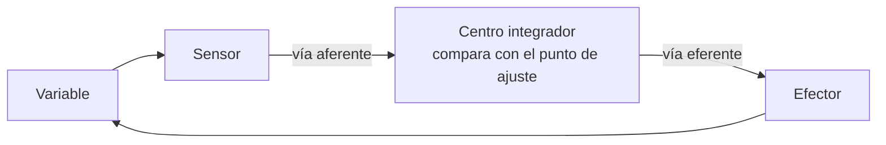

# Apuntes de clase · Tema 1 y generalidades

## Tema 1 · Introducción. Homeostasis y control

*Dra. Mónica García Alloza · clase del 21/09/26 · base: Guyton, cap. 1; Silverthorn, cap. 1* · Preguntas: Tema 1 · Preguntas

## Tema 1 · Introducción. Homeostasis y control › Lo esencial

- **Medio interno = líquido extracelular** (plasma + intersticial). La luz del tubo digestivo, las vías aéreas o la vejiga es **medio externo**. Según la profesora, esto cae casi siempre.
- **Homeostasis:** mantener *estable* (no constante) el medio interno. Las variables oscilan en un rango alrededor de un punto de ajuste.
- **Retroalimentación negativa:** la más frecuente. Mantiene constante una variable y se apaga sola.
- **Retroalimentación positiva:** poco común. Desencadena un fenómeno nuevo y necesita un factor externo para parar. Ejemplo: reflejo de Ferguson.
- **Anticipación:** siempre por el sistema nervioso. Actúa antes de que cambie la variable.

> **Pistas de examen**
>
> - ★★★ «Sale una pregunta en casi todos los exámenes»: **medio interno (LEC) frente a medio externo**.
> - ★★ Retroalimentación positiva: ejemplo y **qué la detiene** (factor externo). La anticipación es **solo del sistema nervioso**.
> - Las ideas clave del final de cada presentación de la Dra. García Alloza son su resumen de lo preguntable. Todas las pistas: Pistas de examen

## Tema 1 · Introducción. Homeostasis y control › 1. La fisiología en los niveles de organización

&#91;image: Niveles de organización: fisiología celular frente a fisiología de aparatos y sistemas\]

El año pasado se estudiaron moléculas, células y tejidos: transporte, comunicación y potenciales. Este año se dan por sabidos y se aplican a órganos y sistemas (fisiología integrativa). La fisiología es la base de la fisiopatología y la farmacología. «Aparato» y «sistema» se usan como sinónimos (en inglés solo existe *system*).

## Tema 1 · Introducción. Homeostasis y control › 2. Medio interno y homeostasis

&#91;image: Los sistemas del organismo y su relación con el medio externo\]

| Concepto | Definición |
| --- | --- |
| Medio externo | Lo que rodea al organismo, **incluida la luz** de digestivo, respiratorio, urinario y reproductor |
| Medio interno | Líquido extracelular: plasma + intersticial (Claude Bernard, *milieu intérieur*) |
| Homeostasis | Capacidad de mantener estable el medio interno (W. Cannon: *homeo*, similar; *stasis*, condición). Equilibrio dinámico |
| Regulación | Sobre todo sistemas nervioso y endocrino, pero participan todos |

El **sistema circulatorio** conecta todos los compartimentos y permite el intercambio entre ellos.

| Parámetros bajo control | Ejemplos |
| --- | --- |
| Internos | Temperatura, pH, osmolaridad |
| Necesidades celulares | O₂, nutrientes, agua, iones (Na⁺, Cl⁻, K⁺, Ca²⁺), hormonas y señales químicas |
| Respuesta al exterior | Temperatura ambiente, humedad, altitud |

> **Para subir nota (Guyton):** el agua corporal es \~60% del peso (\~42 L en 70 kg): ⅔ intracelular (\~28 L) y ⅓ extracelular (\~14 L). Del extracelular, \~¾ es intersticial y \~¼ plasma (\~3 L).

## Tema 1 · Introducción. Homeostasis y control › 3. Salud y enfermedad

&#91;image: Compartimentos (izquierda) y pérdida y recuperación de la homeostasis (derecha)\]

Un cambio externo o una disfunción interna alteran el medio interno y se activa una respuesta compensatoria. Si compensa, hay **salud**. Si falla, hay **enfermedad**, que es terreno de la fisiopatología.

## Tema 1 · Introducción. Homeostasis y control › 4. Mecanismos de control

Todo sistema de control es un bucle de cuatro elementos:

## Tema 1 · Introducción. Homeostasis y control › 4. Mecanismos de control › 4.1 Retroalimentación negativa

La respuesta **se opone al estímulo** y lo reduce. El bucle se apaga al volver al rango normal. Ejemplos: el termostato; en el cuerpo, la termorregulación, el barorreflejo o la glucemia.

&#91;image: Retroalimentación negativa: termostato y oscilación alrededor del punto de ajuste\]

## Tema 1 · Introducción. Homeostasis y control › 4. Mecanismos de control › 4.2 Retroalimentación positiva

La respuesta **refuerza el estímulo** y desencadena un fenómeno nuevo. Necesita un **factor externo que rompa el ciclo**.

&#91;image: Reflejo de Ferguson\]

- **Reflejo de Ferguson (parto):** la cabeza fetal distiende el cuello uterino → se libera oxitocina → el útero se contrae → empuja más al feto → más distensión y más oxitocina. El ciclo se rompe con la salida del bebé.
- **Otros ejemplos:** la apertura de canales de Na⁺ por la despolarización (ciclo de Hodgkin), la coagulación y el pico de LH preovulatorio.

> **Corrección** · En clase: la oxitocina se libera «a nivel hipotalámico». · Correcto: se **sintetiza** en el hipotálamo (núcleos supraóptico y paraventricular) y se **libera a la sangre en la neurohipófisis**.

## Tema 1 · Introducción. Homeostasis y control › 4. Mecanismos de control › 4.3 Anticipación (feed-forward)

**Siempre mediada por el sistema nervioso.** Adapta el organismo **antes** de que la variable cambie; el mecanismo concreto se conoce mal. Ejemplo de clase: el velocista en los tacos ya tiene más presión arterial, más gasto cardíaco y más flujo y temperatura muscular antes de correr. Otro ejemplo: la salivación al oler comida (fase cefálica).

## Tema 1 · Introducción. Homeostasis y control › 4. Mecanismos de control › 4.4 Comparación

|  | Negativa | Positiva | Anticipación |
| --- | --- | --- | --- |
| Frecuencia | La más común | Poco común | Frecuente, mal conocida |
| Qué hace | Mantiene constante una variable | Desencadena un fenómeno nuevo | Se adelanta al cambio |
| Cómo termina | Sola, al corregir | Factor externo | — |
| Quién la media | Todos los sistemas | Todos los sistemas | Solo el sistema nervioso |

> **Para subir nota (Guyton):** la **ganancia** de un sistema de control = corrección / error que persiste. El barorreflejo tiene \~−2 y la termorregulación \~−33 (más ganancia, mejor control). Una retroalimentación positiva con ganancia > 1 entra en **círculo vicioso**, como en el shock hemorrágico grave.

## Tema 1 · Introducción. Homeostasis y control › Glosario

| Término | Definición breve |
| --- | --- |
| Medio interno | Líquido extracelular (plasma + intersticial) |
| Medio externo | Exterior del cuerpo, incluida la luz de los aparatos abiertos al exterior |
| Homeostasis | Mantenimiento dinámico de la estabilidad del medio interno |
| Punto de ajuste | Valor de referencia de una variable regulada |
| Rango normal | Oscilación tolerada alrededor del punto de ajuste |
| Sensor, centro integrador, efector | Elementos del bucle de control |
| Retroalimentación negativa | La respuesta reduce el estímulo |
| Retroalimentación positiva | La respuesta amplifica el estímulo; necesita un factor externo para parar |
| Reflejo de Ferguson | Distensión cervical → oxitocina → contracción uterina |
| Anticipación | Respuesta previa al cambio; solo sistema nervioso |
| Ganancia | Corrección / error residual |

## Pistas de examen

Todo lo que las profesoras han dicho en clase que cae, que es importante o que «quieren que quede claro». Está sacado de las transcripciones, con la cita literal (limpia de errores de transcripción) y el sitio donde repasarlo. Se amplía con cada clase.

> ★★★ **Las negritas de las diapositivas tienen importancia extra**: están reunidas, tema a tema y con 132 preguntas, en Negritas de las presentaciones.

| Nivel | Qué significa |
| --- | --- |
| ★★★ | Dicho de forma explícita: «sale», «superimportante», «no lo podéis olvidar», «no confundir», «quería que os quede claro». También lo que ya ha salido en un test |
| ★★ | Repetido («lo repito», «insisto»), preguntado a la clase o que se hará en prácticas |
| ★ | Señalado con «quiero que veáis» o destacado en un recuadro de la diapositiva |

## Pistas de examen › Lo que enseñan los exámenes reales del curso pasado (añadido el 24/10/26)

- ★★★ **Los cuestionarios se repiten de un año a otro.** Los cuestionarios presenciales del curso pasado son exactamente la batería BAT, y los de digestivo de este curso (en papel 4 y 5) coinciden con ellos casi palabra por palabra. Lo esperable: **los cuestionarios de renal serán BAT30–44** (Cursos anteriores · Renal; los del Tema 20, BAT30, BAT31 y BAT36) **y los de endocrino BAT45–76** (Cursos anteriores · Endocrino). Dominarlas es nota casi segura.
- ★★★ **Reparto del examen teórico de enero 2026 (52 preguntas):** cardiovascular 14, renal 11, respiratorio 10, digestivo 8, endocrino 8 y Tema 1 una. Ningún bloque pasa del 30 %. Los temas con más preguntas: T15 y T22 (4), T3, T5, T11 y T23 (3). Detalle en Exámenes reales del curso pasado.
- ★★ **El examen reformula con lenguaje rebuscado las ideas de los cuestionarios** («identifique la proposición…»): vaciamiento, deglución, vitaminas, Ca²⁺ del marcapasos, seguridad frente al edema. 16 de 52 piden la INCORRECTA.
- ★★ **El práctico (20 preguntas)** salió sobre todo de osmolaridad y volemia (PNA, ADH, aldosterona, agua de mar), espirometría y ácido-base: los seminarios nuevos están en «Cuestionarios de prácticas y seminarios».

## Pistas de examen › Cómo preguntan: lo que dijeron del examen

- **Dra. García Alloza (21/09):** sus diapositivas terminan con unos «*take home points*» (ideas clave): **son el resumen de lo preguntable**. Dijo que el examen incluye preguntas **que han salido en el MIR en los últimos años** y que «no hay pregunta de fisiología del MIR que no hayamos cubierto o para la que no os demos herramientas». Hay preguntas que acierta casi todo el mundo y otras que casi nadie.
- **Test 50 preguntas, 4 opciones, −0,33 por error.** «Si es 478, es 478»: no hay margen de interpretación; aprende las **cifras exactas** que dan.
- **Dra. Castro (22/09):** tests sorpresa de unas **10 preguntas en 3 minutos** por el Campus Virtual (o en papel): «son tan sencillos que se responden si habéis venido a clase». Ya ha habido dos (24/09 y 28/09). Dijo que ahora los pondrá en lunes, por lo poco que se asistió el viernes.
- Su objetivo declarado: que tengáis «conocimientos suficientes de cardio» para el MIR. Espera **razonamiento de mecanismos**, no solo definiciones.
- **Revisión de exámenes:** solo para detectar errores de corrección, no para resolver dudas.
- **Estilo real del test (24/09):** frases largas con **un error cambiado** (lado derecho por izquierdo, arteria por vena, dos cúspides por tres, apertura por cierre). Lee cada palabra. Ver Tests de la plataforma.

## Pistas de examen › Pistas por tema › Tema 1 · Homeostasis y control

| Nivel | Pista literal | Qué te pueden preguntar |
| --- | --- | --- |
| ★★★ | «Sale una pregunta en casi todos los exámenes… un estudiante de medicina no puede dudar entre qué es medio interno y qué es medio externo» | **Medio interno = LEC.** La luz del tubo digestivo, la vejiga o los alvéolos es medio externo |
| ★★ | Preguntó a la clase ejemplos de retroalimentación positiva y qué tiene que pasar para que acabe | Reflejo de Ferguson; la positiva necesita un **factor externo** que rompa el ciclo |
| ★★ | «La anticipación es exclusivamente del sistema nervioso» (lo repitió varias veces) | Anticipación = solo SNC; ejemplo del velocista |
| ★ | Negativa = «la más común del cuerpo humano» | Tipos de control y su frecuencia |

Repaso: Tema 1 · Apuntes

## Pistas de examen › Pistas por tema › Tema 2 · Introducción al aparato cardiovascular

| Nivel | Pista literal | Qué te pueden preguntar |
| --- | --- | --- |
| ★★★ | «**Esto es superimportante.** ¿Entendemos cómo funcionan las válvulas?» | Apertura y cierre por presión, papilares, qué válvula está abierta en cada fase. **Salió en el test del 24/09** (P1 y P4) |
| ★★★ | Test 24/09: «para la eyección es necesaria una presión en el ventrículo mayor de 120 mmHg» | En sus tests, 120 mmHg. Ojo: el 25/09 ella misma dijo 80 (versión de libro) |
| ★★ | Mitral = «la única con dos cúspides; las demás tienen tres» | Trampa del test: «la aórtica tiene dos cúspides» (falso) |
| ★ | «Quiero que veáis que izquierda y derecha las vais a tener al revés» | Identificar cámaras en un dibujo |
| ★ | «Quiero que veáis» el músculo estriado cardíaco («no es igual que el esquelético») y las fibras en capas cruzadas | Diferencias cardíaco-esquelético; giro del ventrículo |
| ★ | Diapositiva: «Los dos ventrículos bombean la misma cantidad de sangre»; el izquierdo genera 4–6 veces más presión | Trampa volumen frente a presión |

Repaso: Tema 2 · Apuntes

## Pistas de examen › Pistas por tema › Tema 3 · Generación del ritmo cardíaco

| Nivel | Pista literal | Qué te pueden preguntar |
| --- | --- | --- |
| ★★★ | «**Una cosa que quería que os quede clara**: el nodo AV es menos excitable, tarda más en disparar… ese retraso permite que primero se contraigan las aurículas y después los ventrículos» | Función y causa del retraso AV; tiempos 0,03 → 0,12 → 0,16 s |
| ★★★ | Test 24/09: «El nodo SA es autorrítmico, dispara potenciales con una frecuencia constante» | Distractores: glutamato, ventrículo izquierdo, «ciclos de contracción» |
| ★★ | Repasó el 24/09: autorrítmicas = «células musculares cardíacas especializadas» que no necesitan estímulo | No son neuronas |
| ★★ | Preguntó a la clase: acoplamiento excitación-contracción, papel del Ca²⁺, desmosomas y uniones GAP | Discos intercalares, sincitio, liberación de Ca²⁺ inducida por Ca²⁺ |
| ★★ | Potencial largo y refractario largo: «nunca vamos a tener sumación» | Por qué no hay tétanos cardíaco |
| ★ | Frecuencias SA 70–80, AV 40–60, Purkinje 15–40 (midió el pulso en clase) | Marcapasos de reserva |

Repaso: Tema 3 · Apuntes

## Pistas de examen › Pistas por tema › Tema 4 · Electrocardiografía

| Nivel | Pista literal | Qué te pueden preguntar |
| --- | --- | --- |
| ★★★ | «La cola marca las cargas negativas y la punta las positivas. **Eso no lo podéis olvidar**» | Signo de la deflexión según el vector |
| ★★★ | «**Lo que quiero que entendáis es que estamos registrando por fuera**», no dentro de la célula | El ECG no registra potenciales de acción |
| ★★★ | Test 24/09: «Onda T = repolarización ventricular» | P, QRS, T; la S es parte del QRS |
| ★★ | «El cálculo del eje eléctrico lo vais a hacer en prácticas» | Eje con I y III, o con DI y aVF (**examen de prácticas**) |
| ★★ | Preguntó a la clase qué derivación da más voltaje | La II (paralela al eje, \~+60°) |
| ★★ | Preguntó: ¿dipolo perpendicular a los electrodos? | Línea isoeléctrica |
| ★ | «Simplemente quiero que veáis»: 6 derivaciones frontales + 6 transversales | 10 electrodos → 12 derivaciones |

Repaso: Tema 4 · Apuntes

## Pistas de examen › Pistas por tema › Tema 5 · Mecánica cardíaca (factores intrínsecos)

| Nivel | Pista literal | Qué te pueden preguntar |
| --- | --- | --- |
| ★★★ | «Trabajo cardíaco. **No confundir con gasto cardíaco**» | Trabajo = VS × PA; GC = VS × FC |
| ★★★ | Postcarga: «¿Se entiende? **Lo repito**». Y el 28/09 lo volvió a repasar | Subida aguda de PA → VS cae → ↑ VTS → ↑ VTD → Frank-Starling lo recupera |
| ★★★ | Frank-Starling: significado funcional (lo repitió el 25 y el 28/09, «insisto») | «El corazón bombea tanta sangre como le llega» |
| ★★ | «Definieron dos conceptos muy importantes»: precarga y postcarga | Definiciones exactas y de qué depende cada una |
| ★★ | Cifras: ciclo 0,8 s; VTD \~135; VTS \~65; VS \~70 mL; GC \~5 L/min | Cálculos de VS y GC |
| ★ | «Lo que quiero que veáis aquí: la adaptación fisiológica frente a la patológica» | Atleta (excéntrica) frente a HTA (concéntrica) |
| ★ | R3: «lo veréis en la práctica de sonidos» | Ruidos cardíacos (**examen de prácticas**) |

Repaso: Tema 5 · Apuntes

## Pistas de examen › Pistas por tema › Tema 6 · Regulación extrínseca y hemodinámica

| Nivel | Pista literal | Qué te pueden preguntar |
| --- | --- | --- |
| ★★★ | «**Lo que quiero que entendáis aquí** es el papel tan importante que tiene el radio» (×16 si se duplica) | Ley de Poiseuille, cálculos con r⁴ |
| ★★★ | «El simpático tiene efectos cronotrópicos e inotrópicos; el parasimpático solamente cronotrópicos negativos. **¿Se ha entendido?**» | Quién hace qué |
| ★★ | Preguntó: «¿Los muscarínicos son canales iónicos o de otro tipo?» → metabotrópicos | Receptor M2 con proteína G |
| ★★ | Preguntó con dos tubos: mismo gradiente, mismo flujo | El flujo depende del **gradiente**, no de la presión absoluta |
| ★★ | «Insisto»: GC = VS × FC; la FC solo se regula por factores extrínsecos | Intrínsecos frente a extrínsecos |
| ★★ | «**Todo esto lo tenéis que saber de neuroanatomía**» (ramas del SNA, vías aferentes y eferentes) | Vago, ganglios, ACh y NA, células cromafines |
| ★ | Pajita larga o corta, agua frente a batido | Longitud y viscosidad en la resistencia |

Repaso: Tema 6 · Apuntes

## Pistas de examen › Pistas por tema › Tema 7 · Circulación sistémica y presión arterial (29/09)

| Nivel | Pista literal | Qué te pueden preguntar |
| --- | --- | --- |
| ★★★ | «**Una cosa que quiero que aprendáis a distinguir** es el flujo o caudal y la velocidad del flujo» (el río: ancho lento, estrecho rápido) | Q igual en todo el circuito; v = Q / área; velocidad mínima en capilares |
| ★★★ | PAM = PD + ⅓ (PS − PD), ≈93 mmHg; hipertensión > 106, hipotensión < 70 (diapositiva 10) | Cálculo con cifras; PAM ≈ GC × RPT |
| ★★★ | «El flujo aumenta 16 veces» al duplicar el radio; arteriolas = «tornillos», sitio de resistencia variable | Poiseuille otra vez; dónde se regula el flujo |
| ★★ | «¿No os pasa que os levantáis rápido y os mareáis?» + «**fijaros qué maravilla**»: barorreceptores que disparan más cuanto más se estira la pared | Barorreflejo paso a paso; simpático si baja, parasimpático si sube |
| ★★ | Ruidos de Korotkoff con la manguera: empiezan a la sistólica, desaparecen a la diastólica | Medida de la PA |
| ★★ | Preguntó a la clase: «si en los capilares hubiera la presión de la aorta, ¿qué pasaría?» → se romperían | Ventajas de la caída de presión y velocidad |
| ★ | El riñón deja de funcionar con perfusión < 60; SRAA «lo veréis muy despacio»; diuresis por presión = ganancia casi infinita | Tres plazos de regulación y quién actúa en cada uno |

Trampas nuevas: «cuerpo carotídeo» (son quimiorreceptores; los barorreceptores están en el **seno carotídeo**); «la baja sería 60» (es **80**); «ruidos de color» (**Korotkoff**); la ECA está en el **pulmón**, no en el riñón; la angiotensina II libera **aldosterona (suprarrenal)** y **ADH (neurohipófisis)**.

Repaso: Tema 7 · Apuntes

## Pistas de examen › Pistas por tema › Tema 8 · Flujo sanguíneo tisular (30/09)

| Nivel | Pista literal | Qué te pueden preguntar |
| --- | --- | --- |
| ★★★ | La pregunta que abre y cierra la clase: «**¿por qué el flujo al músculo se multiplica por 20 en el ejercicio mientras el del cerebro casi no varía?**» | Paralelo + metabólico local + β₂ en músculo/corazón/hígado + miógeno en cerebro/riñón + α en el resto |
| ★★★ | Cifras leídas de la diapositiva 2: cerebro 0,7 · corazón 0,20 · hígado-digestivo 1,35 · riñón 1 · músculo 1,05 · piel 0,25 L/min | Qué órgano recibe más o menos en reposo |
| ★★★ | «¿Cuál es el único parámetro que podemos regular de forma fisiológica? **El radio**» (longitud genética, viscosidad solo con fármacos) | Factores de Poiseuille regulables |
| ★★ | «**Las arteriolas están ordenadas en paralelo**»; los cuatro tubos de 1 L/min; «la sangre siempre viaja por el camino de menor resistencia» | Redistribución sin cambiar el total |
| ★★ | Hiperemia **activa** frente a **reactiva** (la goma en el dedo); la nariz roja del bebé = lo local prevalece sobre lo sistémico | Definiciones y ejemplos |
| ★★ | «La pregunta es muy buena»: el miógeno es retroalimentación negativa; «en tejidos distintos hay regulaciones distintas» (cerebro y riñón) | Mecanismo miógeno paso a paso |
| ★★ | Repaso insistente del óxido nítrico (eNOS, arginina, guanilato ciclasa, GMPc) y del sildenafilo | Vía del NO |
| ★ | Adrenalina: mayor afinidad por β; β₂ solo en hígado, corazón y músculo. Los vasos no tienen parasimpático | Receptores α y β |

Trampas nuevas: la neurona simpática libera **noradrenalina** (en clase dijo adrenalina); las arteriolas están **en paralelo** (dijo «de serie» una vez); los canales de Ca²⁺ del miógeno se abren por **estiramiento**, no por el O₂; el parasimpático en los genitales **vasodilata**, no hace lo mismo que el simpático.

## Pistas de examen › Pistas por tema › Tema 8 · Flujo sanguíneo tisular (30/09)

- 📋 **Seminario 2 (03/11/26)**: PAM = PD + ⅓ PD (la diástole dura ⅔ del ciclo); amplificación del pulso en arterias medianas (menor distensibilidad y ondas reflejadas); velocidad de la onda de pulso 5–10 m/s frente a 0,2 m/s de la sangre (↑ = rigidez); anestesia espinal = arco barorreflejo roto en la eferencia; receptores de volumen y quimiorreceptores. Detalle en «Cuestionarios de prácticas y seminarios».
- 📋 **Seminario 3 · Circulaciones especiales (18/11/26)**: detalle en «Cuestionarios de prácticas y seminarios».
  - ★★ **Coronaria**: el VI se riega sobre todo en **diástole**; el subendocardio es lo más vulnerable; el corazón ya extrae ≈70–75 % del O₂, así que solo puede **aumentar el flujo** (adenosina). El simpático dilata las coronarias por vía **metabólica** (β₁ → ↑consumo de O₂), aunque su efecto directo α sea vasoconstrictor.
  - ★★ **Músculo**: tono simpático α en reposo; **β₂ por la adrenalina circulante** → vasodilatación en la reacción de alarma; el control central prevalece en reposo, en la hipotensión o hemorragia y en los músculos inactivos; en el músculo activo manda el metabólico (simpaticólisis funcional).
  - ★★ **Piel**: anastomosis arteriovenosas con control **nervioso**; calor → retirada del tono α + **vasodilatación activa colinérgica** (NO, VIP, bradicinina); en el ejercicio el simpático es **diferenciado** (piel dilata, vísceras se contraen); el barorreflejo limita la vasodilatación cutánea.
  - ★★ **Cerebro**: el NO nitrérgico y neuronal da un **acoplamiento neurovascular** rápido y local; por eso el flujo regional (PET, RM funcional BOLD) sirve como mapa de actividad.

## Pistas de examen › Pistas por tema › Tema 8 · Flujo sanguíneo tisular (30/09)

  - ★★★ **Pulmón**: arteriolas de pared fina, baja presión (≈15 mmHg) y baja resistencia; capilares con ≈7 mmHg; **vasoconstricción pulmonar hipóxica** (cierre de canales de K⁺ → Ca²⁺) para ajustar V/Q; en altitud, vasoconstricción generalizada → recluta los vértices, pero mantenida → hipertensión pulmonar y cor pulmonale.
  - 📝 **Cuestionario de Moodle**: 1 c · 2 a · 3 a · 4 d · 5 d (flujo coronario máximo en diástole; bradicinina del sudor; autorregulación cerebral; β₂ muscular vasodilatador; hipoxia pulmonar vasoconstrictora).

Repaso: Tema 8 · Apuntes

## Pistas de examen › Pistas por tema › Tema 9 · Circulación capilar y venosa (02/10)

| Nivel | Pista literal | Qué te pueden preguntar |
| --- | --- | --- |
| ★★★ | «**Lo que quiero que os quedéis** es que cada órgano construye su barrera capilar en función de lo que necesita intercambiar» | Continuo / fenestrado / sinusoide con su órgano |
| ★★★ | «**No me lo vayáis a confundir** con la ley de Frank-Starling» | Fuerzas de Starling (capilar) frente a Frank-Starling (corazón) |
| ★★★ | «¿Quién gana?» en cada extremo: PH 32 / 15, π 25 / 0; filtración arterial, absorción venosa; neto 3 L/día a la linfa | Cálculo de presión neta y dirección |
| ★★ | «Los mecanismos de convección... **me gustaría que entendierais**» | Filtración / absorción; convección por presión frente a difusión por gradiente |
| ★★ | «¿Se ha reducido el caudal porque la sangre va más despacio?» → no | v = Q / A otra vez |
| ★★ | Modelo revisado del glucocálix: filtración en todo el capilar, sin reabsorción venosa sostenida | Qué cambia respecto al clásico |
| ★ | 500–700 m² («un campo de fútbol»); 20–30 µm; barrera hematoencefálica: solo liposolubles; linfa: ciega, un sentido, ganglios, edema sin movimiento | Cifras y definiciones |

Trampas nuevas: «20–30 **mm**» son **µm**; «penestrados» = fenestrados; «prelitos» = pericitos; las válvulas venosas se abren **para dejar pasar** la sangre hacia el corazón.

Repaso: Tema 9 · Apuntes

## Pistas de examen › Pistas por tema › Tema 10 · Introducción a la fisiología respiratoria (05/10) · Dra. García Alloza

Cambio de profesora y de estilo: **cuestionario en papel al final de la clase** (5 preguntas copiadas de las diapositivas del día). Cuenta como evaluación continua.

| Nivel | Pista literal | Qué te pueden preguntar |
| --- | --- | --- |
| ★★★ | **Cuestionario en papel** al terminar: funciones, respiración externa frente a celular, vías aéreas (37 °C, 100 %), CFTR, presiones del ciclo | Las cinco están resueltas en Tests de la plataforma; esperable que reaparezcan en el examen |
| ★★★ | «¿Por qué sale el aire? **Es una pregunta de manual**» | Espiración: la presión alveolar sube a **+1 mmHg**, por encima de la atmosférica |
| ★★★ | «La respiración celular **no** es función del aparato respiratorio» | Respiración externa (ventilación, intercambio, transporte) frente a celular (mitocondria) |
| ★★ | Presiones con número y signo: pleural −3 → −6 (−8 en ejercicio); alveolar 0 / −1 / +1 | Cifras exactas y signo; «3 mmHg» sin signo es trampa |
| ★★ | «¿Cuántas bolsas pleurales hay?» (preguntó a la clase); líquido pleural = **transcelular**, ≈25 ml | **Dos** bolsas, dos membranas (visceral y parietal) |
| ★★ | Funciones no respiratorias: pH por CO₂ (CO₂ + H₂O ⇌ H₂CO₃ ⇌ H⁺ + HCO₃⁻), fonación, defensa (macrófagos), reservorio del VI, olfación (Nobel 2004) | Frases con tres partes y una falsa (C1 del cuestionario) |
| ★★ | CFTR: salida de **Cl⁻** y agua; en fibrosis quística falla y **aumenta** la entrada de Na⁺ → moco espeso | Intercambio Na⁺/Cl⁻, aumenta/disminuye |
| ★ | Inspiración activa (diafragma, intercostales externos); espiración tranquila **pasiva**; forzada con abdominales e intercostales internos | Músculos por fase |
| ★ | 2²³ divisiones, ≈90 m², barrera 0,6–2 µm, neumocitos I (intercambio) y II (surfactante); neumotórax / hemotórax | Cifras y definiciones |

## Pistas de examen › Pistas por tema › Tema 10 · Introducción a la fisiología respiratoria (05/10) · Dra. García Alloza

Trampas: «la espiración siempre requiere un esfuerzo extra» → solo la **forzada**; «cuatro/tres bolsas pleurales» → **dos**; «pH intracelular» → pH del **medio interno**.

Repaso: Tema 10 · Apuntes

## Pistas de examen › Pistas por tema › Tema 11 · Distensibilidad, elasticidad y trabajo respiratorio (06/10) · Dra. García Alloza

Lo más valioso de esta clase es lo que dijo **sobre el examen** al corregir el cuestionario anterior: las preguntas del examen son **del mismo tipo que los cuestionarios** («de este tipo salen mucho… en el examen, así»), salen de un banco grande («ponemos el doble de preguntas que en un examen normal») y **nunca son interpretables**: si una opción admite dos lecturas, no la ponen. Y hubo **segundo cuestionario en papel** (6 preguntas, resuelto en Tests de la plataforma).

## Pistas de examen › Pistas por tema › Tema 11 · Distensibilidad, elasticidad y trabajo respiratorio (06/10) · Dra. García Alloza

| Nivel | Pista literal | Qué te pueden preguntar |
| --- | --- | --- |
| ★★★ | **Cuestionario 2 en papel**: distensibilidad (neumocitos I/II), componentes del trabajo, trabajo inspiratorio, surfactante, hipoxemia, presiones del ciclo | Las seis, con una palabra cambiada |
| ★★★ | «¿Dónde es mayor la resistencia, en la tráquea o en los bronquiolos?» (preguntó varias veces; «**esto también sale**») | **Tráquea y bronquios**: la suma de áreas de los bronquiolos es enorme |
| ★★★ | Ley de Laplace: «**se necesita el doble de presión** para mantener abierto un alveolo de la mitad de diámetro» («¿alguien no está de acuerdo?») | P = 2T/r; por qué los pequeños colapsan en los grandes (atelectasia) |
| ★★★ | **1/3 fibras elásticas, 2/3 tensión superficial**; **1 cm H₂O ≈ 200 ml**; 2,5 cm H₂O → 500 ml de volumen corriente | Cifras exactas |
| ★★ | Surfactante: neumocitos **II**, DPFC, SP-A–D; reduce la tensión **2–12 veces** (72 → 50 → 5–30 dinas/cm); 100 µm: 18 → 4 cm H₂O; **menos diluido en los pequeños** | Composición, cuatro efectos, dónde actúa más |
| ★★ | Broncodilatación: **β₂ (adrenalina), ↑ CO₂**. Broncoconstricción: **ACh, histamina, irritantes, leucotrienos**. Asma: «¿agonista o antagonista β₂?» → **agonista** | Farmacología básica |
| ★★ | Trabajo = ΔP pleural × ΔV; **2–3 %** del gasto energético, **50 %** en ejercicio; **histéresis** (el pulmón sigue a la caja con retraso) | Definición, cifras y por qué la curva es doble |
| ★ | Patologías: espondilitis (caja), fibrosis / enfisema (pulmón), ELA / miastenia («anticuerpos contra el receptor de acetilcolina») / Lambert-Eaton, asma; distrés del prematuro (corticoides a la madre, surfactante al niño); suspiro y bostezo | Relacionar cada una con su componente del trabajo |

## Pistas de examen › Pistas por tema › Tema 11 · Distensibilidad, elasticidad y trabajo respiratorio (06/10) · Dra. García Alloza

Trampas: «surfactante de los neumocitos **I**» → II; «la inspiración tranquila no requiere músculo» → siempre lo requiere; «la presión pleural se iguala a la atmosférica / se hace positiva» → siempre negativa; «más diluido en los pequeños» → menos. Transcripción: «7–12 veces» y «18 → 14» son **2–12** y **18 → 4**.

Repaso: Tema 11 · Apuntes

## Pistas de examen › Pistas por tema › Tema 12 · Ventilación pulmonar y alveolar (08/10) · Dra. García Alloza

Sin cuestionario este día, pero con el aviso más explícito del bloque al cerrar la clase: «**salen este tipo de preguntas**: ventilación, perfusión, partes del pulmón, **flujo continuo, flujo discontinuo, cambio de presiones a lo largo del ciclo**».

| Nivel | Pista literal | Qué te pueden preguntar |
| --- | --- | --- |
| ★★★ | «Salen este tipo de preguntas»: zonas de West (flujo ausente / intermitente / continuo) y cambios de presión capilar-alveolar en sístole y diástole | Zona 1, 2, 3; qué pasa si P alveolar > P capilar |
| ★★★ | «¿Los 150 primeros ml que espiras son aire limpio o viciado?» (**limpio**); «¿y los primeros que llegan al alveolo?» (**viciado**). «**Esto sale**» | Espacio muerto 150 ml; 350 ml útiles; ≈7 ciclos para renovar |
| ★★★ | **Alteraciones del cociente V/Q = principal causa de hipoxemia** (la C5 del cuestionario 2). Reprimenda a la clase por no saber explicar el V/Q | V/Q = 0 cortocircuito (sangre derivada); ∞ espacio muerto; más ventilación no es mejor cociente |
| ★★ | VP = Vc × FR ≈ 7 L/min; VA = (Vc − 150) × FR ≈ 4,2 L/min; «¿cuál es mayor? la pulmonar, siempre» | Fórmulas y cifras |
| ★★ | Volúmenes y capacidades (500 / 3000 / 1100 / 1200; CI 3500, CRF 2300, CV 4600, CPT 5800); «¿por qué no se puede usar el volumen residual? porque el pulmón tendría que colapsar» | Definiciones y sumas; 20–30 % menos en mujeres |
| ★★ | Presiones parciales: alveolo O₂ ≈100, CO₂ 40, H₂O 47; sangre arterial 100 / 40; capacidad de difusión O₂ 21 × 11 = 230 ml/min; CO₂ ≈20 veces más soluble | Cifras |
| ★★ | Sistémica 95 → 2 (93) frente a pulmonar 15 → 8 (7 mmHg) | Alta frente a baja presión |
| ★ | Control de la respiración «mayoritariamente involuntario»; seminarios específicos de V/Q y circulaciones especiales |  |

## Pistas de examen › Pistas por tema › Tema 12 · Ventilación pulmonar y alveolar (08/10) · Dra. García Alloza

Trampas: «los primeros 500 ml que exhalo» → 150; «79 % de oxígeno» → nitrógeno; «60 mmHg de O₂» → 160; «diferencia de 1 mmHg, 200 ml» → 11 mmHg, 230 ml/min; «25 a 2» → 95 a 2.

Repaso: Tema 12 · Apuntes

## Pistas de examen › Tema 13 · Transporte de gases en sangre (13/10/26)

- ★★★ **Coeficiente de utilización**: la sangre arterial lleva **20 vol %** de O₂ y la venosa **15**; se ceden **5 ml/100 ml** → **25 %**. Lo hizo calcular en clase. En ejercicio intenso sube al 75–85 % (100 % en zonas de flujo muy lento).
- ★★★ **Cloruro**: «¿los eritrocitos venosos tienen más o menos cloruro que los arteriales? **Más**» (desplazamiento de cloruro: entra Cl⁻ cuando sale HCO₃⁻).
- ★★★ **Efecto Haldane** cuantificado: «sin él, en el pulmón solo me desharía de **2 ml** de CO₂ en lugar de **4**». Cuestionario 3, C8 y C9.
- ★★★ **Mioglobina** tiene **más afinidad** por el O₂ que la Hb (capta el que suelta la Hb en el músculo); igual la **Hb fetal**.
- ★★ La sangre de la **arteria pulmonar** es «**arterial pero desoxigenada**» (PO₂ 40, PCO₂ 45): «estad pendientes de esto».
- ★★ **PO₂ aórtica ≈ 95, no 100**: se mezcla ≈2 % de sangre no oxigenada (bronquial, Tebesio). Cuestionario 3, C9a.
- ★★ **O₂ disuelto ≈ 3 %**, Hb ≈ 97 %; **CO₂**: bicarbonato 70 %, carbamino 23 %, disuelto 7 %. Cuestionario 3, C9d.
- ★★ La curva de la Hb: 97 % a PO₂ 100, **75 % a 40**, todavía 89 % a 60 (margen de seguridad). Derecha = menos afinidad: ↑CO₂, ↑H⁺, ↑T, ↑2,3-BFG (efecto Bohr).
- ★★ «El **ATP/ADP es el paso limitante** del uso de O₂ por la célula, no la PO₂ (basta > 1 mmHg)».
- ★ Cociente respiratorio 0,8 (4 ml de CO₂ por 5 de O₂); 1 con carbohidratos, 0,7 con grasas. Tipos de hipoxia (cianuro = histotóxica). Intoxicación por O₂ (sube el disuelto).
- ⚠ Errores de la transcripción corregidos en los apuntes: «4000 litros» → 4 ml/100 ml; «10 % disuelto» → 3 %; «PCO₂ 25 en el extremo arterial» → 40.

## Pistas de examen › Tema 14 · Control de la respiración (13/10/26)

- ★★★ **Leyó la C5 del cuestionario 3 antes de repartirlo**: «el efecto estimulador del CO₂ **se atenúa a las 48 h**; todas las demás son ciertas». «Os lo pongo, salen de otra forma, pero salen así.»
- ★★★ **Neumotáxico**: si corta antes la rampa → **↑ frecuencia, ↓ volumen corriente**. Lo preguntó **tres veces** hasta que toda la clase lo vio.
- ★★★ **Células glómicas**: canales de K⁺ sensibles al O₂; con hipoxia se **inactivan** → la célula **se despolariza** (no se hiperpolariza) → Ca²⁺ → dopamina/ACh/ATP. «¿Sacan o meten potasio? Sacan.»
- ★★★ **Hipoxia crónica (altitud)**: hiperventilación → ↓ CO₂ → los centrales frenarían; en 2–3 días **baja la sensibilidad central al CO₂/H⁺** → aclimatación. «Si alguien no lo ve cuando lo lea, que me lo diga.»
- ★★★ Cuestionario 3, **C7** (control final = descargas rítmicas de los grupos respiratorios) y **C10** (periféricos: O₂ y también CO₂/H⁺).
- ★★ **Centrales** = CO₂ y H⁺ (H⁺ primario, pero el CO₂ es quien cruza la BHE); casi nada al O₂. **Periféricos** = O₂ (60–30 mmHg) y CO₂/H⁺ **5× más rápido** pero moderado.
- ★★ Efecto crónico del CO₂: cae a **1/5** en 1–2 días (riñón retiene HCO₃⁻, que cruza la BHE).
- ★★ Rampa inspiratoria: **2 s** de subida, corte súbito, **3 s** de relajación (la transcripción dice 12 s). Señal neumotáxica intensa 0,5 s → 30–40/min; débil 5 s → 3–5/min.
- ★★ **Ejercicio**: PO₂, PCO₂ y pH arteriales **no cambian**; la ventilación sube por una señal **neurógena anticipatoria** del encéfalo motor.
- ★★ «¿La respiración es voluntaria o involuntaria? **Involuntaria**»: el control cortical es limitado, no vence a los quimiorreceptores.

## Pistas de examen › Tema 14 · Control de la respiración (13/10/26)

- ★ Hering-Breuer: protector, solo con Vc > 1,5 L (vago). Tos (vago; 2,5 L, ≥100 mmHg, 120–160 km/h) vs estornudo (trigémino, úvula). Receptores J. Morfina/pentobarbital deprimen el centro. Cheyne-Stokes; apnea obstructiva vs central.
- 📋 **Lección Moodle de fisiopatología respiratoria (31/10/26)**: hipoxemia (4 causas: hipoventilación, difusión, shunt, V/Q; la trampa «hiperventilación»), IR global = pO₂ < 60 + pCO₂ > 50, riesgos del O₂ (retención de CO₂, atelectasia por absorción, fibroplasia retrolental), curva de la Hb a la derecha con ↑2,3-DPG y acidosis respiratoria aguda por narcóticos. Detalle en «Tests de la plataforma».
- 📋 **Práctica 3 · Espirometría (19/11/26)**: volumen = integral del flujo (calibración con jeringa de 0,6 l); la espirometría no mide VR, CRF ni CPT; criterios del guion: **FVC y FEV1 ≥ 80 %**, **FEV1/FVC y FEF25–75 % ≥ 70 %** del teórico; obstructivo = FEV1/FVC ↓, restrictivo = FVC ↓ con cociente normal o ↑. Detalle en «Cuestionarios de prácticas y seminarios».
  - 📝 **Lección de Moodle (Sr. Beider)**: VR no medible · la espirometría forzada depende del esfuerzo · FEF25–75 % = vía aérea pequeña · FEV1/FVC 63,7 % con FVC normal = **obstructivo** · salbutamol: FEV1 +32 % (+1,1 l) y cociente 75 % = **reversible** (asma o broncoespasmo por ejercicio, no EPOC). Prueba broncodilatadora positiva: **FEV1 ≥ 12 % y ≥ 200 ml**.

## Pistas de examen › Tema 14 · Control de la respiración (13/10/26)

**Repaso del bloque 3 completo:** con los tres cuestionarios en papel (21 preguntas sobre respiratorio) la profesora ya ha enseñado cómo pregunta: enunciados largos con **«señale la INCORRECTA»** (3 de 10 en el tercero), cifras exactas (150 ml, 350 ml, 1,5 L, 95/45 mmHg, 20→15 vol %, 4 ml de CO₂) y mecanismos razonados (Haldane, Bohr, neumotáxico, células glómicas, aclimatación). Las trampas del cuestionario 3: ventilación alveolar es «por unidad de tiempo» (C3, la que fallaste), la presión pleural nunca se hace positiva en espiración tranquila (C1) y en ejercicio la ventilación alveolar sigue siendo menor que la pulmonar (C4).

## Pistas de examen › Tema 15 · Introducción al aparato digestivo (14/10/26)

- ★★★ En la diapositiva 13 (control del flujo sanguíneo): «**¿qué ocurre durante la digestión? Pregunta de examen**». Hiperemia posprandial por **mecanismos anticipatorios**, **CCK, VIP, gastrina y secretina**, **cininas (calidina, bradicinina)** y **adenosina** (↑ metabolismo → ↓ O₂). Parasimpático vasodilata; **simpático (NA) vasoconstriñe** en **ejercicio intenso y shock**, con límite: **escape autorregulador**.
- ★★★ Cerró con la diapositiva de **bullet points**: «son **preguntas típicas**… las cuestiones que **no os podéis saltar**». Funciones; rítmicas (ondas lentas + espigas) y tónicas; mientérico = movimiento en todo el tubo / submucoso = local; parasimpático ↑ y vasodilata / simpático ↓ y vasoconstriñe; hormonas endocrinas, paracrinas y neurocrinas; peristaltismo («ley del intestino») y segmentación; escape autorregulador.
- ★★★ «Es **imprescindible** que el plexo mientérico sea plenamente funcional» para el peristaltismo. Anillo **2–3 cm por encima**, **relajación receptiva** por debajo; **ley del intestino**, siempre del esófago al ano. Segmentación: **5–30 s**, en paralelo, mezcla.
- ★★ Ondas lentas: **Na⁺** («¿qué hace el sodio? Entra»); espigas: PA a **−40 mV**, canales **calcio-sodio**; tónicas: Ca²⁺ **no asociado a PA**, minutos a horas. Despolarizan: distensión, ACh, parasimpático, hormonas; hiperpolarizan: simpático, NA. «Sed críticos: el origen (células de Cajal) no se conoce del todo.»
- ★★ **Endocrina frente a paracrina** (lo preguntó): viaja por la sangre / actúa en las vecinas. Neurocrina: la libera una neurona (VIP, GRP, encefalina). Endocrinas: gastrina, CCK, secretina, GIP, motilina; paracrinas: somatostatina, histamina.

## Pistas de examen › Tema 15 · Introducción al aparato digestivo (14/10/26)

- ★★ Simpático: «**generalmente** inhibe», pero **excita la muscularis mucosae** e **inhibe severamente las neuronas entéricas**; ganglios celíaco y mesentéricos. Parasimpático craneal (VII, IX, **vago**) hasta la mitad del colon; **sacro** (pélvicos) → colon distal y **defecación**.
- ★★ Vellosidad: arteriola y vénula unidas por **asas capilares** → **flujo contracorriente**; hasta el **80 % del O₂** no llega a la punta → **sufre mucho** con la vasoconstricción. Grasas → **quilífero** → conducto torácico; lo demás → **porta** → sinusoides (células reticuloendoteliales).
- ★★ SN entérico: **>100 millones de neuronas**, independiente pero modulado por el SNA. Mientérico (Auerbach): tono, intensidad, velocidad; **VIP** relaja esfínteres. Submucoso (Meissner): secreción, flujo y absorción locales. ACh ↑, NA ↓.
- ★ **80 % de las fibras vagales son aferentes**. Reflejos a cuatro niveles (pared; ganglios prevertebrales: gastrocólico, enterogástrico, coloileal; médula: defecación; tronco: estómago-duodeno) + dolorosos (inhiben). GALT: alergias e intolerancias. Sincitio: haces de ≈1000 fibras con uniones en hendidura.
- ⚠ Errores de la transcripción corregidos: «40 m» → −40 mV; «simpático con acetilcolina vasodilata» → parasimpático; «parasimpático gravial» → craneal.

## Pistas de examen › Tema 15 · Introducción al aparato digestivo (14/10/26) › El examen real de la profesora (7 preguntas)

Las siete preguntas de su examen de un curso anterior están transcritas y resueltas en Tests de la plataforma, con una tabla de **cómo pregunta**: mecanismo antes que definición, adverbios que cambian la respuesta («principalmente», «inicialmente», «aislado»), distractores verdaderos pero que no responden a la pregunta, y cambio de una palabra. Cinco de las siete son de los temas 3–6.

Añadido el 05/10: el **cuestionario en papel de respiratorio** (5 preguntas, Dra. García Alloza), también en Tests de la plataforma. Su estilo es distinto: una idea de diapositiva por pregunta, opciones con tres partes y una falsa, y cifras con signo. Ya llevas 16 preguntas reales.

## Pistas de examen › Lo que entra en el examen de prácticas (20% de la nota)

| Práctica o seminario | Qué dijeron |
| --- | --- |
| Práctica de electrocardiografía | Os haréis el ECG a vosotros mismos y lo interpretaréis; **cálculo del eje eléctrico** |
| Práctica de sonidos cardíacos | Auscultación; R1, R2 y el R3 («casi no se escucha») |
| Seminarios de cardio | Mecánica cardíaca, regulación integrada y circulaciones especiales (la pulmonar se ve allí, no en teoría) |
| Cuestionarios de prácticas | «Las historias de Balian» (Dr. del Marco): 5–10 preguntas por práctica en el Campus |

## Pistas de examen › Trampas ya detectadas

| Trampa | Qué contestar |
| --- | --- |
| Apertura aórtica: «120 mmHg» o «80 mmHg» | En los tests de la Dra. Castro, 120. En pregunta de libro o tipo MIR, **80 (presión diastólica aórtica)** |
| Derivaciones II y III (en la transcripción aparecen cruzadas) | **II: brazo derecho → pierna izquierda; III: brazo izquierdo → pierna izquierda** |
| Periodo refractario «100 ms» | **\~200 ms el absoluto** (casi todo el potencial) |
| Subida del potencial nodal «por Na⁺» | **Ca²⁺ tipo L**; el Na⁺ (Iƒ) es el prepotencial |
| Células marcapasos «neuronas» | **Músculo cardíaco modificado** |
| R3 al «final del llenado» | R3 = **llenado rápido**; R4 = sístole auricular |
| «Presión auricular derecha = VS» | Es un índice de **precarga (llenado)** |
| Sintrom «baja la viscosidad» | Es un **anticoagulante**; la viscosidad depende del hematocrito |

## Pistas de examen › Checklist antes del examen

- [ ] Distingo medio interno y externo con cualquier ejemplo (luz intestinal, orina, plasma).
- [ ] Explico los tres mecanismos de control y pongo un ejemplo de cada uno.
- [ ] Sé qué válvulas están abiertas en cada fase del ciclo y por qué se abren y cierran.
- [ ] Explico el retraso del nodo AV: dónde, cuánto y para qué.
- [ ] Dibujo el potencial del miocito y el del nodo SA con los iones de cada fase.
- [ ] Deduzco el signo de una deflexión a partir de un vector y dos electrodos.
- [ ] Calculo el eje eléctrico con I y III, y con DI y aVF.
- [ ] Calculo VS, GC, FE y trabajo cardíaco con números.
- [ ] Explico paso a paso la respuesta a una subida aguda de la postcarga.
- [ ] Diferencio Frank-Starling de contractilidad.
- [ ] Sé qué hace el simpático y qué el parasimpático, con receptor y segundo mensajero.
- [ ] Calculo cambios de flujo al cambiar el radio (r⁴).

## Pistas de examen › Lo que confirma el test cardiovascular corregido (16/10/26)

- ★★★ **Nodo sinusal:** la retroalimentación oficial insiste en el **Ca²⁺ tipo L**. Distingue bien entre la despolarización lenta que lleva al umbral (**Na⁺, canales «funny» I\_f**) y la subida del potencial de acción del nodo (**Ca²⁺ tipo L**). Las células marcapasos tienen potencial de **respuesta lenta**.
- ★★★ **Frank-Starling** en Verdadero/Falso cambiando una sola palabra: más distensión da **MÁS** fuerza y más volumen, porque el sarcómero está por debajo de su longitud óptima.
- ★★ **Wiggers:** saber señalar la contracción isovolumétrica (entre el cierre de las AV y la apertura aórtica, con el 1.er tono) frente a la relajación isovolumétrica (junto al 2.º tono).
- ★★ **Simpático y frecuencia cardíaca:** la profesora da por buena la **adrenalina** (β₁), igual que en el Seminario 1.

## Pistas de examen › Tema 16 · Motilidad del aparato digestivo (16/10/26)

- ★★★ Vaciamiento gástrico: «a nivel hormonal la más importante, **la colecistocinina**… la más relevante limitando el vaciado gástrico, **sin discusión**». Se libera con las **grasas** (yeyuno); **secretina** con el **ácido** (duodeno); **GIP** con grasas > hidratos de carbono. Efecto: **↓ bomba pilórica** y **↑ tono del esfínter pilórico**.
- ★★★ Cerró otra vez con **bullet points** (nueve): reflejo masticatorio cíclico; deglución voluntaria + involuntaria (reflejo y centro de la deglución); peristaltismo esofágico primario y secundario; estómago = almacenamiento, mezcla (quimo) y vaciamiento; vaciamiento por bomba pilórica y tono pilórico; segmentación y propulsión; reflejo gastroileal y reflejos del ciego; haustras y movimientos de masa; defecación por reflejo intrínseco + parasimpático, esfínter interno y externo voluntario.
- ★★★ «**Repasadla**, hay **muchísimos detalles**»; «esta clase y las siguientes son **mortales**»; y a los que dicen que de esto caen menos preguntas: «**yo tengo preguntas de todo**».
- ★★ Vaciamiento: lo **estimulan** volumen, **gastrina** (células G del antro) y **parasimpático**; lo **inhiben** distensión e irritación duodenal, **acidez**, **osmolalidad** y productos del quimo (**proteínas >> grasas**), por reflejos duodenales directos (mientérico), **inhibición simpática** (ganglios prevertebrales) e **inhibición de la excitación vagal** («control continuo, no una foto»).
- ★★ **El centro de la deglución inhibe el centro respiratorio** (preguntó cuál es el centro respiratorio basal: grupo respiratorio dorsal; «la fisiología es integrativa»). Aferencias por **V y IX** (pilares amigdalinos) → tracto solitario; eferencias **V, IX, X, XII**.

## Pistas de examen › Tema 16 · Motilidad del aparato digestivo (16/10/26)

- ★★ Peristaltismo esofágico **primario** (continuación de la onda faríngea) frente a **secundario** (distensión por el bolo → mientérico + reflejo vagal). Por delante, **onda de relajación** → relajación receptiva del estómago y duodeno. Tercio superior estriado, dos tercios inferiores liso.
- ★★ Estómago: almacenamiento **0,8–1,5 l** por **reflejo vagovagal** (↓ tono); ondas de mezcla cada **15–20 s**, **anillos antrales**, **retropulsión** contra el píloro cerrado; **bomba pilórica** (unos pocos ml cada vez).
- ★★ Intestino delgado: segmentación **12/min duodeno, 8–9/min íleon** (requiere el mientérico); propulsión **0,5–2 cm/s**, **3–5 h** del píloro a la válvula ileocecal; **acometida peristáltica**. ↑ peristaltismo: gastrina, CCK, insulina, motilina, serotonina, reflejos gastroentérico y gastroileal; ↓: **secretina y glucagón**.
- ★★ **Reflejo gastroileal** (nueva ingesta → pasa al ciego) frente a **reflejos del ciego** (distensión/irritación → contrae el esfínter ileocecal e inhibe el íleon). «Lo de aguas abajo es contrario a lo de aguas arriba.»
- ★★ Colon: **haustras** (circulares + 3 tenias), **80–200 ml de heces/día**, contracciones haustrales **8–15 h**; **movimientos de masa 1–3/día, primera hora tras el desayuno**, reflejos **gastrocólico y duodenocólico**; se pierden las haustras.
- ★ Defecación: ángulo agudo + esfínter débil; interno liso, **externo estriado (pudendo)**; reflejo **mientérico** + **parasimpático (pélvicos)**; abdominales; inhiben: reflejos peritoneo-, nefro- y vesicointestinal. **Acalasia** (EEI que no se relaja). Contracciones de hambre tras **10–12 h** (Guyton: 12–24 h). Molares ≈600 N; bruxismo hasta ×10.

## Pistas de examen › Tema 16 · Motilidad del aparato digestivo (16/10/26)

- 📚 Guyton: las 11 preguntas de motilidad (G16.1–G16.11, antes D1–D11) ya están asignadas al Tema 16; quedan 38 en reserva para los temas 17–19.

## Pistas de examen › Lo que confirma el cuestionario en papel 4 (digestivo, Temas 15–16)

- ★★★ **Simpático frente a parasimpático** es la trampa favorita: salió en 3 de 6 preguntas (espigas activadas por el «simpático»; vaciado favorecido por el «simpático»; fibras «simpáticas» pélvicas). Regla: en el tubo digestivo el **parasimpático activa** (espigas, vaciado, defecación) y el **simpático inhibe** (salvo la muscularis mucosae).
- ★★★ **Contracción frente a relajación**: el esfínter esofágico superior se **relaja** en la deglución, igual que el anal interno en la defecación.
- ★★ **Inventos y palabras absolutas**: el reflejo «superciliar» no existe; el simpático actúa con NA, no dopamina, e inhibe «generalmente», no «siempre»; las vías sensitivas son **aferentes**.
- ★★ **Un distractor cierto que no responde**: «el centro de la deglución inhibe el respiratorio» es verdad, pero no es una función del aparato digestivo.
- ★ Lo que preguntó del vaciamiento: lo **favorecen** el volumen (expansión), la gastrina y el parasimpático; lo **inhiben** el simpático, los reflejos duodenales, la CCK y el GIP.
- ★ Formato: **4 de 6** piden la INCORRECTA o la que NO es. Llevas 43 preguntas reales.

## Pistas de examen › Tema 17 · Secreción en el aparato digestivo (20/10/26, primera parte)

- ★★★ **HCl en la célula parietal**: «os recomiendo que **repaséis todas las bombas e intercambiadores**». H₂O → H⁺ + OH⁻; **H⁺/K⁺-ATPasa** apical saca H⁺; **Na⁺/K⁺-ATPasa** basolateral; **anhidrasa carbónica** (OH⁻ + CO₂ → HCO₃⁻); **HCO₃⁻ sale a la sangre a cambio de Cl⁻**; Cl⁻ a la luz por canales; agua por ósmosis. pH **0,8** (en clase, 0,8–1,5); barrera: **moco alcalino + uniones estrechas**.
- ★★★ **Fases de la secreción gástrica**: **cefálica 30 %** (puede empezar antes de comer), **gástrica 60 %**, **intestinal 10 %**. **Inhiben**: distensión del delgado, ↑ ácido, proteínas degradadas, irritación → **reflejo enterogástrico inverso** (mientérico, simpático, vago) + **secretina, GIP, VIP, somatostatina**: «exactamente igual que en la motilidad».
- ★★★ **Gastrina-histamina**: proteínas → **células G** (antro, glándulas pilóricas 20 %) → gastrina → **ECL** → histamina → **parietales** (glándulas oxínticas 80 %, cuerpo y fondo); **ACh** facilita todo. Pépticas: pepsinógeno → pepsina con el HCl.
- ★★ **Simpático** (lo preguntó un alumno): ligero ↑ local, pero la **vasoconstricción** limita el riego → «el efecto final es limitar la secreción». Parasimpático: glosofaríngeo/vago hasta el inicio del delgado; **pélvicos** al grueso distal.
- ★★ **Factor intrínseco**: atrofia de parietales → **aclorhidria + déficit de B12** (glóbulos rojos; tubo neural y maduración neuronal). «Lo veréis en patología.»
- ★★ **Saliva**: 800–1.500 ml/día, pH 6–7; parótida **serosa (ptialina)**, mucosas (**mucina**); conductos: reabsorben Na⁺ y Cl⁻, secretan K⁺ y HCO₃⁻ → **rica en K⁺ y HCO₃⁻**. **Núcleos salivales superior e inferior**; **parasimpático >>> simpático**; **calicreína → bradicinina** (vasodilatación). «Hambre y apetito no son lo mismo.»

## Pistas de examen › Tema 17 · Secreción en el aparato digestivo (20/10/26, primera parte)

- ★ Enzimas de la boca al **íleon**; moco hasta el **ano**. El moco es **ligeramente básico**, clave tras el estómago. Total ≈ **6,7 l/día**.
- ⚠ Quedó a medias en la diapositiva 9; páncreas, bilis e intestino están hechos con las diapositivas. Errata del bullet point 5: «la fase gástrica está controlada por CCK y secretina» → es la **intestinal** (70 %). «Repasad las dos últimas clases.»
- 📚 Guyton: las 21 preguntas de secreción (G17.1–G17.21, antes D12–D32) pasan al Tema 17; quedan 17 en reserva para los temas 18–19.

## Pistas de examen › Tema 17 · Final de la secreción (21/10/26)

- ★★★ **Bicarbonato pancreático**: anhidrasa carbónica; **cotransporte Na⁺-HCO₃⁻ basolateral = activo secundario, simporte** (lo preguntó: «¿activo o pasivo, primario o secundario, simporte o antiporte? **Son cuestiones que os vais a encontrar**»); Cl⁻/HCO₃⁻ apical; Na⁺/H⁺ basolateral; Na⁺ y agua entre las células; todo gracias a la **Na⁺/K⁺-ATPasa** basolateral. «**Repasad bombas**: en renal es continuo.»
- ★★ **Tripsina autocatalítica** (activa más tripsinógeno, quimotripsinógeno y procarboxipolipeptidasa); **inhibidor de la tripsina** contra la autodigestión. **CCK**: productos de proteínas y **sobre todo grasas** → enzimas; **secretina**: ácido → **bicarbonato**. Fases: **cefálica 20 %, gástrica 10 %, intestinal 70 %**.
- ★★ **Sales biliares + lecitina → micelas** (emulsión y absorción de grasas). Bilis: también excreta **bilirrubina** y exceso de **colesterol** (cálculos). Circulación enterohepática: 94 %, **17 veces** (en clase dijo 14; manda la diapositiva).
- ★ **Criptas** secretan Cl⁻ y HCO₃⁻ (con Na⁺ y agua) para disolver y empujar; las **vellosidades** lo reabsorben al lado. Enzimas finales en el **borde en cepillo**. **Células de Paneth** y nicho de células madre en el fondo de las criptas.

## Pistas de examen › Tema 18 · Digestión y absorción de hidratos de carbono y proteínas (21/10/26)

- ★★★ **Tipo de transporte de cada nutriente**: glucosa y galactosa por **SGLT1** (activo secundario, simporte con Na⁺); fructosa por **GLUT5** (difusión facilitada); salida basolateral de las tres por **GLUT2** (facilitada); gradiente por la **Na⁺/K⁺-ATPasa**. Aminoácidos: activo secundario con **Na⁺**; di- y tripéptidos: con **H⁺** (PepT1).
- ★★★ **Bullet points** (cinco): ptialina y amilasa pancreática; maltasa y α-dextrinasa → glucosa, lactasa y sacarasa en el borde en cepillo; GLUT5/SGLT1/GLUT2; pepsina, tripsina, quimotripsina, carboxipeptidasa, elastasa y peptidasas; aminoácidos y péptidos con Na⁺ o H⁺, proteínas por endocitosis.
- ★★★ **Cómo leer el examen** (comentó el cuestionario 4): «**fijaos en los detalles**: si un enunciado tiene tres apartados y uno no es verdad, nada es verdad». «**No dejéis que se os acumule**.» Pone el doble de preguntas de las que caen y, si una es interpretable y la defendéis, la tienen en cuenta.
- ★★ **La fructosa no va por SGLT1** porque forma un **anillo de cinco** (las tres tienen seis carbonos).
- ★★ **Déficit primario de lactasa** (muy frecuente; baja tras el destete; hasta 90 % en poblaciones asiáticas y africanas) frente a **intolerancia** (cuando hay clínica). Fermentación → H₂ y ácidos grasos de cadena corta → diarrea y cólicos. Tratamiento: menos lácteos o lactasa comercial.
- ★★ **Ptialina 20–40 %** (se para a pH < 4); **amilasa pancreática 50–80 %** (en clase dijo «≈60 %»); glucosa > 80 % de lo absorbido. **Pepsina 10–20 %**, pH < 4, colágeno.
- ★ Superficie: Kerckring (8 mm) + vellosidades (1 mm) + microvellosidades (1.000/célula) = **×1.000, ≈250 m²**. Estómago: solo absorbe lo muy liposoluble (alcohol, fármacos). 1,5 l cruzan la válvula ileocecal; 200 ml de heces.

## Pistas de examen › Tema 18 · Digestión y absorción de hidratos de carbono y proteínas (21/10/26)

- 📚 Guyton: 5 preguntas al Tema 18 (G18.1–G18.5: lactosa, aclorhidria, activación de proteasas, celiaquía, endocitosis en lactantes); quedan 12 en reserva (6 para el Tema 19 y 6 de patología).

## Pistas de examen › Lo que confirma el cuestionario en papel 5 «Aparato digestivo 2»

- ★★★ **Nombres y orígenes cambiados**: «reflejo gastroentérico inverso» (el que existe es el **enterogástrico inverso**, y **inhibe**); secretina → bicarbonato de los «acinos» (es de los **conductos**); gastrina estimulada por «lípidos» (son las **proteínas**).
- ★★★ **Transportadores y enzimas intercambiados**: glucosa y galactosa por «GLUT5» (es **SGLT1**); «amilasa salival» como principal (es la **pancreática**); ptialina «activada» por ácido (se **bloquea** a pH < 4); peptidasas del borde en cepillo rompiendo «proteínas» (rompen **péptidos**).
- ★★ **Pregunta antes de explicar**: las preguntas 6 y 7 son de lípidos, agua e iones (Tema 19). Llega al Tema 19 sabiendo: lipasa **pancreática** como principal; micelas con **monoglicéridos y ácidos grasos**; **CFTR = secreción de Cl⁻**; hierro no hemo por **DMT1** (transportador de metales divalentes); Na⁺ arrastra glucosa y aminoácidos.
- ★ Formato: 3 de 7 piden la INCORRECTA o la que NO es. Llevas **50 preguntas reales**.

## Pistas de examen › Tema 19 · Lípidos, agua, electrolitos y vitaminas (22/10/26)

- ★★★ «**Mirad dónde está el transportador**, si es activo primario o secundario, simporte o antiporte… es una **pregunta típica**: lo que hago es cambiarte el sitio». Na⁺: simporte con glucosa y aminoácidos y antiporte con H⁺; hierro no hemo: **simporte con H⁺ (DMT1)**; Cl⁻ secretado por **CFTR** (apical) y **Na⁺/K⁺/2Cl⁻** (basolateral).
- ★★★ **Bullet points** (nueve): lipasas (lingual mínima, pancreática e intestinal), fosfolipasa A2, hidrolasa de ésteres; micelas + transportadores de ácidos grasos; Na⁺; Cl⁻ (absorción: difusión, intercambio con HCO₃⁻, canales; secreción: CFTR y Na-K-Cl); K⁺ (secreción por aldosterona y AMPc); Ca²⁺ (PTH y vitamina D); hierro no hemo; regulación; vitaminas y B12.
- ★★ **K⁺**: absorción por **arrastre por solvente** (duodeno y yeyuno); **secreción en el colon** (aldosterona, AMPc). **«Absorción activa de HCO₃⁻» no es transporte activo** (vía CO₂). **CFTR = fibrosis quística**, como en el pulmón.
- ★★ **B12**: proteínas → haptocorrina → factor intrínseco → receptor ileal (para el FI, no para la cobalamina) → transcobalamina II. **Hierro**: hemo mejor absorbido pero mecanismo mal conocido; **vitamina C** mejora el no hemo.
- ★★ **Sin sales biliares se perdería ≈40 %** de la grasa (esteatorrea). Lipasa lingual ≈10 %. Solubilidad: cadena corta > media >>>> larga; FAT/CD36, FABPpm, FATP. Quilomicrones y VLDL → linfa; glicerol y cadena corta/media → sangre.
- ★ Capacidad: hasta **20 l de agua** al día (potomanía → hiponatremia); grueso ≈1,2 l de una capacidad de 5–8 l (toxina colérica). «Mañana pasamos a **renal**; repasad esto.»
- 📚 Guyton: 6 preguntas al Tema 19 (G19.1–G19.6). La Unidad XII queda completa; las 6 de patología son refuerzo del bloque.

## Pistas de examen › Lo que enseñan las preguntas de cursos anteriores (subidas el 23/10/26)

- ★★★ La **batería de tests de clase 2025/26** son los tests de la asignatura del curso pasado. **Se repiten**: las preguntas 6 y 7 del cuestionario 5 de este año son casi las BAT28 y BAT29 del curso pasado, con alguna opción retocada. Están en Preguntas de cursos anteriores marcadas con ★: repásalas antes de cada test.
- ★★ La polémica del curso pasado en la BAT29 («¿b o d?») la resolvió este año cambiando la d. Si una opción os parece doble, **defendedla**: dijo que tiene en cuenta las preguntas interpretables.
- ★ Renal (51) y endocrino (82) están en reserva; las claves se revisarán con las diapositivas cuando se den.

## Pistas de examen › Tema 20 · Compartimentos del líquido corporal e introducción a la función renal (23/10/26)

- ★★★ **Dos preguntas MIR** en la propia presentación, las dos de **INCORRECTA**: el 50 % de la osmolaridad del LIC **no** es calcio (es K⁺ y fosfatos); en la deshidratación con el SRAA activado, los cambios de PA **no** se acompañan de cambios proporcionales del FG (autorregulación). La primera ya estaba en la batería de clase del curso pasado (BAT36).
- ★★★ **Bullet points** (seis): funciones renales; **Na⁺ ≈142 mOsm/l**, principal osmolito del LEC; **osmolaridades constantes ≈300 mOsm**; seguridad frente al edema **17 mmHg** (−3 + 7 + 7); vejiga: **pélvicos** al detrusor y **pudendo** al esfínter externo; control voluntario: **corteza y protuberancia**.
- ★★ **Tabla de hipo/hipernatremias** (Na⁺, LEC, LIC): SIADH = hipo-sobrehidratación; diabetes insípida = hiper-deshidratación; Cushing/hiperaldosteronismo = hiper-sobrehidratación; insuficiencia suprarrenal/diuréticos = hipo-deshidratación. Hiponatremia (hinchazón) >>>> hipernatremia (contracción).
- ★★ **Compartimentos**: LIC 28 l, LEC 14 l (plasma 3 + intersticial 11); indicadores: inulina (LEC), azul de Evans (plasma), agua tritiada (total); LIC e intersticial se **calculan**.
- ★ Funciones: EPO, renina, calcitriol, gluconeogénesis; reserva de 3/4. Micción: L2 simpático (vasos), S2–S3 pélvicos (detrusor) y pudendo (esfínter externo); vejiga atónica, automática y neurogénica.
- ★★★ De la clase: Na⁺ = principal osmolito del LEC, «grabadlo ya para siempre… yo ya he puesto tres preguntas relacionadas con esto». Y la regla de las natremias: «el objetivo es controlar la natremia; el agua siempre va hacia normalizarla» → en toda hiponatremia el agua entra en las células (LIC↑, aunque haya deshidratación); en toda hipernatremia sale (LIC↓, aunque haya sobrehidratación).

## Pistas de examen › Tema 20 · Compartimentos del líquido corporal e introducción a la función renal (23/10/26)

- ★★ De la clase: los 17 mmHg frente al edema (3 + 7 + 7) son «una pregunta MIR»; insistió en el **lavado de proteínas** (la linfa retira proteínas → ↓ presión oncótica intersticial → sale menos líquido) y en que el edema con fóvea solo aparece al superar los 3 mmHg del intersticio.
- ★ De la clase: hiponatremia en el 15–20 % de los hospitalizados, cerebro vulnerable (cráneo cerrado), corregir despacio; vejiga atónica = solo rebosamiento; la **antipirina «no la tenéis que saber»**. Anunció un seminario de ácido-base integrado.
- 📚 Guyton: Unidad V completa (132), 21 al Tema 20 y 111 en reserva. Cursos anteriores · Renal: 9 preguntas del Tema 20 (5 de la batería).

## Pistas de examen › Tema 21 · La nefrona como unidad funcional (26/10/26)

- ★★★ **Aclaramiento: filtra y se secreta → MAYOR de 125; filtra y se reabsorbe → MENOR.** Lo preguntó en voz alta, muchos fallaron, y ese mismo día salió en el cuestionario en papel 6 (pregunta 4).
- ★★★ **El aclaramiento es un VOLUMEN de plasma** por unidad de tiempo, no una cantidad, concentración ni porcentaje (pregunta 5 del cuestionario 6). Cs = U × V / P (salió en el examen de enero 2026, E10).
- ★★★ **Secreción ≠ excreción**; excretada = filtrada − reabsorbida + secretada.
- ★★ **Cifras**: FPR 625, FG 125 (20 %; el 80 % no se filtra), reabsorción 124, orina 1 ml/min; 180 l/día; el plasma se filtra 60 veces al día. Trampa del cuestionario: «625 ml/min = FG» (es el FPR).
- ★★ **Inulina = FG** (solo se filtra); **creatinina ≈140** (se secreta algo, pero se compensa; endógena); si cae el FG, sube la creatinina plasmática. **PAH → flujo plasmático renal**. Urea: se reabsorbe y se secreta, no sirve.
- ★★ **Solo las yuxtamedulares (≈20 %) concentran la orina.** Nefronas sin regeneración: ≈10 % de pérdida por década desde los 40.
- ★ Uromodulina (asa ascendente gruesa): defensa frente a E. coli y frente a cálculos de calcio.
- 📋 **Cuestionario en papel 6 (26/10, Temas 20–21)**: eran las BAT30, 31, 33, 34 y 37 del curso pasado casi literales; la 1 trae dos opciones falsas (b y d). Detalle en Tests de la plataforma.

## Pistas de examen › Tema 22 · Filtración glomerular (27/10/26)

- ★★★ **«Las proteínas no filtran»**, por tamaño (poro ≈8 nm) y sobre todo por **carga**: toda la barrera es electronegativa; a igual tamaño pasa mejor lo catiónico. Concepto «muy básico que vamos a usar para todo».
- ★★★ **Presiones**: «pensad en qué sentido van las fuerzas y que la **coloidosmótica de Bowman es casi cero**; con eso contestáis todo». A favor PG (60); en contra πG (32) y PB (18); PFN = 10 mmHg. FG = Kf × PFN.
- ★★★ **Constricción de la eferente → bifásica**: sube el FG al principio (↑PG) y luego baja (↑πG al concentrarse las proteínas). Constricción aferente → ↓FG. Salió en enero 2026 (E19) y en BAT38.
- ★★★ **πG sube a lo largo del capilar** (28 → 36 mmHg) y sube más si aumenta la fracción de filtración.
- ★★ **Mácula densa**: detecta el **NaCl del líquido tubular** (no de la sangre). ↓NaCl → dilata la aferente + renina → angiotensina II → contrae la eferente. Bloquear la angiotensina II → ↓↓FG.
- ★★ Mecanismos **intrínsecos** (miogénico y retroalimentación tubuloglomerular) son los principales; el equilibrio glomerulotubular es adicional; la regulación **extrínseca es mucho menos relevante** (simpático solo en emergencias).
- ★★ Litiasis → ↑PB → ↓FG; ↑proteínas plasmáticas → ↑πG → ↓FG; diabetes/nefropatía/edad → ↓Kf.
- ★ Comentó que de renal (presiones, filtración) y de respiratorio **suele haber preguntas** en el examen; de endocrino rara vez sueltas.
- 📋 Confirmado el 28/10: el cuestionario 7 trajo BAT32, BAT38 y BAT39, de las candidatas **BAT32, BAT38, BAT39 y BAT40** (Cursos anteriores · Renal).

## Pistas de examen › Tema 23 · Función tubular (28/10/26)

- ★★★ **Transporte máximo vs gradiente-tiempo**: Tm = sustancias con transporte **activo** (glucosa 375 mg/min); el **Tm global** se alcanza cuando **todas las nefronas** se saturan, pero la glucosa **aparece en orina antes** (cada nefrona a su ritmo). El **Na⁺ del proximal es activo pero sigue gradiente-tiempo** porque la ATPasa nunca se satura. Salió ese día en el cuestionario 7 (preguntas 4 y 5).
- ★★★ **SGLT2 90 % / SGLT1 10 %** en el riñón; en el intestino el mayoritario era el SGLT1: «lo van a preguntar de diferentes maneras».
- ★★★ **Permeabilidad al agua por segmentos**: descendente fino muy permeable → **hiperosmótico**; ascendente grueso impermeable → **hipoosmótico** (Na⁺/2Cl⁻/K⁺); distal inicial **diluyente** (mácula densa); porciones finales según **ADH**. Preguntas 7 y 8 del cuestionario 7.
- ★★★ **Fuerzas peritubulares**: a favor πc (32) y Pli (6); en contra Pc (13) y πli (15); neta 10 mmHg. «Tened clarísimo en qué sentido va cada fuerza.»
- ★★ **Proximal**: 65 %, nutrientes, **secreta** H⁺ (no los reabsorbe: pregunta 6). Glucosa o proteínas en orina = marcador de alteración.
- ★★ **Angiotensina II a tres niveles**: aldosterona; constricción eferente → ↑fracción de filtración → ↑πc peritubular → ↑reabsorción; acción directa (ATPasa Na⁺/K⁺, NHE, Na⁺/HCO₃⁻).
- ★★ **Intercaladas A (acidosis, secretan H⁺) y B (alcalosis, secretan HCO₃⁻)**: lo preguntó; vuelve en el Tema 25.
- ★ PNA = lo contrario de la angiotensina II; simpático por receptores α y renina; ADH, aldosterona y PTH «solo apuntadas» hasta endocrino.
- 📋 **Cuestionario en papel 7 (28/10, Temas 22–23)**: 1–3 = BAT32, 38 y 39; 4–8 nuevas, de las diapositivas del Tema 23 cambiando una palabra. Detalle en Tests de la plataforma. Para el siguiente: **BAT40** y **BAT41–44**.

## Pistas de examen › Tema 24 · Concentración y dilución de la orina (29/10/26)

- ★★★ **Orina concentrada = médula hiperosmótica + ADH alta** («dos condiciones imprescindibles»; REN14, E14 de enero 2026).
- ★★★ **Orina diluida = más volumen, menos osmolaridad, mismo soluto** (BAT41, clave d); una orina diluida **sube** la osmolaridad plasmática (trampa de febrero 2021, P26 = REN30).
- ★★★ **Multiplicador**: la ascendente gruesa (impermeable al agua, Na⁺/2Cl⁻/K⁺) crea hasta **200 mOsm**; la descendente se concentra perdiendo agua; repetido → **1.200 mOsm/l**.
- ★★★ **Vasos rectos mantienen, no crean** la hiperosmolaridad; si ↑flujo medular → lavado → ↓concentración.
- ★★ **Urea 40–50 %**: UT-A1 luminal y UT-A3 basolateral (colector medular, activados por ADH); UT-A2 en el asa fina, a ambos lados.
- ★★ **Volumen obligatorio 0,5 l/día** (600 ÷ 1.200) y **densidad 1,002–1,028** (habrá seminario).
- ★★ **ADH controla solo agua → cambia la osmolaridad; aldosterona y angiotensina II apenas** (el Na⁺ va con su agua).
- ★ **Sed**: tercer ventrículo, umbral **↑2 mEq/l de Na⁺**; el alivio oral es momentáneo pero sirve para medir la ingesta.
- 📋 Próximo cuestionario: lo esperable es BAT40–44.

## Pistas de examen › Tema 25 · Regulación hidroelectrolítica y ácido-base (30/10/26)

*Clases del 30/10 y del 03/11/26 + diapositivas y exámenes; el 03/11 se dieron fosfato y amoníaco y el repaso.*

- ★★★ **Seminario de ácido-base** anunciado: en el test, las preguntas de gasometrías tienen cuatro opciones casi iguales («muy de detalle»).
- ★★★ **K⁺ y pH**: acidosis **aguda ↓** la secreción de K⁺, acidosis **crónica ↑** (bullet point; E18 de enero 2026 y P28 de febrero 2021).
- ★★★ **Canales BK y ROMK** en la célula principal; intercaladas A reabsorben K⁺, B lo secretan.
- ★★★ **Amonio**: colector **permeable al NH₃ e impermeable al NH₄⁺** (E13 de enero 2026); **ganancia neta de HCO₃⁻ solo con tampones no bicarbonato** (fosfato, NH₃).
- ★★★ **Proximal = 80–90 %** de la secreción de H⁺ (Na⁺/H⁺) y reabsorción de HCO₃⁻; **intercaladas A en acidosis, B en alcalosis**.
- ★★★ **Gasometría**: pH + PCO₂ + HCO₃⁻; pH y PCO₂ en sentido contrario = respiratoria, en el mismo = metabólica (EP8 y EP12 del práctico 2026; P29 de 2021).
- ★★ **Calcio**: se filtra y reabsorbe, **no se secreta**; proximal sin PTH, asa y distal con PTH; se excreta sobre todo por heces. **PTH ↓reabsorción de fosfato.**
- ★★ **Tres factores de la secreción de K⁺**: ↑K⁺ extracelular, ↑aldosterona, ↑flujo tubular; «el Ca²⁺ no se secreta» sale a veces.
- ★★ **Magnesio**: 65 % en el asa ascendente gruesa, paracelular (claudinas, luz positiva).
- ★★ **La ingesta de Na⁺ no determina la excreción de K⁺**.
- ★ **Tres líneas de defensa**: tampones (inmediata; intracelulares 60–70 %), respiración (minutos-horas), riñón (horas-días).
- 📋 Próximo cuestionario: lo esperable es BAT42–43 y REN10, REN19, REN20, REN32, REN33.

## Pistas de examen › Lo que añaden el examen de 2021 y los recuerdos de 2024 (28/10/26)

- **Tema 4**: fibrilación auricular (sin P, QRS irregulares) y extrasístole ventricular (QRS ancho sin P previa); cálculo del eje (59° en 2024).
- **Tema 5**: el volumen sistólico sube con el retorno venoso (precarga) y el simpático; la presión intraventricular máxima es en la eyección.
- **Tema 6**: venas = reservorio y distensibilidad; turbulencia ↑ al bajar la viscosidad/hematocrito (Reynolds).
- **Tema 8**: control local metabólico e hiperemia reactiva; barorreceptores actúan directamente sobre el SNC; ortostatismo → ↑resistencia periférica.
- **Tema 9**: el músculo en ejercicio recibe hasta el 80 % del gasto cardíaco.
- **Temas 11–14**: surfactante (iguala la tensión entre alveolos, ↑distensibilidad); espacio muerto alveolar = aire inspirado; PO₂ venosa depende del consumo tisular; sección bajo el bulbo = parálisis respiratoria; FEF 25–75 y patrones obstructivo/restrictivo.
- **Temas 15–19**: sistema porta, fases de la deglución y reflejos (gastrocólico, intestino-intestinal), bomba H⁺/K⁺ y Cl⁻, gastrina del antro, tripsina activa los zimógenos, solo se absorben monosacáridos y aminoácidos/di-tripéptidos, B12-haptocorrina-factor intrínseco, Fe²⁺ y ferritina, quilomicrones = cadena larga.
- **Temas 20–25**: sudor hipotónico → ↓LEC con hipernatremia; ingesta de sal → ↑osmolaridad, ↑volemia, ↑ADH; micción = corteza y protuberancia; miogénico y mácula densa ante ↓PA (pregunta de desarrollo en 2021); creatinina e inulina (la creatinina se secreta: sobreestima); > 125 ml/min = filtra y secreta; glucosa y aminoácidos al 100 %; orina diluida SUBE la osmolaridad plasmática; gasometría: acidosis metabólica con compensación respiratoria y renal.

## Pistas de examen › Lo que añaden el examen de 2021 y los recuerdos de 2024 (28/10/26)

- **Endocrino (para cuando toque)**: islotes (5 tipos celulares), PTH (hipocalcemia, calcitriol), tiroideas (tiroglobulina, desyodación, T3 activa), lazos de retroalimentación, GH lipolítica e hiperglucemiante, preprohormonas, insulina anabólica, eje HHS con glucocorticoides exógenos (CRH y ACTH bajas).

## Pistas de examen › Lo que añaden los exámenes de 2015–2020 (02/11/26)

- **Formato antiguo**: 5 opciones con una o varias correctas; el actual es de 4 y una correcta, pero las ideas se repiten.
- **Cardiovascular**: eje y derivaciones del ECG (aVR, DII), bloqueo AV, presión intraventricular en cada fase, Frank-Starling (adaptar el gasto al retorno venoso), meseta y tetanización, arterias/venas (elasticidad vs capacitancia).
- **Respiratorio**: espirometría restrictiva (↓FVC con FEV₁/FVC normal) vs obstructiva, histéresis, quimiorreceptores periféricos (pO₂) vs centrales (pCO₂/H⁺), crisis asmática.
- **Digestivo**: ondas lentas vs espigas, peristaltismo aboral, digestión de grasas (bilis + lipasa), secreción de HCl (desarrollo 2020).
- **Renal**: aclaramiento, micción (pudendos = esfínter externo), furosemida en el asa ascendente gruesa, regulación de la reabsorción tubular (desarrollo 2020), ácido-base.
- **Endocrino (para cuando toque)**: curva de glucemia con 75 g y la insulina a los 30–60 min, PTH y calcitriol, GH, oxitocina, cortisol, eje tiroideo (desarrollo 2020), catecolaminas.

## Pistas de examen › Tema 26 · Introducción al sistema endocrino

*Clase del 03/11/26 · empieza el Bloque 6 · Endocrino.*

- ★★★ **Clasificación química y sus consecuencias**: dónde se almacenan, cómo viajan, dónde está el receptor. Es lo que preguntan **PRE1, PRE3, PRE4 y PRE5** de la batería 2025-26 y **S24** de los recuerdos de septiembre 2024 («su acción es específica gracias a los receptores»; actúan a ng–pg/ml; las peptídicas no se pueden dar por vía oral).
- ★★★ **Las peptídicas no se pueden dar por vía oral** («de momento», dice la diapositiva): **se desnaturalizan en el estómago**; la microencapsulación «no funciona especialmente bien». Lo explicó con calma.
- ★★★ **Esteroides: no se almacenan**, el colesterol se moviliza rápido y se fabrican **a demanda**; atraviesan la membrana sin transportador (la trampa de PRE3).
- ★★★ **Tasa de aclaramiento metabólico** = velocidad de desaparición / concentración plasmática (bullet point). Y los niveles en sangre dependen de la **secreción y del aclaramiento**, no solo de la secreción (PRE2).
- ★★ **Unión a proteínas**: alarga la vida media y hace de **depósito** (lo repitió).
- ★★ **Retroalimentación**: simple (glucosa-insulina) frente a jerárquica (**CRH → ACTH → cortisol**).
- ★★ **Ejemplos de cada receptor enzimático**: leptina → JAK-STAT; PNA → guanilato ciclasa (GMPc); insulina → tirosina cinasa.
- ★★ **Ritmos**: cortisol circadiano; **melatonina (pineal) de noche**; la **GH es pulsátil**, sin ritmo diario bien caracterizado, y por eso en niños con problemas de crecimiento **se estimula un pico** para medirla.
- ★ **RIA y ELISA** (bullet point): saber el principio, no el protocolo.
- 📋 **Cuestionario siguiente**: lo esperable es **PRE1–5** («Generalidades hormonales» de la batería 2025-26, en «Cursos anteriores · Endocrino»).

## Pistas de examen › Tema 27 · Páncreas endocrino

*Clase del 05/11/26 · diapositivas, clase y exámenes recopilados.*

- ★★★ **Secreción de insulina en la célula β** (GLUT2 → glucocinasa → ATP → cierre de K⁺-ATP → despolarización → Ca²⁺): es **PRE32**, **END26**, **END37** y la del END con «corriente de K repolarizante» (falsa: es el **cierre** del canal de K⁺ lo que despolariza). La curva insulina-glucosa es **sigmoidea**, no exponencial.
- ★★★ **Qué estimula la insulina**: glucosa, aminoácidos, **incretinas (GLP-1, GIP)**, glucagón, ACh; la inhiben **somatostatina y noradrenalina** (BAT48, BAT55, BAT63 y **S25** de los recuerdos de septiembre 2024).
- ★★★ **Receptor**: 2 α + 2 β; la insulina se une a las **α**, las **β** tienen la **tirosina cinasa** y fosforilan los IRS (**PRE33**: la trampa es «se une a las β»; **BAT56**).
- ★★★ **Síntesis**: preproinsulina → proinsulina → insulina + **péptido C equimolar**; viaja **libre**; el péptido C tiene **vida media más larga** y mide la secreción (**PRE31**).
- ★★★ **Efectos**: anabólica; **inhibe la lipasa sensible a hormonas**, inactiva la fosforilasa, activa glucógeno sintetasa y glucocinasa (**PRE34**, **BAT54**, **END41**). El **encéfalo** capta glucosa sin insulina; el músculo tras el ejercicio, casi sin ella.
- ★★★ **Glucagón**: Gs → AMPc → PKA; glucogenólisis (no glucogénesis), gluconeogénesis, lipólisis; lo estimulan los aminoácidos y el ejercicio (**PRE35**).
- ★★ **Somatostatina**: frena insulina y glucagón por vía **paracrina** (bullet point). **Grelina**: ingesta, grasa y GH. **PP**: inhibe secreción y motilidad GI.
- ★★ **Insulina y K⁺**: mete K⁺ en las células (enlaza con el Tema 25).
- ★ Islotes y porcentajes de cada célula; el **cuarto tipo** clásico del Guyton es la **PP**, aunque las diapositivas añaden las **ε (grelina)** (un END lo dio por bueno).

## Pistas de examen › Tema 27 · Páncreas endocrino

- 📋 **Cuestionario siguiente**: lo esperable es **PRE31–35** («Páncreas endocrino» de la batería 2025-26, en «Cursos anteriores · Endocrino»).
- ★★ **Encéfalo e insulina**: la diapositiva dice «efecto limitado (?)», pero la profesora insistió en que las neuronas **necesitan un control estricto de la insulina** aunque capten glucosa sin ella.
- ★★ **Glucosa + insulina en la hiperpotasemia** (para no causar hipoglucemia) y **GLUT4 por contracción** tras el ejercicio (se preguntó en clase).

## Pistas de examen › Tema 28 · Adenohipófisis y neurohipófisis

*Clase del 05/11/26 (segunda parte).*

## Pistas de examen › Tema 28 · Adenohipófisis y neurohipófisis

- ★★★ **Liberadoras e inhibidoras** y **sistema porta**: es **PRE6** (las RH llegan por los vasos porta; la neurohipófisis **no** sintetiza ADH ni oxitocina; la dopamina **inhibe** la prolactina; el asa corta es la de la hormona hipofisaria, no la de la glándula final) y **PRE8** (ACTH, TSH y LH son adenohipofisarias; ADH, oxitocina, somatostatina y GnRH, no).
- ★★★ **GH diabetógena** (no insulinomimética), **lipolítica** y **anabólica proteica**; receptor **JAK2-STAT**; IGF-1 sobre todo hepático y **de vida media larga**: es **PRE7** y BAT50, BAT60 y BAT65 de «Cursos anteriores · Endocrino». La profesora insistió: **GH e insulina van de la mano**.
- ★★★ **ADH**: **V2-AMPc-AQP2** (riñón), **V1-IP₃** (vasoconstricción), **V3** (ACTH). El estímulo es el **AUMENTO** de la osmolaridad (la trampa de **PRE9**). Repaso del Tema 24.
- ★★★ **Supraóptico → ADH; paraventricular → oxitocina** (bullet point; PRE9 c).
- ★★ **Barorreceptores y ADH**: con PA normal **inhiben** la ADH de forma tónica; cuando baja la presión **cesa la inhibición** y se libera (lo repitió dos veces).
- ★★ **Oxitocina**: regulación **al alza** de sus receptores al final del embarazo y **retroalimentación positiva** (parto y eyección de leche, «el ejemplo típico»).
- ★★ **Prolactina**: sube desde la semana 5, la frenan estrógenos y progesterona hasta el parto, la succión la estimula y **frena los ciclos ováricos**.
- ★★ **Los receptores peptídicos no son nucleares** (aviso sobre la pregunta 2 del cuestionario 9: «leed con calma todos los detalles»).
- ★ Gigantismo, acromegalia y enanismo; ADH y oxitocina se diferencian en **2 aminoácidos** (arginina en posición 8 = arginina-vasopresina).
- 📋 **Cuestionario siguiente**: lo esperable es **PRE6–9** (batería 2025-26, en «Cursos anteriores · Endocrino»).

## Pistas de examen › Tema 29 · Hormonas tiroideas

*Clase del 09/11/26 · diapositivas, clase y exámenes recopilados.*

## Pistas de examen › Tema 29 · Hormonas tiroideas

- ★★★ **Síntesis**: NIS (**sodio**-yoduro, no potasio), **pendrina** (cloruro-yoduro, apical), **peroxidasa** (oxidación y **organificación**), acoplamiento MIT + DIT = T₃ y DIT + DIT = T₄, pinocitosis con **megalina**. Es **PRE10, PRE11, PRE12, PRE16 y PRE17** de la batería 2025-26.
- ★★★ **T₄ 93 %, T₃ 7 %**: la tiroides libera sobre todo **T₄**; **T₃ es la más activa** (trampa de **PRE13 b** y **PRE17 c**).
- ★★★ **Transporte y tiempos**: 99 % unidas; **T₃ actúa antes** (6–12 h) que **T₄** (2–3 días) (**PRE13 a**, **PRE18**). Degradación sobre todo por **desyodación** (**S23** de los recuerdos de septiembre 2024). **D1 y D2 activan (T₄ → T₃); D3 inactiva** (PRE18 d).
- ★★★ **Receptor**: nuclear, **heterodímero con RXR** (no trímero), con efectos **genómicos y no genómicos** (**PRE13 c, PRE19**).
- ★★★ **Efectos**: ↑metabolismo basal, ↑Na⁺/K⁺-ATPasa, glucólisis y gluconeogenia, **↓colesterol y triglicéridos** (**S26**), **↑inactivación de glucocorticoides** (**PRE15**: la trampa dice «disminución»). No estimulan la síntesis de glucógeno para ahorrar energía (**PRE20**) ni la secreción de glucagón (**PRE14**).
- ★★ **TSH**: AMPc; su efecto **más precoz e importante** es la **proteólisis de la tiroglobulina** (≈30 min). **TRH**: fosfolipasa C. El **frío** estimula el eje.
- ★★ **Graves**: anticuerpos que **imitan a la TSH** → hipertiroidismo con **TSH baja**. **Bocio por falta de yodo**: TSH **alta**.
- 📋 **Cuestionario siguiente**: lo esperable es **PRE10–20** (sección «Tiroides» de la batería 2025-26, en «Cursos anteriores · Endocrino»).
- ★★ **T₃ inversa (rT₃)**: forma **no funcional** producida por la **D3**; es un mecanismo de control. Y **desyodar no siempre inactiva**: T₄ → T₃ **activa** (lo subrayó en clase).

## Pistas de examen › Tema 29 · Hormonas tiroideas

- ★★ **TSH muy baja en Graves** (preguntado en clase) y **temblor fino de manos** como signo típico del hipertiroidismo.
- ★ **Pendrina** también en las **intercaladas B** del riñón (Tema 25). **RXR** se une a derivados de la **vitamina A**.
- ★ **Frío** → ↑eje tiroideo; **↓leptina** y **ansiedad** → lo frenan (con su razonamiento energético).

## Pistas de examen › Tema 30 · Metabolismo fosfocálcico

*Clase del 10/11/26 · diapositivas, clase, exámenes recopilados y cuestionario 11.*

## Pistas de examen › Tema 30 · Metabolismo fosfocálcico

- ★★★ **Dos líneas de defensa**: 1.ª **calcio intercambiable** del hueso (inmediata); 2.ª **hormonal** (PTH, vitamina D, calcitonina). Es lo que preguntan las **preguntas 1 y 2 del cuestionario 11** («la formación y resorción óseas están regulados hormonalmente», literal de la diapositiva 7).
- ★★★ **PTH y osteoclastos**: **no tienen receptor de PTH**; la PTH actúa sobre **osteoblastos y osteocitos** → **RANKL y M-CSF**, **↓OPG** (**PRE38 d**; cuestionario 11, preguntas 3 y 5). Si falla el receptor de RANKL → **no maduran los osteoclastos**.
- ★★★ **PTH en el riñón**: **↑reabsorción de calcio, ↓reabsorción de fosfato** (bullet point; PRE38 c; enlaza con el Tema 25).
- ★★★ **Vitamina D**: activación renal estimulada por la PTH; **calbindina**; **aumenta** (no disminuye) la reabsorción renal de calcio (**PRE37 d**); receptor nuclear con **RXR**.
- ★★★ **Calcitonina**: células **C**, hipocalcemiante, **opuesta pero menos relevante**; **más relevante en niños** (**PRE39 a**); a largo plazo ↓osteoclastos **y** ↓osteoblastos (cuestionario 11, pregunta 4).
- ★★ **Distribución**: 99 % del calcio en hueso; **50 % ionizado, 41 % unido a proteínas (no difunde)**; absorción ≈35 % (neta ≈10 %) (**PRE36**).
- ★★ **Hipocalcemia** = excitabilidad, tetania, **QT largo**; **hipercalcemia** = **QT corto** (la trampa de **PRE40 d**).
- ★★ **PTH no actúa directamente en el intestino**: lo hace **a través del calcitriol**. (S22 de septiembre 2024: la PTH no es una hormona trópica.)
- 📋 **Cuestionario siguiente**: **PRE36–40** («Calcio, PTH y vitamina D» de la batería 2025-26).
- ★★★ **«Inhibir la inhibición»**: la PTH activa RANKL y M-CSF e **inhibe la OPG**; los osteoclastos **no** tienen receptor de PTH (lo repitió tres veces).

## Pistas de examen › Tema 30 · Metabolismo fosfocálcico

- ★★★ **Calcitonina = tiroidea** (células C), no paratiroidea: «leed con cuidado» (cuestionario 11, pregunta 4).
- ★★ **Primera línea independiente de las hormonas; «el sistema es jerárquico»**; la PTH es «sin duda» la hormona más relevante de la segunda línea.
- ★★ **PTH: ↑Ca y ↓fosfato en el riñón**, para evitar precipitados de fosfato cálcico; actúa en el 10 % final del calcio filtrado (efecto renal limitado).
- ★★ **Sin vitamina D, la PTH apenas actúa en el hueso.** Receptor de vitamina D = **heterodímero con RXR**.
- ★ **Osteoblastos y pirofosfato**: fosfatasa alcalina (para depositar) frente a pirofosfatasa-fosfodiesterasa 1 y proteína de la anquilosis (para limitar).

## Pistas de examen › Tema 31 · Glándulas suprarrenales

*Clase del 10/11/26 · diapositivas, clase, exámenes recopilados y cuestionario 12.*

## Pistas de examen › Tema 31 · Glándulas suprarrenales

- ★★★ **Regulación de la aldosterona**: **K⁺ y angiotensina II** la estimulan; la **ACTH solo es permisiva**; el **PNA** la frena (**PRE22**).
- ★★★ **Mecanismo**: **MR citoplasmático** → núcleo → ATPasa Na⁺/K⁺, ENaC, ROMK; **11β-HSD2** protege el MR del cortisol; también **efectos no genómicos** (**PRE23**; bullet point).
- ★★★ **Déficit de mineralocorticoides**: pérdida de Na⁺, **retención de K⁺** (y H⁺), hipovolemia y **shock** (**PRE25**).
- ★★★ **POMC**: **PC1 → ACTH** (hipófisis), **PC2 → α-MSH** (hipotálamo); la ACTH contiene la secuencia de la MSH (**PRE24**).
- ★★ **Transporte**: cortisol 90–95 % unido a **transcortina**, 60–90 min; aldosterona 60 %, 20 min (**PRE26**).
- ★★ **Médula: 80 % adrenalina**; todas las hormonas corticales son **esteroides del colesterol** (**PRE21**).
- ★★ **Conn**: hipopotasemia + alcalosis + HTA con **Na⁺ casi normal** (por el escape de aldosterona). Enlaza con el Tema 25 (K⁺ y pH) y el Tema 7 (HTA).
- ★ Ojo con la errata del bullet point: la que estimula la corteza es la **corticotropina hipofisaria (ACTH)**; la **hipotalámica** es la **CRH**.
- 📋 **Cuestionario siguiente**: **PRE21–26** («Suprarrenal» de la batería 2025-26); PRE27–30 (cortisol y estrés) irán con el Tema 32.
- ★★★ **ACTH: crucial para el cortisol, permisiva para la aldosterona** (lo repitió; cuestionario 12, preguntas 1 y 5).
- ★★★ **Aldosterona: estímulos principales ↑K⁺ y ↑angiotensina II**; el Na⁺ influye poco.
- ★★ **Losartán = antagonista de la angiotensina II (AT1)** → vasodilatación y ↓aldosterona (resuelve la duda del 05/11). Primer paso en la HTA: reducir la sal.
- ★★ **Escape de aldosterona**: se compensa el Na⁺ y el agua, **no el K⁺** → hipopotasemia y alcalosis.
- ★★ **11β-HSD disminuida → el cortisol activa el MR** (lo preguntó en clase).

## Pistas de examen › Tema 31 · Glándulas suprarrenales

- ★ **Dexametasona**: glucocorticoide «absolutamente específico», sin efecto mineralocorticoide.
- ★ Puede preguntar el razonamiento fisiológico (p. ej., **colesterol desmolasa limitada** → sin corticoides), pero no la patología ni las listas de enzimas.

## Pistas de examen › Tema 32 · Glucocorticoides y estrés

*Clase del 12/11/26, diapositivas y exámenes recopilados.*

## Pistas de examen › Tema 32 · Glucocorticoides y estrés

- ★★★ **Razonar el eje**: «no voy a preguntar qué ocurre en el Addison, pero sí qué pasa si **baja o sube el cortisol**». ↓Cortisol → ↑ACTH (y MSH, hiperpigmentación); Cushing primario → **ACTH baja**; secundario → **ACTH alta**.
- ★★★ **Anabólico en el hígado, catabólico fuera**: gluconeogenia, glucógeno y proteínas plasmáticas ↑ en el hígado; ↓captación de glucosa (**GLUT-4**), ↓síntesis proteica y lipólisis fuera (**PRE27, PRE28**).
- ★★★ **Antiinflamatorio**: ↓prostaglandinas y leucotrienos, **estabiliza lisosomas**, **↓permeabilidad capilar** (no la aumenta), ↓migración de leucocitos, ↓IL → ↓fiebre (**PRE29**).
- ★★★ **Alergia**: «cuidado», **no actúa sobre la reacción antígeno-anticuerpo** (**PRE30 d**, falsa).
- ★★ **Estrés = respuesta integrada**: eje HHA (cortisol ×20) + **descarga simpática** y catecolaminas medulares en paralelo; las catecolaminas actúan **antes** que el cortisol (**PRE30 a**). Lucha o huida → ↑**glucemia** (no ↓).
- ★★ **Eustrés (agudo, pico puntual) frente a distrés (crónico, sostenido)**; la **atrofia del hipocampo** es del estrés **crónico** (PRE30 b, falsa). Homeostasis frente a **alostasis** y **carga alostática**.
- ★★ **Ritmo circadiano**: máximo **por la mañana**, mínimo por la tarde. **ACTH: paso limitante del cortisol, permisiva para la aldosterona**; desmolasa = paso limitante de la síntesis.
- ★★ **11β-HSD2** protege el MR del cortisol en el túbulo renal; la **dexametasona** es glucocorticoide casi puro.
- ★ **Eosinopenia y linfocitopenia** = criterio de hipercortisolismo; ↑eritrocitos; uso contra el **rechazo de trasplantes**.
- ★ Receptores adrenérgicos: **α: NA > A**; **β2 y β3: A ≫ NA**. Síntesis: tirosina hidroxilasa (limitante) … **PNMT** (solo para la adrenalina).
- 📝 **Avisos del examen** (final de la clase del 12/11):

## Pistas de examen › Tema 32 · Glucocorticoides y estrés

  - salen **frases del Guyton tal cual**, en la última edición y en la anterior, y también **preguntas de otros años**; «el examen no es fácil»;
  - en la hoja, **solo la respuesta** en su zona, **sin tachones ni ambigüedades**: «no nos hagáis dudar»;
  - el **día de revisión no es tutoría**: las dudas, **ahora** (tutorías, correo; a ella o a la **Dra. Castro**).
- 📋 **Cuestionario siguiente**: **PRE27–30** («Cortisol y estrés» de la batería 2025-26).
